# Analytics operable chrome — amendment to Plan 29

## Intent

User request, verbatim (the scope and UI instructions):

> Work only in worktree /home/codyh/workspace/yakka-wt/30-analytics-operable-chrome (branch docs/30-analytics-operable-chrome, off origin/master). Don't edit other worktrees or checkouts. You may read them.
>
> Task: headless design amendment after Plan 29 was designed (PR #280, e5052a43), built and closed out (PR #282, aeacc24a, now docs/plans/29-analytics-ui-rework.md), and deployed. Cody is looking at the live Plan 29 UI and says it is still broken.
>
> Cody (21 Nov 2026, 8:24 PM AEST), verbatim: "We are clearly getting all events, yet the dashboard only shows like 16 - and there's no longer any way to manage tokens, tenancies etc. There's nothing in the dashboard to even select results by tenancy. Most of the graphs have gibberish descriptions that don't actually describe, in simple terms, what they actually are meant to be showing. It has fake filters everywhere saying 30d with an x that does nothing, and you can't actually filter anything anywhere. Am I missing something or is it actually all just broken"
>
> Cody (8:25 PM): build agents are Haiku, Luna or Composer and need explicit direction, especially for UI. The design or amendment must be prescriptive and leave no judgement to the builder. For every screen give: the route, the nav entry, a layout spec (regions, column widths, order) with an ASCII wireframe; every control (type, label, options, default, the exact query param or API field it sets, and what changes when it's used); every table's columns, sort order, row height and empty, loading and error states; and every chart's type, data source and endpoint field, axes, units, theme token, and the exact plain-language caption text. Also list explicit 'do not' rules (no decorative chips, no centre alignment, no white backgrounds), and give each item an acceptance check that can be tested with Playwright. Name the files and components to change.
>
> Cody (8:27 PM): include UI mockups as images. For each screen in the amendment, produce a PNG mockup and commit it under docs/plans/<plan>/mockups/<screen>.png, then reference it from DESIGN.md next to that screen's spec. The most reliable way: write a static HTML/CSS mockup per screen using the real theme tokens and realistic sample data, then screenshot it at 1440x900 with Playwright (headless Chromium on this machine). Commit the HTML sources too, under mockups/src/. The mockups must follow the density rules: full width, left-aligned, 28-32 px rows, dark or no-white chart surfaces, and a visible tenant selector and working filter bar. The written spec stays authoritative; the images are a visual reference.
>
> This is Plan 30, docs/plans/30-analytics-operable-chrome (better slug if the skill prefers). It amends Plan 29; do not reopen the closed-out 29 folder as the build source. Keep Cody's density rules: old-school, full width, no centre alignment, and no white chart backgrounds. Don't build product code, don't merge, and don't invent a new IAM system.
>
> The design must cover: restoring token, tenant and membership management in the nav; a global tenant selector that scopes every view; real working filters (time window, repo, tenant, kind) with no decorative chips; correct event counts; and a one-sentence plain-language caption on every chart saying what it shows and how to read it.
>
> The amendment must therefore be a new plan that specifies the missing chrome and the event-count/caption/filter behaviour, and names any Plan 29 leftovers only where they still apply. Be holistic about every board and explorer that uses the shared chrome.
>
> Follow the Yakka design skill. You are headless and no one will answer: keep an assumption ledger. If a question truly blocks the work and only Cody can answer it, stop and report it rather than assuming. Land the design (docs, mockup HTML, and mockup PNGs only) as its own ready PR into master, not draft. Write /home/codyh/workspace/yakka-design-logs/30-analytics-operable-chrome/done.md with the PR URL, a short verdict on whether the live UI is broken and why, mockup paths, and what Executor must build.

## Problem and verified ground

The live UI is broken as an operational dashboard: scope is not editable, account tools are undiscoverable, tenancy is silently remembered, activity observations look like an ingestion count, and captions describe implementation rather than the question answered. This is mostly missing design scope, not evidence that Plan 29 was not deployed or that its builders omitted D01–D18.

Verified on 21 November 2026 in this worktree, whose starting HEAD equals origin/master at 313a34ca:

- [Design PR #280](https://github.com/codyhamilton/yakka/pull/280) merged e5052a43; [build PR #282](https://github.com/codyhamilton/yakka/pull/282) merged aeacc24a at 2026-11-20T22:18:08Z. The only build source for this amendment is this folder. [Plan 29's closed record](../29-analytics-ui-rework.md) remains closed.
- Following the public index redirect, live index.html, js/app.js and js/core/chips.js match this checkout byte for byte. Fly reports app yakka version 51 deployed. Health returns 200 and version dev; this does not prove which API commit is deployed. The supplied investigation identifies image deployment-2e55ba513cd5abbd860ca6e272dfd78f, updated 2026-11-20T22:52:39Z. That image provenance was not independently authenticated here.
- `web/js/core/read-context.js:25–33` defaults to 30d. `web/js/app.js:131–149` renders a display-only scope bar. `web/js/core/chips.js:143–148` resets a removed window to 30d. There is no input to choose a window. Plan 29 D01's explicit all-history action is the applicable leftover; D04's resolved-window wiring is retained.
- `serve/analytics.go:29` defaults lists to 100, maximum 500; explore cap is 20,000. There is no product limit of 16. `/activity` is a union of session starts, artifact versions, brief executions and rejections, not the event ledger. One brief can produce both an artifact observation and an execution observation. Hook events and commits do not appear as individual activity rows (`store/activity.go`). This is an additional count explanation beyond the original investigation's default-window hypothesis.
- `/profile` still creates tenants/tokens and lists/revokes tokens (`web/js/identity/flows.js:97`); `/settings`, `/device` still exist. No topbar link exposes them. `/v1/me` gives owned tenants; there is no invitation, member-list, role-edit or membership-write API. Tenant reset/delete already have an owner-only UI at API-origin `/profile/lifecycle` (`serve/lifecycle_profile.go`, `.html`), but the SPA lost its link.
- No global tenant control exists. `rememberedTenant()` chooses storage or the first owned tenant; the only analytics-related select is inside Profile. D07 required tenant propagation, not a visible selector. Captions such as River, ECDF populations and Basis: row clock is event time meet neither the user's language nor operability needs.
- Live authenticated counts remain unverified. The supplied collector credential returned 401; no credential retry, browser cookie scraping, or secret inspection was performed. No number in a mockup is a production claim.

Stable ground read: `docs/OVERVIEW.md`, `docs/ARCHITECTURE.md` and `docs/design/` contracts, especially 07 (historical site) and 09 (current workspace). Existing route, grain, auth, server read budget, cohort, chart inspectability and theme contracts remain binding except for the explicit extensions below. Stable-doc corrections accompany this design: 07's obsolete site implementation is marked historical and its lifecycle-link claim corrected; 09 points to this amendment's interactive scope/count/caption contracts. There is no new IAM domain or deployment mechanism.

## Solution Shape

One shell owns visible tenant selection, editable scope, count context and navigation. Every board and explorer consumes its resolved read context. A small additive event-count API supplies exact retained fact and rejection totals instead of trying to infer ingestion from activity. Existing management functions become a dense, linked account console, with existing API-origin lifecycle security preserved. Every chart has a literal caption plus a table view; no builder chooses wording, layout, colours or fallback behaviour.

The unusually detailed screen contracts below are deliberate: Cody explicitly requires design-level UI prescriptions, overriding the skill's usual preference to defer below-phase detail. They are contracts, not execution briefs.

### Domain: shell and scope (owner: analytics web)

`ScopeState = {tenant, win, from, to, tz, filters, exclude, cohorts, cmp, panelSpecs}`. Add **reserved** URL field `tenant` to `contract/url-state.js`; never leave it in unknown fields or add it to fact filters. Collector selection precedence is a URL tenant found in `/v1/me.tenants` → valid remembered tenant → first active owned tenant. A foreign, deleted or pending URL tenant **stops reads** and shows “This tenant is unavailable to your account.” with “Choose a tenant”; never silently falls back. Initial missing tenant is canonicalized with replaceState. Every later committed scope edit pushes once. Back/Forward restores inputs and results without another push. Single-tenant users still see the selector and immutable ID. No cross-tenant aggregate option.

Direct local mode has a read-only tenant field “Local collector”; no fabricated `/me` identity. A bearer-only remote connection is bound to its authorized tenant; if `/me` requires a browser session, show “Token-bound tenant” and hide management writes behind “Sign in to manage account”. Do not expose a selectable tenant list by probing IDs. A supplied URL tenant in token-bound/direct mode cannot override credential isolation.

After lifecycle operations and on window focus/pageshow, revalidate /me lifecycle_state/generation before tenant reads. If the remembered generation changed or tenant disappeared, clear that selection and all tenant-sensitive caches and require explicit re-selection; never automatically choose a different tenant in response to reset/delete. Preserve existing cross-tab invalidation notices and pending-state suspension.

A tenant change cancels scheduler generations, closes inspectors, stops Follow, clears selections/cohorts/cursors and prior entity payloads **before** new reads. Preserve the window/timezone, clear repo/kind/other entity filters and per-panel scope predicates; preserve panel chart/measure selections. Re-fetch schema/facets/counts with the new tenant. Clear all tenant-sensitive caches including baseline, content and score catalogue caches. On a detail route, navigate to its parent list (`artifact` → `/ledger`; session detail → `/sessions`; plan detail → `/plans`) under the new tenant; do not look up an old identity in a new tenant. Navigation and question-path links propagate committed scope unless their label explicitly promises another window; such links preserve tenant. Saved boards cannot restore a tenant the user cannot access.

Freeze relative bounds once per applied scope generation, using the existing read-context clock; APIs get absolute RFC3339 `from`,`to`, never `win`. `win=all` sends `all=1` and a frozen `to` with no `from`. Custom input uses the displayed IANA timezone and existing inclusive `[from,to]` store semantics. Implement timezone conversion without interpreting wall-clock inputs in another zone; reject nonexistent/ambiguous DST wall times with “Use an unambiguous time in the selected timezone.” rather than guessing. The 24 hours option writes `win=1d` (read old `24h` URLs compatibly). 7d/30d/90d are elapsed durations; no silent timezone-day rounding.

Panel-local time, repo, tenant and kind overrides may not shadow the visible global bar. Existing saved panel overrides of those fields become visible global scope when unambiguous: only if all such overrides agree and the global field is absent, promote their common value once by replaceState and remove it from pN; a global value always wins. Conflicting overrides block affected panels with “Saved panel scope conflicts with the global filters. Reset panel scope.” Reset removes only those override fields from pN. Preserve other valid advanced URL state. No new cohort language or attribution semantics.

**Proof S1:** In Playwright, intercept every analytics request while selecting tenant B, 7 days, a repo and Brief; all requests either carry B plus frozen scope or are documented metadata/exact-identity reads below. Resolve delayed A requests afterwards; no A text/mark/count can return. Back restores A only through a new authorized generation. Repeat for each screen listed below, saved-board open and browser reload.

### Domain: truthful read contracts (owner: Go analytics/store, consumed by shell)

Add `GET /v1/analytics/event-counts` and advertise `/schema.features.event_counts=true`. Tenant auth, four-request concurrency, one-second deadline, cancellation and no silent truncation are unchanged. Request filter parsing and predicates must be the **same** as `/explore`, including time, repo_id, kind, harness, plan, event/tool/source/conversation filters, exclusions and supported cohort membership. Reject unsupported predicates with 400 `unsupported_filter`, never ignore them. Implement as store queries over retained facts/rejections, not loops over paginated JSON and not sums of `/summary` measures.

Successful body (nonnegative integer counts, UTC `checked_at`):

```json
{"matched":{"events":8406,"rejections":4,"rows":8410},"tenant_total":{"events":12480,"rejections":9,"rows":12489},"checked_at":"2026-11-21T10:24:00Z","unit":"retained_record"}
```

`events` is COUNT(*) of retained `facts` rows, including every stored fact type such as session_action; a stored usage fact is counted once, even if other reports call it a model call. `rejections` is COUNT(*) of retained rejections. `rows=events+rejections` matches the exact `/explore` UNION's population. This is neither a lifetime delivery counter nor a receipt count: deduplicated ingestion and removed history cannot be reconstructed. `tenant_total` clears **all** filters including time, repo, kind, exclusions and cohorts, retaining only authenticated tenant; it includes history after the current window's end. The two sets are computed in one read transaction. `matched` obeys the frozen applied window; `tenant_total` means all currently retained history. No guessed 16, no zero for absent fields.

The shared retained-record predicate is a bounded correction to **ExplorePage and event-counts**, not a change to every existing summary/activity rejection query. Fact-side fields use existing factWhere semantics. Rejection-side field values are: time=at, kind=wf_kind(path), plan=wf_plan(path), conversation_id=stored conversation_id, stage=stored stage; repo_id, harness, norm_event, event, tool, model and source are absent and compare as empty strings. Every include field is OR within its repeated values and AND across fields; a nonempty include cannot match an absent field. Exclusions use the same values, so excluding a nonempty absent value does not exclude a rejection. Cohort membership uses stored conversation_id. Do not ignore conversation/event/tool/source/model includes or excludes on the rejection side as current rejWhere does. Implement one store retained-record predicate helper consumed by both queries; leave other rejection-route semantics unchanged and subject to F refusal. No derived repo/harness from a session is invented. Unrecognized includes/excludes return 400 unsupported_filter. Add `/schema.features.record_filters=true` alongside event_counts. On a legacy server without record_filters, Ledger/session records refuse advanced fields whose rejection behaviour is unsafe (conversation_id, event, norm_event, tool, model, source and exclusions other than stage) with “This server cannot apply these filters to rejection records.” Repo/kind/time-only reads retain existing valid semantics. Browser and Go fixtures must include rejections with matching and different conversation IDs, path-derived kinds and missing fields; matched.rows equals a complete Explore traversal under the same predicate. This guarantees a session-detail event list cannot accidentally include another session’s rejections.

Counts and rows from separate HTTP responses are not a distributed snapshot. Display “Counts checked {local timestamp}”; a new data notification or Refresh clears page cursors and requests counts and first pages again. Do not append a page with changed scope. There is no new persisted snapshot/IAM subsystem. Fixtures without concurrent writes must reconcile exactly. During live ingestion, page loading can display “Counts may have changed; Refresh” when loaded rows exceed the checked count.

The analytics header always shows `Events matching filters: {matched.events} · Rejections: {matched.rejections} · All retained events in tenant: {tenant_total.events}`. Ledger separately shows `{loaded rows} rows displayed of {matched.rows} matching records`. Pulse/Workflow activity separately shows `{loaded activity rows} observations displayed of {population.cohort_n} matching observations`. Per-chart population units remain explicit (calls, files, hashes, sessions, plans); chart counts never become ingestion totals. Counts loading: “Counting retained events…”; error: “Event counts unavailable” + Retry counts; legacy schema without capability: “This server cannot report retained-event totals.” + link to Ledger; never show zero or sample totals. No new endpoint can be required before the API is deployed: capability detection allows Pages-first rollout.

**Proof N1:** Seed tenant A with 12,480 facts over multiple years, exactly 8,406 in the 30d scope, nine total/four in-window rejections, and 16 activity observations; tenant B has a disjoint manifest. Assert these are three different denominators in Pulse and Ledger; All history changes matching events to 12,480, activity stays typed observations, and Ledger appends 100-row pages without changing the event total. Verify every fact type, repo/kind intersection, empty window, foreign tenant refusal, legacy capability absence and 503. Go tests compare against the fixture's SQL/manifest, and Playwright asserts the visible labels.

### Domain: filter applicability (owner: panel/read adapters)

Never remove a committed filter to make a chart load. For `/query`, supported filters are the intersection of the chosen measure's published dimensions and the route's scope filters; for entities use that grain's scope filter declarations; for distribution preserve its declared restrictions. Validate before fetching; also inspect **all** response `ignored_filters` entries after fetching. Any active unsupported filter produces a panel with **no data marks** and literal text `This chart cannot apply {labels}. Change the filters to view it.` Labels use “repository”, “document kind”, or the visible advanced-filter name, sorted alphabetically. A panel button “Edit filters” focuses the first relevant bar input; it does not clear it. Do not offer disabled fake option controls inside panels.

| Source | Scope obligation / explicit exceptions | Browser proof |
|---|---|---|
| query/summary | Per-measure applicability; summary's mixed counters must be individually gated, not mislabeled as filtered. Hooks and cost currently lack kind; both support repo_id. Show unavailable cells/panels, retain other valid counters. | F1: choose Brief, assert unsupported cost/hook plots contain no marks or stale totals and exact explanation. |
| distribution | Kind, plan, event, tool, source unsupported; repo only if route applies its actual declared semantics. No inferred session cost allocation to documents. | F2: choose kind=brief on Cost/Compare; all three cost distribution panels refuse rather than return unfiltered data. |
| entities, activity, explore, score-series, scores | Send shared filters where route supports them, with per-grain applicability and response checks. Score kind is the global kind if selected; “All kinds” uses explicit panel default Design and names Design in title/caption. | F3: fixture with disjoint repo/kind rows; no other matching identity appears in applicable charts/tables. |
| schema, facets, baselines | Tenant metadata. Schema and baselines are not date-filtered. Facets use tenant and frozen window only (its existing contract); other filters do not narrow options. Baseline label: “All-history baseline for this scorer in this tenant”. | F4: metadata carries tenant; selecting a repo does not erase other repo options; baseline remains labeled all history. |
| exact entity, conversation, content | Tenant + exact identity; do not send cohort to routes that reject it. Related lists obey scope when supported; immutable version text and whole-run totals have literal “Exact version; analytics time filter does not alter these bytes” / “Whole session” labels. If selected identity falls outside filters, show “This record is outside the current filters” and retain identity metadata; filtered lists are empty. | F5: tighten time beyond selected version, see outside-filter notice and unchanged exact bytes, not blank or different content. |
| operations footprint | Tenant-wide storage and source capabilities; explicitly label “All retained data in selected tenant; time, repository and kind do not apply to storage totals.” Retained-record lists remain filtered. | F6: change tenant and confirm footprint changes; time changes list but leaves labeled storage total. |
| account/lifecycle | Tenant controls scope token display and selected action. Membership intentionally lists all owned tenants; no time/repo/kind controls on these non-analytics screens. | F7: tenant B has only B tokens; membership still lists A and B with Owner; no invite controls. |

This preserves Plan 29 D07 and capability honesty; it is not a claim those endpoints currently implement richer attribution. Filtered-away charts are preferable to false answers, but applicable tables and ledger remain usable. No new session attribution mechanism is authorized.

## Binding visual and interaction contracts

All screen sections inherit V, C, T and P below; their IDs are acceptance checks and are part of the phase outcomes. Specific screen values override only the named default. Widths are measured at 1440×900, device scale 1, 100% zoom. A minimum-width table may scroll **inside its panel**, never widen the document. At narrower widths wrap toolbar rows, then collapse grids below 900px; never hide the tenant or filters in a menu.

### V — layout, density, tokens and prohibitions

| ID | Binding item | Playwright acceptance |
|---|---|---|
| V1 | Viewport-width body/main, margin 0, padding 12px sides; available content W=1416px. No max-width wrapper. Top identity row 46px; analytics nav row 32px; account nav row 32px; page heading 32px; editable filter row minimum 44px; count line 32px. Main scroll is vertical; top regions remain in document flow. | At 1440 width main.left=0, inner region.left=12, right=1428, scrollWidth≤1440. |
| V2 | Body 13px/1.35 system-ui; h1 19px, h2 14px. Every data/header row is **30px**, single line, ellipsis with full text title. Buttons/selects/input minimum 28px; panel padding 8px, gap 8px, border 1px, radius 2px; no shadows. Text and numbers left aligned, tabular numerals for numbers. | Measure each tbody row 30±1px; text-align=left for th/td, headings and captions. Keyboard focus visible. |
| V3 | Real tokens from `web/css/charts.css`: background `--yk-bg`, panels `--yk-surface`, inputs `--yk-surface-alt`, text `--yk-text`, muted `--yk-muted`, border `--yk-border`. Charts use `--yk-chart-surface/text/muted/grid`; categorical series registry `--yk-cat-1..8`, fixed neutral categories, sequential `--yk-seq-1..5`, status tokens for process shape; no literal white fills. Dark defaults follow existing theme-bootstrap preference; do not overwrite saved theme. Light surface #f4f6f8, dark #1b2734. | Toggle Theme on each route; inspect DOM/SVG/canvas and shadow roots after repaint; no surface is rgb(255,255,255), series survive with stable identity colours. |
| V4 | **Do not** add decorative chips, a removable default 30d chip, centre alignment, white chart backgrounds, hero cards, large padding, rounded pills, gradients, animations, invented totals, silent filter dropping, client-derived member roles, invitations, hidden tenant selection or a new IAM system. No page starts with only a centered sign-in/loading block. | No scope chip exists for a default; each remaining advanced removal control changes URL and data. Scan computed alignment/background and screenshot review against these references. Assert no Invite/Add member/Change role controls. |
| V5 | Navigation row 1: Start, Pulse, Trends, Cost, Quality, Tools, Workflow, Compare, Scatter, Plans, Sessions, Ledger, Operations, in that order. Row 2: Tokens, Tenants, Membership, Settings, Device approval, in that order. Brand → Start; Theme at right of tenant field. Active link uses aria-current=page; anchor section links aria-current=location. | Click every link from Pulse; no 404/named “future phase” destination. Tab order follows visual order. |

### C — shared controls (every analytics screen, including detail screens)

Inputs are native labeled controls, not custom chip dropdowns. Filter inputs maintain a local draft; changing one does not fetch until Apply. Show literal “Unapplied changes” beside Apply while dirty. Tenant changes commit immediately as S1 specifies. URL and bar always describe the committed results; never relabel old data with draft inputs.

| ID/type/label | Options and default | Exact state / API field and effect | Playwright acceptance |
|---|---|---|---|
| C1 select Tenant, width 260px, top row | Owned active tenants in `/me` order; option `{name} · {id}`, pending disabled with lifecycle state. Selection precedence in S1; always visible. | URL `tenant`; storage `yakka-analytics-tenant`; transport's collector `tenant` query on every analytics read. Change obeys S1 teardown. | Select B; inspect requests, tokens, count labels and focus; one push, no A data. |
| C2 select Window, 150px | 24 hours=1d, 7 days=7d, **30 days=30d**, 90 days=90d, All history=all, Custom…=custom. Legacy valid duration URLs get a literal additional selected option “URL window: {duration}”. | Apply sets `win`, clears from/to; custom sets from/to and removes win; relative API bounds per S1. Custom reveals two datetime-local controls labeled From/To, width 190px each, no defaults until entered. | Each option changes request bounds and seeded rows; custom blank/from≥to disables Apply with inline “Enter a start before the end.” |
| C3 select Repository, 260px | All repositories=absent; facets.repos values sorted codepoint by label, one value per option. Default absent. Preserve a valid URL value not returned by facets as “{value} (not in this window)”. | URL/API `repo_id`. A multi-valued old URL shows a native multiple select with every value selected, same repeated field; user may reduce it. | Apply a repo, see exact repo_id on requests or F state; empty facet list keeps All option. |
| C4 select Kind, 130px | All kinds=absent; Design=design, Brief=brief, Report=report. Default absent. Unknown URL values remain visible with “Unsupported kind: {value}”; Apply blocked until corrected. Old repeated values use native multiple select. | URL/API `kind`; no conflict with local chart kind. User change updates chart title/caption population and tables or F state. | Select Brief; applicable charts contain only briefs; controls and captions say brief, never silently design. |
| C5 select Timezone, 220px, second wrapped row if needed | Browser IANA zone default, UTC, Australia/Brisbane plus URL zone and supported Intl timezones, sorted; validate with Intl.DateTimeFormat. | URL/API `tz`; changes chart labels, calendar/hour buckets and custom wall-time parsing; does not change duration windows. | Select UTC, labels and hour buckets change; custom timestamps map exactly to UTC wire values. |
| C6 button Apply filters | Enabled if valid and dirty; initial no-op disabled. Enter in form submits once. | Commit C2–C5 draft together, one URL push, clear cursors/selection, rerender generation/counts/filtered pages. Panel specs preserved except conflicting scope reset rules. | Change three inputs: zero reads until Apply; one history entry and identical frozen bounds on all subsequent reads. |
| C7 button Reset filters | Always available. | Set win=30d, remove from/to, repo/kind and every other include/exclude/cohort/pick/selection/hide/cmp field; keep tenant, timezone and chart/measure configuration. Compare screen reasserts its documented cmp=period default. | From dirty/custom/advanced state, reset produces only canonical defaults plus tenant/tz/pN; all active scope filters visibly disappear and results change. |
| C8 button All history | Always visible, including empty states. | Commit win=all immediately, clear from/to, retain repo/kind and tenant; mark any prior draft discarded. Refresh counts/rows. | Click in empty 30d view; request all=1, no from, real old events appear; count line retains all-history tenant denominator. |
| C9 button Refresh | Label Refresh; no persistent state. | New generation, new frozen now, same committed filters; discard cursors, refetch first pages and counts. | A late seeded event appears after Refresh; no duplicated rows. |
| C10 button Theme | Existing saved/system default. | Existing theme storage; toggles document data-theme and every chart; no API/query change. | Both themes meet V3 on all routes. |
| C11 details Advanced scope | Closed initially; contains existing URL/legend/cohort filters as labeled rows `{name}: {value}` with button “Remove {name}: {value}”. No default window/tenant chips. Read-only legends are not filters; filter action labeled explicitly. | Removal deletes exact repeated include/exclude/ca..cd key and pushes; clears related pick/selection; refetch. Never resets window when removing an advanced predicate. | Open deep link with harness+cohort; remove one and assert exact URL delta and population. |

Metadata loading disables only affected select plus Apply with “Loading filter options…”; current committed selection remains visible. Failure gives “Filter options unavailable” + Retry filter options and leaves current URL selections usable. Tenant list loading disables all tenant-sensitive reads. No tenants gives “Create a tenant to view analytics” + link to Profile; no select of fake tenant. Time/repo/kind are omitted on account, login, callback, device, not-found and lifecycle screens because they have no analytics population; this necessary exception avoids fake controls. Those mockups label the distinction explicitly. Global tenant remains visible or truthfully unavailable before authentication.

### T — tables and statuses

All tables below use a semantic caption, header scope=col, 30px rows, left alignment and explicit units. Table view is present on **every** chart; Show table/Show chart toggles locally, default chart, no query/API mutation. Its columns and order are defined in chart contracts below, not chosen by a builder. Sort is stable, null last in both directions, final tie identity ascending; server pagination order is authoritative and must never be replaced by sorting only a loaded page. Text cells ellipsize; inspector/accessible title exposes the full identity. `—` means unavailable, 0 only means actual numeric zero.

- **T1 loading:** keep header; one full-span 30px status row “Loading {table caption}…”; aria-busy=true. Remove prior tenant/scope rows immediately. Test delay responses and assert no previous-scope rows/zeros.
- **T2 empty:** header plus one full-span 30px row “No records match these filters.” and actions All history/Reset filters using C7/C8; account empty wording is overridden below. Test empty fixture and both recovery actions.
- **T3 error:** header plus one full-span 30px row “Could not load {table caption}.”, sanitized API code and Retry. Retry repeats the committed scope, not draft. 401 shows Sign in, 403 “You do not have access to this tenant”, 503 busy/timeouts named separately. Never raw body HTML/stack traces. Test each status and focusable recovery.
- **T4 paging:** initial limit=100 unless route's existing schema budget is lower. Button “Load more {noun}” appends using API `next` as `cursor`, frozen bounds, tenant, filter and sort. Disable while pending; label Loading…; hide when no next. Failure leaves loaded same-scope rows and gives Retry next page. Do not treat explore cap as a total. Test ≥237 rows, 100→200→237, exact identities once; sort/scope clears cursor. Bounded exact detail collections keep their published cap and show “{n} displayed; server limit {limit}” plus Open ledger filtered to identity if incomplete.
- **T5 chart errors:** same vocabulary as T1–T3 in panel, no marks until data valid, caption remains visible. `partial`, `sampled`, `coarsened`, lower-bound and omitted-group facts appear as text below caption; retain Plan 29 numerical honesty. For sampled scatter show “{returned_n} plotted of {population_n}; sample {sample_rule}”. Test no response flag silently vanishes.

### P — panel controls and caption registry

Every panel frame order is title → one-sentence caption → compact controls → chart/table → population/coverage text. Chart area uses V3 with no white background. Default chart height 112px in the reference, **production minimum 160px**, panel height auto; no squeezing rows below 30px to fit 900px. Production can scroll farther than references. No hidden caption behind a tooltip. Generic panel basis/debug text moves into details “Data details”, closed by default; it never substitutes for the caption.

Only alternatives in the caption table are offered: omit cumulative entirely in this amendment (old cumulative deep links show “Cumulative display is unavailable; choose columns or lines.” with an explicit Choose columns action that writes pN.chart=columns). Slope alternatives require cmp=period and a finite window; otherwise refuse as Compare does. All configurable controls write the existing encoded `pN` (`view-spec.js`) for that visual slot via one push and reload **only** that panel with the committed global context. Options are deterministic ordered intersections of the panel registry's advertised list with the server grain/measure capability, sorted by visible English label; keep the selected incompatible option visible and refuse with F rather than choose another measure. Panel types/defaults are fixed below. No new control is created just because a schema field exists.

| ID | Type/label, options, default | pN / API mapping; effect | Playwright proof |
|---|---|---|---|
| P1 | select Measure; registry measures intersect grain measures; default as chart contract | `measures[0]`; query/distribution `measure`, entities `fields`. Redraw axis/unit/caption from controlled dictionary. | Change Cost→Model calls on eligible trend; query, axis and caption all change; unadvertised field absent. |
| P2 | select Group by; No grouping then published measure dims/grain lenses excluding id/hour_of_day/weekday, as supported by panel; default chart contract | `split`; query/distribution `dim`, score `dim`, entities lens. | Pick Harness; marks/table column/title/caption name harness; no stale Model label. |
| P3 | select Chart; only `panel.charts` compatible with the registry caption templates; default specified | `chart`; existing element adapter; no changed data scope. | Toggle supported alternative; caption changes chart grammar and inspect().marks represents same population. |
| P4 | Distribution selects Grain (Model call=call, Session=conversation); Group by (model,harness,session_model,session_repo, capability intersection); Measure from DIST_MEASURES | `scope.grain`, `scope.dim`, `measures[0]`; /distribution grain,dim,measure. Default ranges conversation/session_repo; histogram call/harness; ECDF conversation/model; Compare all call/model. Invalid call+session lens is disabled with explanation. | Choose Session repo in call grain; cannot silently fetch; changing grain makes valid option available. |
| P5 | Quality selects Check and Scorer; check catalogue order; default clarity if present else first published; scorer first lexical with positive baseline for check, else first lexical published, else unsupported | `scope.check`, `scope.scorer`; scores/score-series/entities check,scorer and baselines population=content. Global kind selected else default Design; repeated multi-kind global scope is refused on single-kind score endpoints with “Choose one document kind for this chart.” No second hidden kind choice. | Seed two scorers; changing scorer changes both plot and all-history baseline consistently; missing baseline labeled. |
| P6 | Scatter selects X axis, Y axis, Size (None then numeric fields), Colour (None then categorical lenses); options panel list intersect schema scatter_fields/predicate; defaults chart contracts | `scope.x/y/size/colour`, measures preserved by codec; entities `fields` ordered x,y,size unique; colour lens. | Change axes, inspect fields and axes/caption; numeric-only options, no id/model as X/Y. |
| P7 | Workflow Group by select | Only Plan enabled; Harness and Repo absent because no execution aggregate API. `scope.p12_grouping=plan`. | No clickable unsupported grouping; plan completion fields stay server measures. |
| P8 | Show table / Show chart; Data details; Edit filters; Retry | Local display state only / focus C input / retry panel same scope. Defaults chart, details closed. | Table exact values/units match mark hover and declared columns; error recovery keeps filters. |
| P9 | Pointer/keyboard chart actions and inspector | Preserve existing brush→`sel`, inspect→`pick`, legend include/exclude→exact declared filter/exclude; no hidden scope. Inspector buttons Open, Include, Exclude, Compare, Copy key; Close inspector/Escape local only. Open uses scoped destination; Include/Exclude push filter/exclude; Compare allocates next ca..cd and cmp=cohorts, refuses when full; Copy key clipboard only. Selection tray Add cohort A..D writes existing cohort slot; Open list opens grain list with selection predicate; Clear selection removes sel. | Exercise each through existing inspect() coordinates and keyboard; assert visible Advanced scope, URL delta and exact-population count. Tenant switch clears all. |

**Caption rule P10:** literal default captions in the catalogue and screen references are authoritative. For alternate measures/groups/charts, use exactly these templates and a controlled label dictionary; never emit a raw snake_case identifier as prose. For count measure labels use “model calls”, “hook events”, “sessions”, “artifact versions”, “commits”, “rejections”; money uses “priced spend” and “USD”; token measures use “input tokens”, “output tokens”, “cached input tokens”, “cache-write tokens”, “reasoning tokens”. Entity dictionaries: model→model, harness→coding tool, session_model→session model, session_repo/repo_id→repository, kind→document kind, plan→plan, tool→tool, tool_kind→tool category; other advertised labels use the published human label, or expose unsupported until a label is added. Bucket labels: hour/day/week/month or “{step} {unit} buckets” from response. Quality score unit is “normalized score (0–1)” under the published content-grain contract; do not multiply by 100 or label it a percentage.

| Chart family | Exact alternate-caption template | Table columns and fixed order/sort |
|---|---|---|
| columns | Each bar shows {measureLabel} per {bucketLabel}, grouped by {groupLabel}; taller bars mean more {unitLabel}. | Bucket, Group, Value ({unit}); time asc then group asc. |
| lines/area | Each line shows {measureLabel} over time for one {groupLabel}; higher points mean more {unitLabel} in that bucket. | Bucket, Group, Value ({unit}); time asc/group asc. |
| small multiples | Each small chart shows {measureLabel} over time for one {groupLabel} on the same scale; compare heights across charts. | Group, Bucket, Value ({unit}); group asc/time asc. |
| rank/bars | Each bar shows {measureLabel} for one {groupLabel}; longer bars mean more {unitLabel}. | Group, Value ({unit}); value desc/group asc. |
| stacked/share | Each bar shows {measureLabel} for one {groupLabel}, split by {seriesLabel}; compare segment lengths using the {unitLabel} axis. | Group, Series, Value ({unit}); group asc/series asc. Share uses percent, 0–100. |
| treemap | Each rectangle shows {measureLabel} for a {childLabel} within a {parentLabel}; larger rectangles mean more {unitLabel}. | Parent, Child, Value ({unit}); value desc/identity asc. |
| ranges | Each row shows the spread of {measureLabel} for one {groupLabel}; the box covers the middle half and the line marks the median. | Group, Period, Minimum, Lower quarter, Median, Upper quarter, 95th percentile, Maximum, Count, Unpriced; group asc/current before previous. |
| slope | Each segment joins a {groupLabel}’s previous and selected-period {measureLabel}; an upward segment means more {unitLabel} in the selected period. | Group, Previous ({unit}), Current ({unit}), Change ({unit}); current desc/group asc. |
| histogram | Each bar counts {populationLabel} in a {measureLabel} range; taller bars mean more {populationLabel} in that range. | Group, Period, From ({unit}), To ({unit}), Count, Unpriced; group asc/period/current first/bin lower edge asc. |
| cumulative distribution | Each line shows the percentage of {populationLabel} at or below a {measureLabel} value; read up from a value to find that percentage. | Group, Period, Bin upper edge ({unit}), Cumulative count, Cumulative share (%); same order, edges asc. |
| scatter | Each dot is a {entityLabel}, with {xLabel} across and {yLabel} up; {sizeSentence}. | Identity, X ({xUnit}), Y ({yUnit}), Size ({sizeUnit}) if selected, Colour if selected; canonical identity asc. sizeSentence is exactly “larger dots mean more {sizeLabel}” or “all dots have the same size”. |
| calendar | Each square shows {measureLabel} on one day; use the labelled colour scale to compare {unitLabel}. | Date, Value ({unit}); date asc. |
| rhythm | Each square counts hook events for a weekday and hour in the selected timezone; use the labelled colour scale to compare event counts. | Weekday (Mon=1), Hour (0–23), Hook events; weekday/hour asc. |
| score ranges/trend | Replace only “design” with selected kind and “clarity” with selected check's published human label in the literal captions below; group term changes through dictionary. | Ranges: Group, Count (content versions), Minimum, Lower quarter, Median, Upper quarter, 95th percentile, Maximum, Baseline lower quarter, Baseline median, Baseline upper quarter. Trend: Bucket, Group, Count, Lower quarter, Median, Upper quarter. Order group asc or time/group asc. |
| strip | Each dot is a file’s latest {checkLabel} score, grouped by {groupLabel}; dots farther right have higher scores. | Repository, Path, Kind, Score, Scorer, Observed; identity asc. |
| band mix | Each bar counts files of one document kind by {checkLabel} band; unscored files are shown separately from scored files. | Kind, Band, Files; kind asc, existing band order followed by unscored/baseline unavailable. |

P10 proof: open every default screen, compare each visible caption to its literal below; change every offered control once and assert exact template expansion, real measure/unit/group and one sentence. Inspect all chart registry entries, including dynamically configured/legacy panels, for a registered caption function. An unsupported configuration must show a readable refusal rather than a raw identifier or generic “Recent observations”.

## Chart catalogue — exact defaults, units and captions

All endpoint paths below are under `/v1/analytics/` unless explicitly `/v1/`. Append the committed read context except F metadata/identity exceptions. Every row is a binding item **G-{key}**: Playwright must assert its request fields, fixture values, axes/units from inspect(), token colours, exact caption and chart/table agreement. The table supplies the item-specific part of P10; T1–T5 supply its states. No caption may be invented at build time.

### G-activity — Recent activity (`river`)

- Type: table; Table only in default; optional lanes X=event time, Y=observation type; unit observations.
- Source/fields: `activity?mode=list&limit=100 → rows[].event_time,type,identity,repo_id,path,conversation_id,kind,plan,stage; population.cohort_n/returned_n; next`.
- Tokens: V3 chart surface/grid/text; `--yk-cat-1..8` via colour registry; fixed neutral/status tokens where named; categorical type.
- Controls/defaults: C only; T4 Load more observations; row Open/inspect; no other selectors.
- Caption, exactly: “Each row is a session start, artifact version, brief execution or rejection; these observations are not a count of all events.”
- Table: Time (selected timezone), Type, Repository, Plan, Kind, Path, Conversation, Stage, Open; event_time DESC, type ASC, identity ASC. Type labels: Session start, Artifact version, Brief execution, Rejection. Initial 100, Load more observations.
### G-metrics — Window totals (`pulse-strips`)

- Type: metrics; No axes; seven labeled numeric cells; units USD,calls,events,versions,commits,sessions,unpriced calls.
- Source/fields: `summary → cost_usd,model_calls,hook_events,artifact_versions,commits,conversations; price availability; scores catalogue only for explicitly labeled score row`.
- Tokens: V3 chart surface/grid/text; `--yk-cat-1..8` via colour registry; fixed neutral/status tokens where named; text; warning for missing prices.
- Controls/defaults: C only; per-value Data details; no other selectors.
- Caption, exactly: “These totals describe the selected period; each label names its own unit and the values must not be added together.”
- Table: Metric, Selected period, Previous period, Change, Unit; fixed metric order priced spend/model calls/hook events/artifact versions/commits/sessions/unpriced calls. Previous unavailable for All history; no meaningless percentage when prior=0.
### G-movers — Spend by harness and model (`movers`)

- Type: bars; Horizontal bars X=USD, zero origin; Y=harness then model, descending value; sparklines X=time,Y=USD same unit.
- Source/fields: `query?measure=cost_usd&dim=harness&bucket=none and dim=model; previous equal-length bounds plus bucket=day → rows[].k[],v,t`.
- Tokens: V3 chart surface/grid/text; `--yk-cat-1..8` via colour registry; fixed neutral/status tokens where named; categorical harness/model.
- Controls/defaults: P8/P9; fixed cost and dimensions; no other selectors.
- Caption, exactly: “Each bar shows priced spend for a harness or model; longer bars mean more dollars spent in the selected period.”
- Table: Harness/model, Current priced spend (USD), Previous priced spend (USD), Change (USD), Unpriced calls; harness rows then model rows, each spend DESC, identity ASC.
### G-calendar — Daily spend (`calendar`)

- Type: heat; Calendar X=day of week Mon–Sun; Y=week start; colour=USD/day; no numeric Y.
- Source/fields: `query?measure=cost_usd&bucket=day → rows[].t,v; no dimensions`.
- Tokens: V3 chart surface/grid/text; `--yk-seq-1..5`; sequential.
- Controls/defaults: P1/P8/P9; default cost_usd; no other selectors.
- Caption, exactly: “Each square shows priced spend on one day; use the labelled colour scale to compare dollars spent.”
- Table columns/order: corresponding chart-family row in P10; scatter marginal tables add Axis, From, To, Count, Missing count, sorted axis X then Y, bin lower edge ASC. Source totals and eligibility units remain distinct.
### G-coverage — Data coverage (`coverage`)

- Type: table; Table only; no axes, no percentage combining fact types.
- Source/fields: `schema.coverage.facts[type].first_ts,last_ts (Unix seconds),last_received_at (Unix nanoseconds), schema.coverage.usage with the same units; summary.unpriced_calls; schema.coverage.scored_content_by_kind[kind].total/scored are distinct content hashes per kind, tenant-all-history metadata, never a filtered missing-score count`.
- Tokens: V3 chart surface/grid/text; `--yk-cat-1..8` via colour registry; fixed neutral/status tokens where named; text; warning for incomplete.
- Controls/defaults: C and P8 only; no other selectors.
- Caption, exactly: “These rows show the latest retained records and missing prices or scores; missing data is not zero activity.”
- Table: Source, Latest retained timestamp, Age, Missing-data count, Unit; source codepoint ascending. Unknown ages/denominators show —.
### G-columns — Spend over time (`trend-columns`)

- Type: columns; Stacked columns X=event-time bucket in selected timezone; Y=USD starting 0.
- Source/fields: `query?measure=cost_usd&dim=model&bucket=auto → rows[].t,k[],v; bucket,bucket_step,coarsened`.
- Tokens: V3 chart surface/grid/text; `--yk-cat-1..8` via colour registry; fixed neutral/status tokens where named; categorical model.
- Controls/defaults: P1/P2/P3/P8/P9; cost_usd/model/columns; no other selectors.
- Caption, exactly: “Each bar shows priced model spend in one time bucket; taller bars mean more dollars spent.”
- Table columns/order: corresponding chart-family row in P10; scatter marginal tables add Axis, From, To, Count, Missing count, sorted axis X then Y, bin lower edge ASC. Source totals and eligibility units remain distinct.
### G-lines — Spend by model over time (`trend-lines`)

- Type: lines; Lines X=event-time bucket; Y=USD; missing values are gaps.
- Source/fields: `query?measure=cost_usd&dim=model&bucket=auto → rows[].t,k[],v`.
- Tokens: V3 chart surface/grid/text; `--yk-cat-1..8` via colour registry; fixed neutral/status tokens where named; categorical model.
- Controls/defaults: P1/P2/P3/P8/P9; cost_usd/model/lines; no other selectors.
- Caption, exactly: “Each line shows a model’s priced spend over time; higher points mean more dollars spent in that bucket.”
- Table columns/order: corresponding chart-family row in P10; scatter marginal tables add Axis, From, To, Count, Missing count, sorted axis X then Y, bin lower edge ASC. Source totals and eligibility units remain distinct.
### G-multiples — One spend chart per model (`trend-multiples`)

- Type: lines; Small-multiple lines X=time, Y=USD shared domain across all models; groups lexical.
- Source/fields: `query?measure=cost_usd&dim=model&bucket=auto → rows[].t,k[],v`.
- Tokens: V3 chart surface/grid/text; `--yk-cat-1..8` via colour registry; fixed neutral/status tokens where named; categorical model.
- Controls/defaults: P1/P2/P8/P9; cost_usd/model/lines; no other selectors.
- Caption, exactly: “Each small chart shows one model’s priced spend over time on the same scale; compare heights across charts.”
- Table columns/order: corresponding chart-family row in P10; scatter marginal tables add Axis, From, To, Count, Missing count, sorted axis X then Y, bin lower edge ASC. Source totals and eligibility units remain distinct.
### G-rhythm — When hook events happen (`rhythm`)

- Type: heat; Heatmap X=hour 0–23, Y=weekday Mon–Sun, colour=hook-event count; timezone C5.
- Source/fields: `query?measure=hook_events&dim=weekday&dim=hour_of_day&bucket=none → rows[].k[],v`.
- Tokens: V3 chart surface/grid/text; `--yk-seq-1..5`; sequential.
- Controls/defaults: P8/P9 only; hook_events fixed; no other selectors.
- Caption, exactly: “Each square counts hook events for a weekday and hour in the selected timezone; use the labelled colour scale to compare event counts.”
- Table columns/order: corresponding chart-family row in P10; scatter marginal tables add Axis, From, To, Count, Missing count, sorted axis X then Y, bin lower edge ASC. Source totals and eligibility units remain distinct.
### G-rank — Spend by model (`rank`)

- Type: bars; Horizontal rank X=USD starting 0; Y=model, value desc then identity asc.
- Source/fields: `query?measure=cost_usd&dim=model&bucket=none → rows[].k[],v`.
- Tokens: V3 chart surface/grid/text; `--yk-cat-1..8` via colour registry; fixed neutral/status tokens where named; categorical model.
- Controls/defaults: P1/P2/P3/P8/P9; cost_usd/model/rank; no other selectors.
- Caption, exactly: “Each bar shows a model’s total priced spend; models are ordered from most to least dollars spent.”
- Table columns/order: corresponding chart-family row in P10; scatter marginal tables add Axis, From, To, Count, Missing count, sorted axis X then Y, bin lower edge ASC. Source totals and eligibility units remain distinct.
### G-costmap — Spend by harness and model (`treemap`)

- Type: treemap; Treemap area=USD; parent=harness, child=model; no axes; sorted spend desc.
- Source/fields: `query?measure=cost_usd&dim=harness&dim=model&bucket=none → rows[].k[0],k[1],v; summary missing pricing context`.
- Tokens: V3 chart surface/grid/text; `--yk-cat-1..8` via colour registry; fixed neutral/status tokens where named; categorical child model.
- Controls/defaults: P1/P2/P8/P9; parent Harness fixed, split Model; no other selectors.
- Caption, exactly: “Each rectangle shows priced spend for a model within a harness; larger rectangles mean more dollars spent.”
- Table columns/order: corresponding chart-family row in P10; scatter marginal tables add Axis, From, To, Count, Missing count, sorted axis X then Y, bin lower edge ASC. Source totals and eligibility units remain distinct.
### G-ranges — Session cost by repository (`dist-ranges`)

- Type: ranges; Horizontal box/whisker X=USD/session, Y=repository; whiskers min/max, marker p95; no zero substitution.
- Source/fields: `distribution?measure=cost_usd&grain=conversation&dim=session_repo → rows[].k,n,unpriced,min,p25,median,p75,p95,max`.
- Tokens: V3 chart surface/grid/text; `--yk-cat-1..8` via colour registry; fixed neutral/status tokens where named; categorical repository.
- Controls/defaults: P4/P8/P9; no other selectors.
- Caption, exactly: “Each row shows the spread of session costs for a repository; the box covers the middle half and the line marks the median.”
- Table columns/order: corresponding chart-family row in P10; scatter marginal tables add Axis, From, To, Count, Missing count, sorted axis X then Y, bin lower edge ASC. Source totals and eligibility units remain distinct.
### G-hist — Model call costs by harness (`dist-hist`)

- Type: columns; Histogram X=USD/call fixed returned bins, Y=calls from 0; groups separate small multiples, no overlapping bars.
- Source/fields: `distribution?measure=cost_usd&grain=call&dim=harness → rows[].k,bins[].lo,hi,n; unpriced`.
- Tokens: V3 chart surface/grid/text; `--yk-cat-1..8` via colour registry; fixed neutral/status tokens where named; categorical harness.
- Controls/defaults: P4/P8/P9; no other selectors.
- Caption, exactly: “Each bar counts model calls in a cost range for a harness; taller bars mean more calls in that range.”
- Table columns/order: corresponding chart-family row in P10; scatter marginal tables add Axis, From, To, Count, Missing count, sorted axis X then Y, bin lower edge ASC. Source totals and eligibility units remain distinct.
### G-ecdf — Share of sessions below each cost (`dist-ecdf`)

- Type: ecdf; Step line X=USD/session bin upper edge; Y=cumulative percent 0–100; label binned approximation.
- Source/fields: `distribution?measure=cost_usd&grain=conversation&dim=model → rows[].k,bins[].hi,n; cumulative sum of bin n / sum bin n`.
- Tokens: V3 chart surface/grid/text; `--yk-cat-1..8` via colour registry; fixed neutral/status tokens where named; categorical model.
- Controls/defaults: P4/P8/P9; no other selectors.
- Caption, exactly: “Each line shows the percentage of sessions at or below a cost; read up from a dollar amount to find that percentage.”
- Table columns/order: corresponding chart-family row in P10; scatter marginal tables add Axis, From, To, Count, Missing count, sorted axis X then Y, bin lower edge ASC. Source totals and eligibility units remain distinct.
### G-scores — Design scores by harness (`score-ranges`)

- Type: ranges; Horizontal box/whisker X=clarity score 0–1, Y=harness; content-version weighted, all-history baseline band.
- Source/fields: `scores?kind=design&check=clarity&dim=harness plus /v1/baselines?population=content&kind=design&check=clarity → checks[name=clarity].groups[].key,n,min,p25,median,p75,p95,max; scorers[scorer][check].p25,median,p75`.
- Tokens: V3 chart surface/grid/text; `--yk-cat-1..8` via colour registry; fixed neutral/status tokens where named; categorical harness; baseline neutral.
- Controls/defaults: P2/P5/P8/P9; harness/ranges; global kind else Design; no other selectors.
- Caption, exactly: “Each row shows design clarity scores for a harness, counting each content version once; the box covers the middle half and the line marks the median.”
- Table columns/order: corresponding chart-family row in P10; scatter marginal tables add Axis, From, To, Count, Missing count, sorted axis X then Y, bin lower edge ASC. Source totals and eligibility units remain distinct.
### G-scoretrend — Design clarity over time (`score-trend`)

- Type: lines; Lines X=event-time day for ≤90d, week for ≤730d else month (all uses schema retained span); Y=clarity score 0–1; median solid, quartiles dashed.
- Source/fields: `score-series?kind=design&check=clarity&dim=session_model&bucket=day|week|month → checks[name=clarity].points[].t,groups[].key,n,p25,median,p75; baselines same scorer`.
- Tokens: V3 chart surface/grid/text; `--yk-cat-1..8` via colour registry; fixed neutral/status tokens where named; categorical session model.
- Controls/defaults: P2/P5/P8/P9; session_model/lines; no other selectors.
- Caption, exactly: “Each line shows design clarity scores over time for one session model; the middle line is the median and the outer lines bound the middle half.”
- Table columns/order: corresponding chart-family row in P10; scatter marginal tables add Axis, From, To, Count, Missing count, sorted axis X then Y, bin lower edge ASC. Source totals and eligibility units remain distinct.
### G-strips — Artifact clarity by kind (`score-strips`)

- Type: scatter; Dot strips X=clarity score 0–1, Y=document kind; one dot per latest file, not per content hash.
- Source/fields: `entities?grain=artifact → rows[].id.repo_id,path,m[score:clarity],l.kind; selected check/scorer`.
- Tokens: V3 chart surface/grid/text; `--yk-cat-1..8` via colour registry; fixed neutral/status tokens where named; categorical kind.
- Controls/defaults: P5/P8/P9; kind fixed; score:clarity; no other selectors.
- Caption, exactly: “Each dot is a file’s latest clarity score, grouped by document kind; dots farther right have higher scores.”
- Table columns/order: corresponding chart-family row in P10; scatter marginal tables add Axis, From, To, Count, Missing count, sorted axis X then Y, bin lower edge ASC. Source totals and eligibility units remain distinct.
### G-bands — Artifact score bands (`band-mix`)

- Type: bars; Stacked horizontal bars X=file count from 0; Y=document kind; series=published clarity band plus unscored and baseline unavailable.
- Source/fields: `entities?grain=artifact&mode=aggregate&stat=count&dim=band:clarity&dim=kind → groups[].k,n (adapter also rows[].k,v)`.
- Tokens: V3 chart surface/grid/text; `--yk-cat-1..8` via colour registry; fixed neutral/status tokens where named; low=`--yk-status-bad`, mid=`--yk-status-warn`, high=`--yk-status-good`; unscored=`--yk-neutral-unscored`; unavailable=`--yk-neutral-unknown`.
- Controls/defaults: P5/P8/P9; no other selectors.
- Caption, exactly: “Each bar counts files of one document kind by clarity band; unscored files are shown separately from scored files.”
- Table columns/order: corresponding chart-family row in P10; scatter marginal tables add Axis, From, To, Count, Missing count, sorted axis X then Y, bin lower edge ASC. Source totals and eligibility units remain distinct.
### G-mix — Hook events by tool category (`mix`)

- Type: bars; Stacked bars X=hook-event count from 0; Y=tool category; series=harness.
- Source/fields: `query?measure=hook_events&dim=tool_kind&dim=harness&bucket=none → rows[].k[0],k[1],v`.
- Tokens: V3 chart surface/grid/text; `--yk-cat-1..8` via colour registry; fixed neutral/status tokens where named; categorical harness.
- Controls/defaults: P8/P9; fixed hook_events/tool_kind/harness/stacked; no other selectors.
- Caption, exactly: “Each bar counts hook events for a tool category, split by harness; longer segments mean more events.”
- Table columns/order: corresponding chart-family row in P10; scatter marginal tables add Axis, From, To, Count, Missing count, sorted axis X then Y, bin lower edge ASC. Source totals and eligibility units remain distinct.
### G-toolsmap — Hook events by harness and tool (`treemap`)

- Type: treemap; Area=hook-event count; parent=harness, child=tool; no axes.
- Source/fields: `query?measure=hook_events&dim=harness&dim=tool&bucket=none → rows[].k[0],k[1],v; tool_kind as explicitly titled fallback only if tool dimension absent`.
- Tokens: V3 chart surface/grid/text; `--yk-cat-1..8` via colour registry; fixed neutral/status tokens where named; categorical tool.
- Controls/defaults: P8/P9; fixed hook_events/harness/tool; fallback title/caption replace tool with tool category; no other selectors.
- Caption, exactly: “Each rectangle counts hook events for a tool within a harness; larger rectangles mean more events.”
- Table columns/order: corresponding chart-family row in P10; scatter marginal tables add Axis, From, To, Count, Missing count, sorted axis X then Y, bin lower edge ASC. Source totals and eligibility units remain distinct.
### G-toolsrank — Most used tools (`rank`)

- Type: bars; Horizontal bars X=hook-event count from 0; Y=tool; count desc.
- Source/fields: `query?measure=hook_events&dim=tool&bucket=none → rows[].k[],v`.
- Tokens: V3 chart surface/grid/text; `--yk-cat-1..8` via colour registry; fixed neutral/status tokens where named; categorical tool.
- Controls/defaults: P8/P9; fixed hook_events/tool/rank; no other selectors.
- Caption, exactly: “Each bar counts hook events for a tool; tools are ordered from most to least events.”
- Table columns/order: corresponding chart-family row in P10; scatter marginal tables add Axis, From, To, Count, Missing count, sorted axis X then Y, bin lower edge ASC. Source totals and eligibility units remain distinct.
### G-shapes — Execution completion by plan (`shape-bars`)

- Type: bars; Stacked horizontal bars X=execution count from 0; Y=plan; unreported desc tie identity asc.
- Source/fields: `entities?grain=plan&sort=executions_unreported:desc&limit=12 → rows[].id,m.executions_complete,executions_unreported,executions_started,complete_share,last_ts`.
- Tokens: V3 chart surface/grid/text; `--yk-status-good/warn/info`; status: good=complete, warn=unreported, info=started (not success).
- Controls/defaults: P7/P8/P9; no other selectors.
- Caption, exactly: “Each bar counts a plan’s complete, unreported and started executions; completion describes recorded steps, not whether the work succeeded.”
- Table: Repository, Plan, Complete executions, Unreported executions, Started executions, Complete share (%), Last observed; sort executions_unreported DESC, identity ASC, top 12 explicitly labeled.
### G-planline — Plan activity over time (`plan-timeline`)

- Type: lanes; Event lanes X=event timestamp, Y=plan; marker style=event_type; no continuous duration inferred.
- Source/fields: `entity?grain=plan&collection=events&repo_id=&plan= → rows[].ts,event_type,path,conversation_id; entities?grain=execution&repo_id=&plan= → id.brief_path,conversation_id,m.ts,session_cost_usd,l.shape`.
- Tokens: V3 chart surface/grid/text; `--yk-cat-1..8` via colour registry; fixed neutral/status tokens where named; categorical event type.
- Controls/defaults: P8/P9; plan selector existing served plan list, default first unreported-desc plan; scope.plan exact selected plan; no other selectors.
- Caption, exactly: “Each marker shows a recorded plan event at its event time; rows separate plans and do not imply continuous work between markers.”
- Table: Event time, Event type, Repository, Plan, Path, Conversation, Session cost (USD) where served; event time ASC then stable identity. Never infer hash from a plan event.
### G-planrank — Associated spend by plan (`rank`)

- Type: bars; Rank bars X=associated USD from 0; Y=plan; overlapping associated spend never summed.
- Source/fields: `entities?grain=plan&sort=associated_cost_usd:desc → rows[].id,m.associated_cost_usd,unpriced_calls; flags.associated_cost_lower_bound`.
- Tokens: V3 chart surface/grid/text; `--yk-cat-1..8` via colour registry; fixed neutral/status tokens where named; categorical plan.
- Controls/defaults: P8/P9; fixed associated_cost_usd/rank; no other selectors.
- Caption, exactly: “Each bar shows spend from sessions associated with a plan; shared sessions can contribute to more than one plan, so do not add the bars.”
- Table columns/order: corresponding chart-family row in P10; scatter marginal tables add Axis, From, To, Count, Missing count, sorted axis X then Y, bin lower edge ASC. Source totals and eligibility units remain distinct.
### G-sessionxy — Session spend and commits (`scatter-session`)

- Type: scatter; Scatter X=priced USD, Y=commits integer; size=unpriced calls; marginal histogram X=field values,Y=count, whole eligible population.
- Source/fields: `entities?grain=session&mode=scatter&fields=cost_usd,commits,unpriced_calls → rows[].id,m.cost_usd,commits,unpriced_calls,l.session_model; marginals; population_n,returned_n`.
- Tokens: V3 chart surface/grid/text; `--yk-cat-1..8` via colour registry; fixed neutral/status tokens where named; categorical session model.
- Controls/defaults: P6/P8/P9; no other selectors.
- Caption, exactly: “Each dot is a session, with priced spend across and commit count up; larger dots mean more calls without prices.”
- Table columns/order: corresponding chart-family row in P10; scatter marginal tables add Axis, From, To, Count, Missing count, sorted axis X then Y, bin lower edge ASC. Source totals and eligibility units remain distinct.
### G-artifactxy — Writing-session spend and clarity (`scatter-artifact`)

- Type: scatter; Scatter X=writing-session USD, Y=clarity 0–1; equal size; whole-population marginals as session scatter.
- Source/fields: `entities?grain=artifact&mode=scatter&fields=writing_session_cost_usd,score:clarity → rows[].id,m.writing_session_cost_usd,m[score:clarity],l.session_model; marginals`.
- Tokens: V3 chart surface/grid/text; `--yk-cat-1..8` via colour registry; fixed neutral/status tokens where named; categorical session model.
- Controls/defaults: P5/P6/P8/P9; size None; no other selectors.
- Caption, exactly: “Each dot is a file, with its writing session’s spend across and its clarity score up; this association does not prove that spending improves quality.”
- Table columns/order: corresponding chart-family row in P10; scatter marginal tables add Axis, From, To, Count, Missing count, sorted axis X then Y, bin lower edge ASC. Source totals and eligibility units remain distinct.
### G-planxy — Plan spend and artifact count (`scatter-plan`)

- Type: scatter; Scatter X=associated USD, Y=files integer; equal size; whole-population marginals.
- Source/fields: `entities?grain=plan&mode=scatter&fields=associated_cost_usd,artifacts → rows[].id,m.associated_cost_usd,artifacts,l.repo_id; marginals`.
- Tokens: V3 chart surface/grid/text; `--yk-cat-1..8` via colour registry; fixed neutral/status tokens where named; categorical repository.
- Controls/defaults: P6/P8/P9; size None; no other selectors.
- Caption, exactly: “Each dot is a plan, with associated session spend across and file count up; plans can share the same session costs.”
- Table columns/order: corresponding chart-family row in P10; scatter marginal tables add Axis, From, To, Count, Missing count, sorted axis X then Y, bin lower edge ASC. Source totals and eligibility units remain distinct.
### G-dayxy — Daily spend and commits (`scatter-day`)

- Type: scatter; Scatter X=USD per time bucket, Y=commits/bucket integer; equal size; tooltip names actual bucket and interval; no claim every bucket is a day.
- Source/fields: `entities?grain=time&mode=aggregate&fields=cost_usd,commits&bucket=auto → rows[].id.t,tz,m.cost_usd,commits`.
- Tokens: V3 chart surface/grid/text; `--yk-cat-1..8` via colour registry; fixed neutral/status tokens where named; categorical time bucket neutral; focus selected.
- Controls/defaults: P6/P8/P9; colour None, size None; no other selectors.
- Caption, exactly: “Each dot is a time bucket, with priced spend across and commits up; buckets without prices remain marked as incomplete.”
- Table columns/order: corresponding chart-family row in P10; scatter marginal tables add Axis, From, To, Count, Missing count, sorted axis X then Y, bin lower edge ASC. Source totals and eligibility units remain distinct.
### G-compranges — Call cost spread: current and previous (`dist-ranges`)

- Type: ranges; Box/whisker X=USD/call; Y=model with Current/Previous separate rows.
- Source/fields: `distribution?grain=call&dim=model&measure=cost_usd, once current and once previous equal-length bounds → same fields as ranges`.
- Tokens: V3 chart surface/grid/text; `--yk-cat-1..8` via colour registry; fixed neutral/status tokens where named; categorical model; previous dashed/outlined.
- Controls/defaults: P4/P8/P9; no other selectors.
- Caption, exactly: “Each pair of rows compares call costs for a model in the selected and previous equal-length periods; compare medians and the middle-half boxes.”
- Table columns/order: corresponding chart-family row in P10; scatter marginal tables add Axis, From, To, Count, Missing count, sorted axis X then Y, bin lower edge ASC. Source totals and eligibility units remain distinct.
### G-comphist — Call cost ranges: current and previous (`dist-hist`)

- Type: columns; Histogram X=USD/call same fixed bin edges for both periods; Y=call count; grouped current/previous bars from 0.
- Source/fields: `distribution?grain=call&dim=model&measure=cost_usd, both periods → bins[].lo,hi,n`.
- Tokens: V3 chart surface/grid/text; `--yk-cat-1..8` via colour registry; fixed neutral/status tokens where named; categorical model; previous outline.
- Controls/defaults: P4/P8/P9; no other selectors.
- Caption, exactly: “Each bar counts calls in a cost range for the selected or previous equal-length period; compare bar heights within the same range.”
- Table columns/order: corresponding chart-family row in P10; scatter marginal tables add Axis, From, To, Count, Missing count, sorted axis X then Y, bin lower edge ASC. Source totals and eligibility units remain distinct.
### G-compecdf — Call cost percentages: current and previous (`dist-ecdf`)

- Type: ecdf; Step lines X=USD/call, Y=cumulative percent 0–100; binned approximation.
- Source/fields: `distribution?grain=call&dim=model&measure=cost_usd, both periods → bins[].hi,n`.
- Tokens: V3 chart surface/grid/text; `--yk-cat-1..8` via colour registry; fixed neutral/status tokens where named; categorical model; previous dashed.
- Controls/defaults: P4/P8/P9; no other selectors.
- Caption, exactly: “Each line shows the percentage of calls at or below a cost in one period; a higher line means more calls fall below that cost.”
- Table columns/order: corresponding chart-family row in P10; scatter marginal tables add Axis, From, To, Count, Missing count, sorted axis X then Y, bin lower edge ASC. Source totals and eligibility units remain distinct.
### G-complines — Spend: current and previous (`trend-lines`)

- Type: lines; Lines X=elapsed offset within each equal period (tooltip includes actual date); Y=USD.
- Source/fields: `query?measure=cost_usd&dim=model&bucket=auto, current and previous → rows[].t,k[],v`.
- Tokens: V3 chart surface/grid/text; `--yk-cat-1..8` via colour registry; fixed neutral/status tokens where named; categorical model; previous dashed.
- Controls/defaults: P1/P2/P8/P9; cost_usd/model/lines; no other selectors.
- Caption, exactly: “Each line shows priced spend in the selected or previous equal-length period; matching elapsed positions compare the same point within each period.”
- Table columns/order: corresponding chart-family row in P10; scatter marginal tables add Axis, From, To, Count, Missing count, sorted axis X then Y, bin lower edge ASC. Source totals and eligibility units remain distinct.
### G-slope — Model spend change (`rank`)

- Type: lines; Slope X=Previous then Current (categorical two positions); Y=USD same zero-based domain; end labels values.
- Source/fields: `query?measure=cost_usd&dim=model&bucket=none, both periods → rows[].k[],v`.
- Tokens: V3 chart surface/grid/text; `--yk-cat-1..8` via colour registry; fixed neutral/status tokens where named; categorical model.
- Controls/defaults: P1/P2/P8/P9; cost_usd/model/slope; no other selectors.
- Caption, exactly: “Each segment joins a model’s previous and selected-period spend; an upward segment means that model cost more in the selected period.”
- Table: Model, Previous spend (USD), Current spend (USD), Change (USD); current spend DESC then model ASC.
### G-sessionlanes — Session events over time (`session-lanes`)

- Type: lanes; Lanes X=event time, Y=event type; event markers, no inferred duration.
- Source/fields: `explore?conversation_id={id}&limit=100 plus shared scope → rows[].ts,type,repo_id,path,kind,cost_usd; next. conversation?id= supplies whole-session metadata/totals only`.
- Tokens: V3 chart surface/grid/text; `--yk-cat-1..8` via colour registry; fixed neutral/status tokens where named; categorical event type.
- Controls/defaults: P8/P9; exact session identity; no other selectors.
- Caption, exactly: “Each marker shows a retained event in this session matching the filters; gaps between markers do not prove the session was idle.”
- Table: Event time, Event type, Repository, Plan, Path, Conversation, Session cost (USD) where served; event time ASC then stable identity. Never infer hash from a plan event.
### G-artifactscore — Clarity across file versions (`artifact score history`)

- Type: lines; Line with markers X=version observation time, Y=clarity score 0–1; gaps for unavailable score.
- Source/fields: `entity?grain=artifact&repo_id=&path= → rows[].content_hash,ts,scores[check].score,scorer; only plot entries whose scorer equals selected scorer, others are gaps; no invented historical score reads`.
- Tokens: V3 chart surface/grid/text; `--yk-cat-1..8` via colour registry; fixed neutral/status tokens where named; categorical selected scorer.
- Controls/defaults: P5/P8/P9; fixed exact file; no other selectors.
- Caption, exactly: “Each point shows this file version’s clarity score at its observation time; higher points mean a higher score under the selected scorer.”
- Table: Observed, Version hash, Check, Scorer, Score; observation time ASC, hash ASC. Null score stays —; no connected line through missing scores.
### G-footprint — Retained storage (`ops-footprint`)

- Type: bars; Horizontal bars X=bytes (binary display KiB/MiB), Y=storage category; tenant lifetime, not filtered by time/repo/kind.
- Source/fields: `/v1/admin/status → tenants[] selected by exact tenant id; selected entry.footprint.{ledger_bytes,wal_bytes,archive_bytes,blob_bytes,pending_bytes,other_bytes}; schema.coverage source times`.
- Tokens: V3 chart surface/grid/text; `--yk-cat-1..8` via colour registry; fixed neutral/status tokens where named; categorical storage category.
- Controls/defaults: P8 only; no other selectors.
- Caption, exactly: “Each bar shows retained bytes for one storage category in this tenant; longer bars mean more space used.”
- Table: Storage category, Retained bytes, Display size; bytes DESC then category ASC. Exact integer bytes in table.

## Screen contracts and image references

These screens are exhaustive for shared chrome. The ASCII region identifiers inherit the exact pixel/column rules below; S-{screen} is the route-specific Playwright assertion in addition to every referenced C/P/G/T/V item. Each reference is a committed 1440×900 PNG from the adjacent HTML, using synthetic data and the real token declarations; screenshots are not proof of product behaviour.

### S-start — Start

- Route: `/`. Nav entry: Start.
- Visual reference: 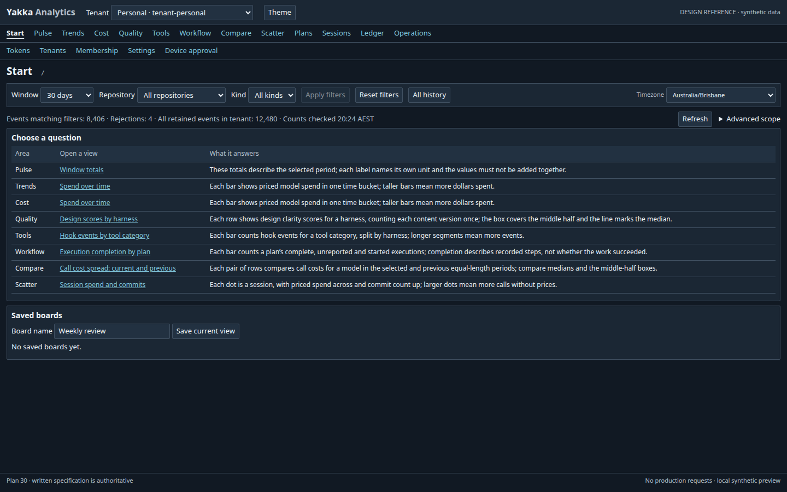
  [HTML source](mockups/src/start.html).
- Layout: V1 top row/nav/heading; C1–C11 shared toolbar and counts, then full-width Question paths table, then Saved boards section. Question paths are columns Area (140px), Question (380px), Explanation (remaining 896px); fixed Cost/Quality/Plans/Activity/Health group order and existing QUESTION_PATHS order within groups. Each question is a scoped link, capability missing → disabled text plus reason, never dead link. Saved-board table Name (300px), Open (80px), Delete (80px), URL summary (remaining); name ASC. Name text input default blank, required trimmed; Save current view writes existing browser saved-board store with full canonical scope. Open restores authorized URL, Delete removes local entry. No saved boards → “No saved boards yet.” No chart on this screen.
```text
| identity / tenant / theme (full width)          |
| analytics nav                                 |
| account nav                                   |
| title                                         |
| editable filters + counts (full width)         |
| Question paths W                              |
| Saved boards W                                |
```
- Acceptance S-start: enter `/` directly; verify the exact region order/widths, specified controls/defaults/URL or API fields, table columns/order and T1–T4, all referenced G proofs, keyboard access and V1–V5. Apply 1d/repo/Brief and change tenant; each region updates or shows the explicit F exception, never stale data.

### S-pulse — Pulse

- Route: `/b/pulse`. Nav entry: Pulse.
- Visual reference: 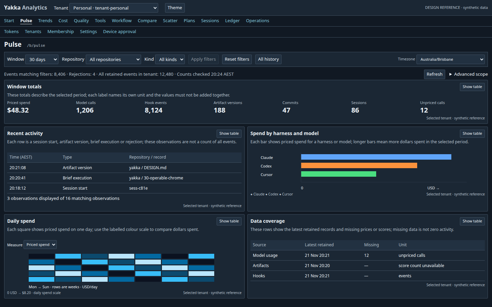
  [HTML source](mockups/src/pulse.html).
- Layout: V1 top row/nav/heading; C1–C11 shared toolbar and counts, then two equal columns, each (W−8)/2 = 704px, gap 8px; DOM/reading order G-metrics, G-activity, G-movers, G-calendar, G-coverage. Odd final panel spans W. Pulse metrics additionally spans W first. Panel heights auto, chart minimum 160px in production.
```text
| tenant / theme                              |
| analytics nav                               |
| account nav                                 |
| title                                       |
| Window | Repository | Kind | Timezone | Apply|
| counts / Refresh / advanced scope            |
| G-metrics (1416px)                         |
| G-activity            | G-movers             |
| G-calendar            | G-coverage           |
```
- Controls: C1–C11 plus only the P controls explicitly listed on those G items. All data tables, states and order inherit those G items and T; no extra per-board sort or fake filter controls.
- Acceptance S-pulse: navigate directly, assert nav/toolbar and panel DOM order above, then execute S1/F1–F7 for relevant sources, each G-item proof and T1–T5. On window change every visible population/caption/mark must either update or give its specified exception/refusal.

### S-trends — Trends

- Route: `/b/trends`. Nav entry: Trends.
- Visual reference: 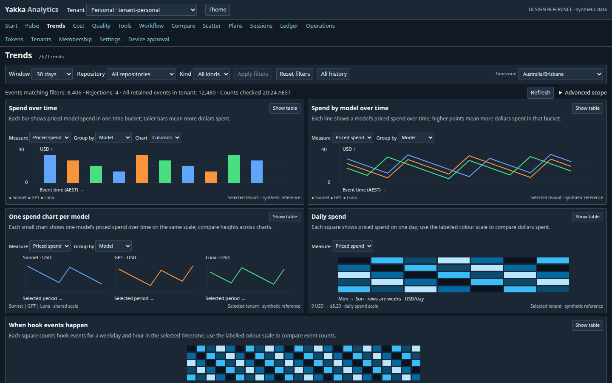
  [HTML source](mockups/src/trends.html).
- Layout: V1 top row/nav/heading; C1–C11 shared toolbar and counts, then two equal columns, each (W−8)/2 = 704px, gap 8px; DOM/reading order G-columns, G-lines, G-multiples, G-calendar, G-rhythm. Odd final panel spans W. Pulse metrics additionally spans W first. Panel heights auto, chart minimum 160px in production.
```text
| tenant / theme                              |
| analytics nav                               |
| account nav                                 |
| title                                       |
| Window | Repository | Kind | Timezone | Apply|
| counts / Refresh / advanced scope            |
| G-columns             | G-lines              |
| G-multiples           | G-calendar           |
| G-rhythm              (full width) |
```
- Controls: C1–C11 plus only the P controls explicitly listed on those G items. All data tables, states and order inherit those G items and T; no extra per-board sort or fake filter controls.
- Acceptance S-trends: navigate directly, assert nav/toolbar and panel DOM order above, then execute S1/F1–F7 for relevant sources, each G-item proof and T1–T5. On window change every visible population/caption/mark must either update or give its specified exception/refusal.

### S-cost — Cost

- Route: `/b/cost`. Nav entry: Cost.
- Visual reference: 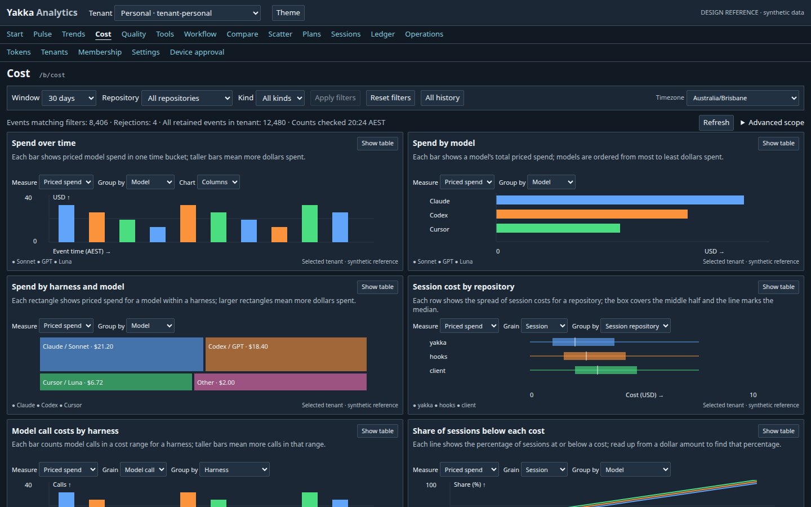
  [HTML source](mockups/src/cost.html).
- Layout: V1 top row/nav/heading; C1–C11 shared toolbar and counts, then two equal columns, each (W−8)/2 = 704px, gap 8px; DOM/reading order G-columns, G-rank, G-costmap, G-ranges, G-hist, G-ecdf. Odd final panel spans W. Pulse metrics additionally spans W first. Panel heights auto, chart minimum 160px in production.
```text
| tenant / theme                              |
| analytics nav                               |
| account nav                                 |
| title                                       |
| Window | Repository | Kind | Timezone | Apply|
| counts / Refresh / advanced scope            |
| G-columns             | G-rank               |
| G-costmap             | G-ranges             |
| G-hist                | G-ecdf               |
```
- Controls: C1–C11 plus only the P controls explicitly listed on those G items. All data tables, states and order inherit those G items and T; no extra per-board sort or fake filter controls.
- Acceptance S-cost: navigate directly, assert nav/toolbar and panel DOM order above, then execute S1/F1–F7 for relevant sources, each G-item proof and T1–T5. On window change every visible population/caption/mark must either update or give its specified exception/refusal.

### S-quality — Quality

- Route: `/b/quality`. Nav entry: Quality.
- Visual reference: 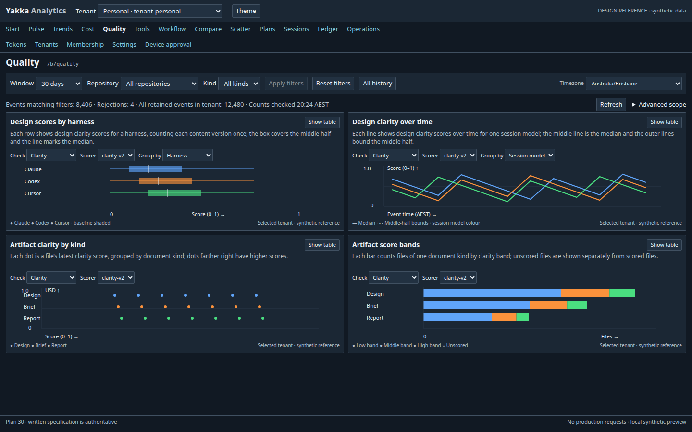
  [HTML source](mockups/src/quality.html).
- Layout: V1 top row/nav/heading; C1–C11 shared toolbar and counts, then two equal columns, each (W−8)/2 = 704px, gap 8px; DOM/reading order G-scores, G-scoretrend, G-strips, G-bands. Odd final panel spans W. Pulse metrics additionally spans W first. Panel heights auto, chart minimum 160px in production.
```text
| tenant / theme                              |
| analytics nav                               |
| account nav                                 |
| title                                       |
| Window | Repository | Kind | Timezone | Apply|
| counts / Refresh / advanced scope            |
| G-scores              | G-scoretrend         |
| G-strips              | G-bands              |
```
- Controls: C1–C11 plus only the P controls explicitly listed on those G items. All data tables, states and order inherit those G items and T; no extra per-board sort or fake filter controls.
- Acceptance S-quality: navigate directly, assert nav/toolbar and panel DOM order above, then execute S1/F1–F7 for relevant sources, each G-item proof and T1–T5. On window change every visible population/caption/mark must either update or give its specified exception/refusal.

### S-tools — Tools

- Route: `/b/tools`. Nav entry: Tools.
- Visual reference: 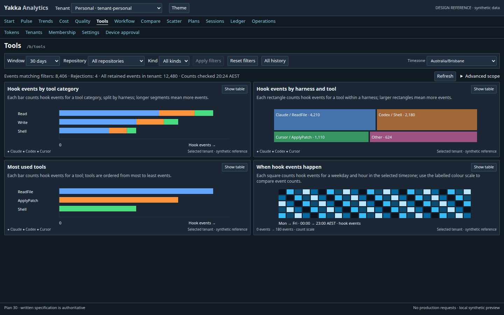
  [HTML source](mockups/src/tools.html).
- Layout: V1 top row/nav/heading; C1–C11 shared toolbar and counts, then two equal columns, each (W−8)/2 = 704px, gap 8px; DOM/reading order G-mix, G-toolsmap, G-toolsrank, G-rhythm. Odd final panel spans W. Pulse metrics additionally spans W first. Panel heights auto, chart minimum 160px in production.
```text
| tenant / theme                              |
| analytics nav                               |
| account nav                                 |
| title                                       |
| Window | Repository | Kind | Timezone | Apply|
| counts / Refresh / advanced scope            |
| G-mix                 | G-toolsmap              |
| G-toolsrank              | G-rhythm             |
```
- Controls: C1–C11 plus only the P controls explicitly listed on those G items. All data tables, states and order inherit those G items and T; no extra per-board sort or fake filter controls.
- Acceptance S-tools: navigate directly, assert nav/toolbar and panel DOM order above, then execute S1/F1–F7 for relevant sources, each G-item proof and T1–T5. On window change every visible population/caption/mark must either update or give its specified exception/refusal.

### S-workflow — Workflow

- Route: `/b/workflow`. Nav entry: Workflow.
- Visual reference: 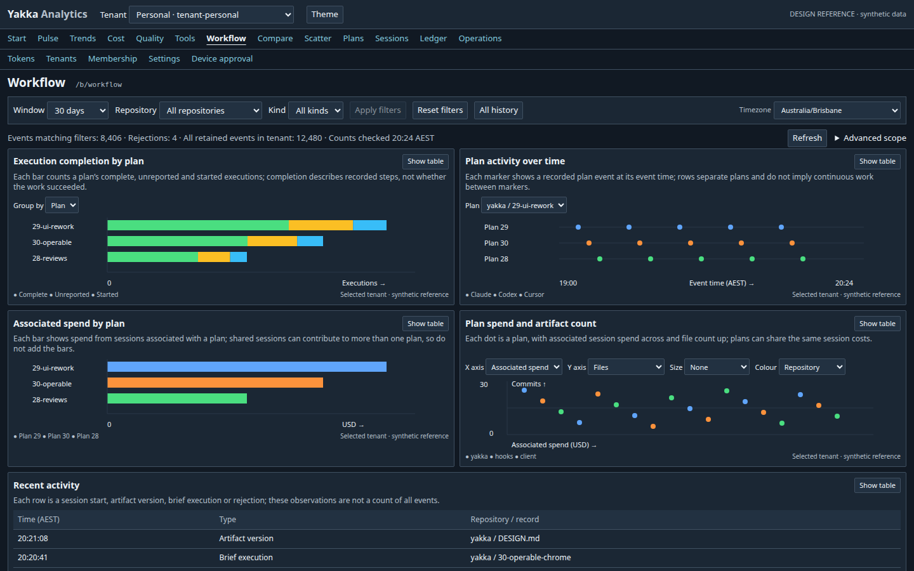
  [HTML source](mockups/src/workflow.html).
- Layout: V1 top row/nav/heading; C1–C11 shared toolbar and counts, then two equal columns, each (W−8)/2 = 704px, gap 8px; DOM/reading order G-shapes, G-planline, G-planrank, G-planxy, G-activity. Odd final panel spans W. Pulse metrics additionally spans W first. Panel heights auto, chart minimum 160px in production.
```text
| tenant / theme                              |
| analytics nav                               |
| account nav                                 |
| title                                       |
| Window | Repository | Kind | Timezone | Apply|
| counts / Refresh / advanced scope            |
| G-shapes              | G-planline           |
| G-planrank            | G-planxy             |
| G-activity            (full width) |
```
- Controls: C1–C11 plus only the P controls explicitly listed on those G items. All data tables, states and order inherit those G items and T; no extra per-board sort or fake filter controls.
- Plan timeline selector: native select Plan; options from served first plan page sorted unreported DESC/identity ASC, label repo/plan; default first eligible plan, pN.scope.plan/repo_id → exact plan timeline read. Empty list gives T2. A selected global plan must win over this local selection. Test changing plan changes only exact timeline identity within global scope.
- Acceptance S-workflow: navigate directly, assert nav/toolbar and panel DOM order above, then execute S1/F1–F7 for relevant sources, each G-item proof and T1–T5. On window change every visible population/caption/mark must either update or give its specified exception/refusal.

### S-compare — Compare

- Route: `/b/compare`. Nav entry: Compare.
- Visual reference: 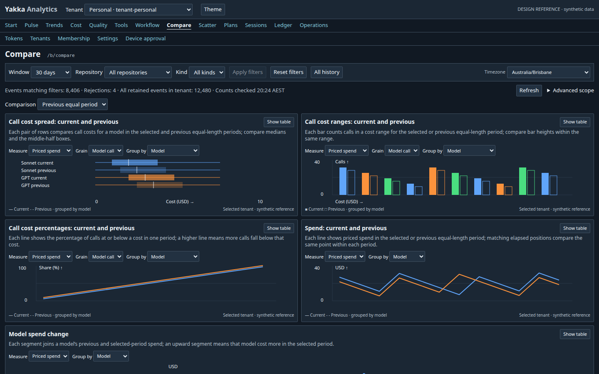
  [HTML source](mockups/src/compare.html).
- Layout: V1 top row/nav/heading; C1–C11 shared toolbar and counts, then two equal columns, each (W−8)/2 = 704px, gap 8px; DOM/reading order G-compranges, G-comphist, G-compecdf, G-complines, G-slope. Odd final panel spans W. Pulse metrics additionally spans W first. Panel heights auto, chart minimum 160px in production.
```text
| tenant / theme                              |
| analytics nav                               |
| account nav                                 |
| title                                       |
| Window | Repository | Kind | Timezone | Apply|
| counts / Refresh / advanced scope            |
| G-compranges          | G-comphist           |
| G-compecdf            | G-complines          |
| G-slope               (full width) |
```
- Controls: C1–C11 plus only the P controls explicitly listed on those G items. All data tables, states and order inherit those G items and T; no extra per-board sort or fake filter controls.
- Compare control: select Comparison, options Previous equal period=period (default), No comparison=off, Saved cohorts=cohorts (enabled only with ≥2 valid slots); URL cmp and pN.scope.cmp synchronized. Finite bounds previous=[from−(to−from),from], inclusive like the existing source contract; an event exactly at the shared boundary belongs to both comparisons and Data details must say so; All history shows “Choose a finite period to compare periods.” and zero comparison marks; never silently compare an arbitrary period. Test 7d pairs exact equal spans and all-history refusal.
- Acceptance S-compare: navigate directly, assert nav/toolbar and panel DOM order above, then execute S1/F1–F7 for relevant sources, each G-item proof and T1–T5. On window change every visible population/caption/mark must either update or give its specified exception/refusal.

### S-scatter — Scatter

- Route: `/b/scatter`. Nav entry: Scatter.
- Visual reference: 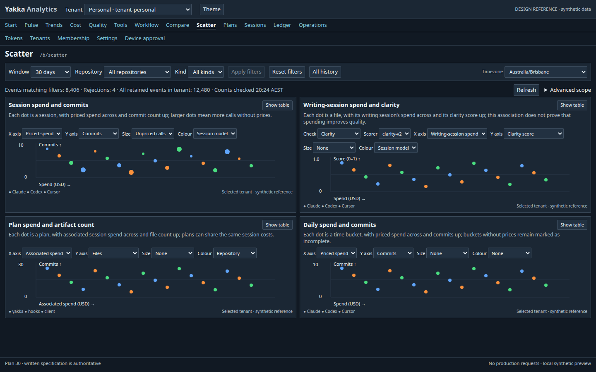
  [HTML source](mockups/src/scatter.html).
- Layout: V1 top row/nav/heading; C1–C11 shared toolbar and counts, then two equal columns, each (W−8)/2 = 704px, gap 8px; DOM/reading order G-sessionxy, G-artifactxy, G-planxy, G-dayxy. Odd final panel spans W. Pulse metrics additionally spans W first. Panel heights auto, chart minimum 160px in production.
```text
| tenant / theme                              |
| analytics nav                               |
| account nav                                 |
| title                                       |
| Window | Repository | Kind | Timezone | Apply|
| counts / Refresh / advanced scope            |
| G-sessionxy           | G-artifactxy         |
| G-planxy              | G-dayxy              |
```
- Controls: C1–C11 plus only the P controls explicitly listed on those G items. All data tables, states and order inherit those G items and T; no extra per-board sort or fake filter controls.
- Acceptance S-scatter: navigate directly, assert nav/toolbar and panel DOM order above, then execute S1/F1–F7 for relevant sources, each G-item proof and T1–T5. On window change every visible population/caption/mark must either update or give its specified exception/refusal.

### S-plans — Plans

- Route: `/plans`. Nav entry: Plans.
- Visual reference: 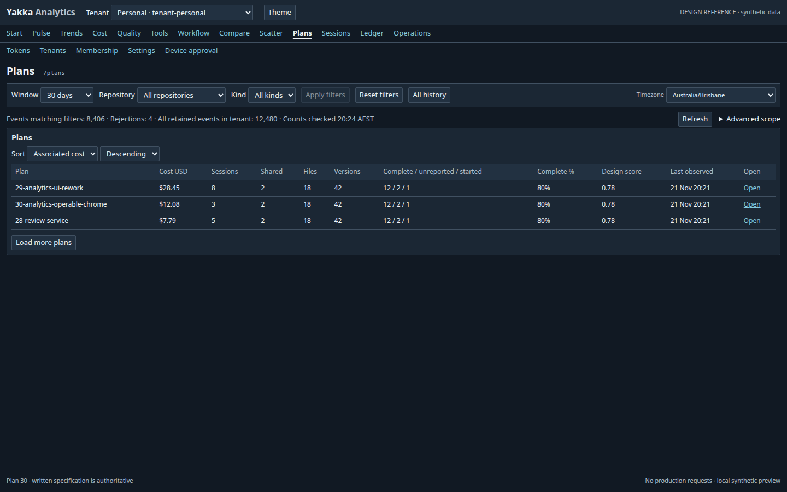
  [HTML source](mockups/src/plans.html).
- Layout: V1 top row/nav/heading; C1–C11 shared toolbar and counts, then full-width plans table (minimum 1416px, internal horizontal scroll), controls immediately above. Columns: Plan identity (220px), Associated cost USD (110), Sessions (70), Shared sessions (80), Files (60), Versions (70), Complete/unreported/started executions (160), Complete share % (100), Latest design score / scorer (180), Last observed (150), Open (70). Sort control Measure: associated_cost_usd default, sessions, shared_sessions, artifacts, versions, executions, complete_share, last_ts where schema publishes; Direction Descending default / Ascending; URL sort={measure}:{desc|asc}, /entities?grain=plan&sort=..., clear cursor. Do not offer design_score sort without a server scalar scorer contract. Scores list scorer explicitly; no averaging scorers. T4 Load more plans. Row Open navigates encoded /plans/{repo}/{plan} preserving scope; no centre-aligned metrics.
```text
| identity / tenant / theme (full width)          |
| analytics nav                                 |
| account nav                                   |
| title                                         |
| editable filters + counts (full width)         |
| Plans table W                                 |
| Load more / status W                          |
```
- Acceptance S-plans: enter `/plans` directly; verify the exact region order/widths, specified controls/defaults/URL or API fields, table columns/order and T1–T4, all referenced G proofs, keyboard access and V1–V5. Apply 1d/repo/Brief and change tenant; each region updates or shows the explicit F exception, never stale data.

### S-plan-detail — Plan: analytics-ui-rework

- Route: `/plans/codyhamilton%2Fyakka/29-analytics-ui-rework`. Nav entry: Plans → Open.
- Visual reference: 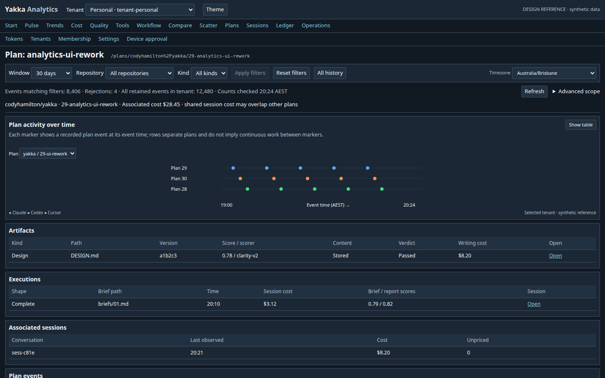
  [HTML source](mockups/src/plan-detail.html).
- Layout: V1 top row/nav/heading; C1–C11 shared toolbar and counts, then full-width exact identity/summary strip, full-width G-planline, then full-width Artifacts, Executions, Associated sessions and Plan events tables in that order. Artifacts: Kind, Path, Latest version, Score/scorer/band, Content, Screen verdict, Writing session cost USD, Open; kind/path ASC. Executions: Shape, Brief path, Time, Session cost USD, Brief/report scores, Session; time DESC, identity ASC. Sessions: Conversation, Last observed, Cost USD, Unpriced calls; last observed DESC/id ASC. Events: Time, Type, Event, Path, Conversation; time DESC/type/identity ASC. For each table identity/path columns 240px, time 150px, other columns split remaining equally, minimum 1416px internal scroll if needed. Sources, exactly: artifacts /entities?grain=artifact&repo_id=&plan=; executions /entities?grain=execution&repo_id=&plan=; session identities /entity?grain=plan&repo_id=&plan=&collection=sessions then /entities?grain=session&id={conversation_id} repeated to enrich rows; events /entity?grain=plan&repo_id=&plan=&collection=events. Shared supported scope applies to the entity lists. Exact collection session/event reads accept identity/window only; if another active scope cannot be applied faithfully, show F refusal for that region instead of unfiltered rows. Preserve parent identity and filtered-child semantics F5. Open links go to scoped artifact/session details; each paged collection gets T4. Back to plans is a link to /plans with scope. No extra sort controls.
```text
| identity / tenant / theme (full width)          |
| analytics nav                                 |
| account nav                                   |
| title                                         |
| editable filters + counts (full width)         |
| Identity W                                    |
| G-planline W                                  |
| Artifacts W                                   |
| Executions W                                  |
| Associated sessions W                         |
| Plan events W                                 |
```
- Acceptance S-plan-detail: enter `/plans/codyhamilton%2Fyakka/29-analytics-ui-rework` directly; verify the exact region order/widths, specified controls/defaults/URL or API fields, table columns/order and T1–T4, all referenced G proofs, keyboard access and V1–V5. Apply 1d/repo/Brief and change tenant; each region updates or shows the explicit F exception, never stale data.

### S-sessions — Sessions

- Route: `/sessions`. Nav entry: Sessions.
- Visual reference: 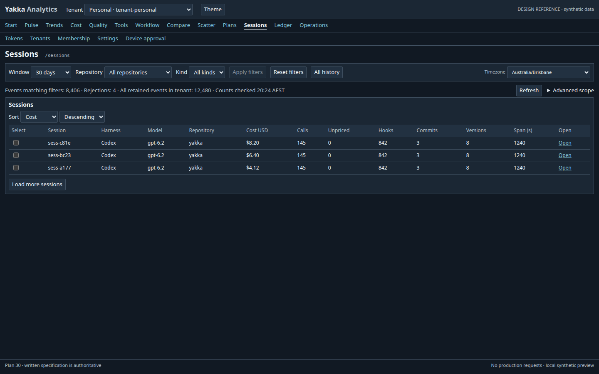
  [HTML source](mockups/src/sessions.html).
- Layout: V1 top row/nav/heading; C1–C11 shared toolbar and counts, then full-width session table, sort controls above. Columns: Select (32px), Session ID (180), Harness (90), Model (140), Repository (180), Cost USD (100), Calls (70), Unpriced (70), Hook events (80), Commits (70), Artifact versions (80), Span seconds (90), Open (70); minimum 1416px internal scroll. Source /entities?grain=session, rows[].id,l.harness,session_model,session_repo and m.cost_usd,model_calls,unpriced_calls,hook_events,commits,artifact_versions,duration_s. Sort select Cost (cost_usd) default, Calls (model_calls), Unpriced (unpriced_calls), Hook events, Commits, Artifact versions, Span (duration_s), capability intersection; Direction Descending default / Ascending, URL/API sort=measure:dir. Row Select checkbox default off changes existing selection tray predicate, never filters immediately. Open scoped /sessions/{id}. T4 Load more sessions.
```text
| identity / tenant / theme (full width)          |
| analytics nav                                 |
| account nav                                   |
| title                                         |
| editable filters + counts (full width)         |
| Sessions table W                              |
| Load more / status W                          |
```
- Acceptance S-sessions: enter `/sessions` directly; verify the exact region order/widths, specified controls/defaults/URL or API fields, table columns/order and T1–T4, all referenced G proofs, keyboard access and V1–V5. Apply 1d/repo/Brief and change tenant; each region updates or shows the explicit F exception, never stale data.

### S-session-detail — Session: sess-c81e

- Route: `/sessions/sess-c81e`. Nav entry: Sessions → Open.
- Visual reference: 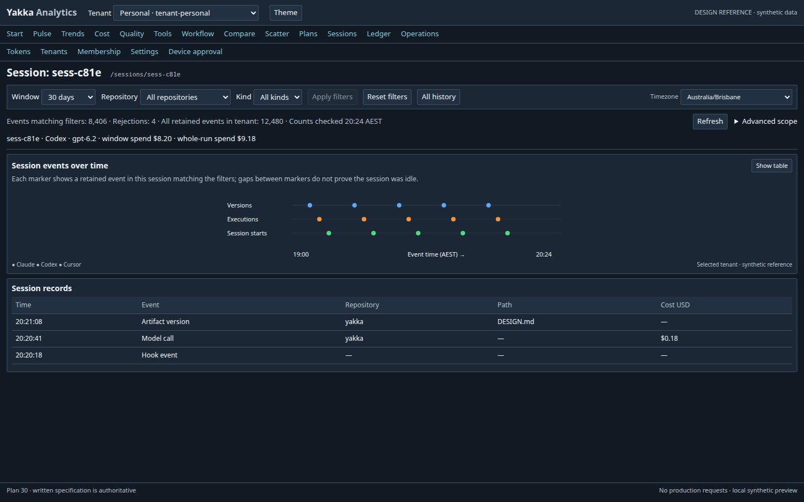
  [HTML source](mockups/src/session-detail.html).
- Layout: V1 top row/nav/heading; C1–C11 shared toolbar and counts, then full-width exact identity and separate “Selected window” / “Whole session” measure strips, G-sessionlanes full-width, then Session records table. Columns Time (150px), Event type (120), Repository (180), Path/event (remaining), Cost USD (110); event time DESC/type/identity ASC. Source for records/timeline: /explore?conversation_id={id}&limit=100 plus shared scope, with T4 Load more session events. Timeline draws loaded matching events up to 5000 marks and explicitly says “{n} loaded matching events plotted”; table can continue beyond that, Open full ledger adds conversation_id. /conversation?id= supplies exact whole-session metadata/totals (its events are whole-run and must not be used as filtered events). Selected-window summary uses /entities?grain=session&id={id} with applicable global scope, not conversation.window_totals when repo/kind is selected. Whole-session summary is always labeled as an exception. Back to sessions link preserves scope. P8/P9 only, no invented duration filter.
```text
| identity / tenant / theme (full width)          |
| analytics nav                                 |
| account nav                                   |
| title                                         |
| editable filters + counts (full width)         |
| Identity + selected/whole totals W            |
| G-sessionlanes W                              |
| Session records W                             |
```
- Acceptance S-session-detail: enter `/sessions/sess-c81e` directly; verify the exact region order/widths, specified controls/defaults/URL or API fields, table columns/order and T1–T4, all referenced G proofs, keyboard access and V1–V5. Apply 1d/repo/Brief and change tenant; each region updates or shows the explicit F exception, never stale data.

### S-ledger — Event ledger

- Route: `/ledger`. Nav entry: Event ledger.
- Visual reference: 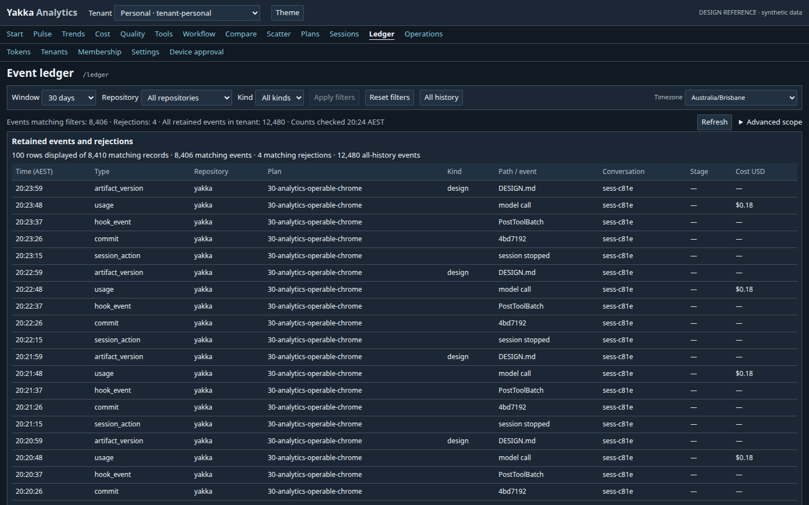
  [HTML source](mockups/src/ledger.html).
- Layout: V1 top row/nav/heading; C1–C11 shared toolbar and counts, then full-width header page count, ledger table, T4 Load more events. Source /explore; query limit=100 and cursor, returned rows include facts UNION rejections, source fields ts,type,repo_id,plan,kind,path,conversation_id,rejection_stage,cost_usd. Columns Time (150px), Type (120), Repository (160), Plan (180), Kind (70), Path/event (remaining, min 240), Conversation (150), Stage (80), Cost USD (90). Keep served keyset event-time DESC/type/identity tie order; no local page sort control. Click/Enter row opens inspector P9; Open artifact only with exact repo/path; Open session only with conversation_id. Caption “Each row is a retained event or rejection matching these filters; load more rows to continue through the same result set.” No chart in default ledger.
```text
| identity / tenant / theme (full width)          |
| analytics nav                                 |
| account nav                                   |
| title                                         |
| editable filters + counts (full width)         |
| Event ledger table W                          |
| Load more / status W                          |
```
- Acceptance S-ledger: enter `/ledger` directly; verify the exact region order/widths, specified controls/defaults/URL or API fields, table columns/order and T1–T4, all referenced G proofs, keyboard access and V1–V5. Apply 1d/repo/Brief and change tenant; each region updates or shows the explicit F exception, never stale data.

### S-artifact — Artifact: DESIGN.md

- Route: `/artifact?repo_id=codyhamilton%2Fyakka&path=docs%2Fplans%2F30-analytics-operable-chrome%2FDESIGN.md`. Nav entry: Ledger/plan → Open artifact.
- Visual reference: 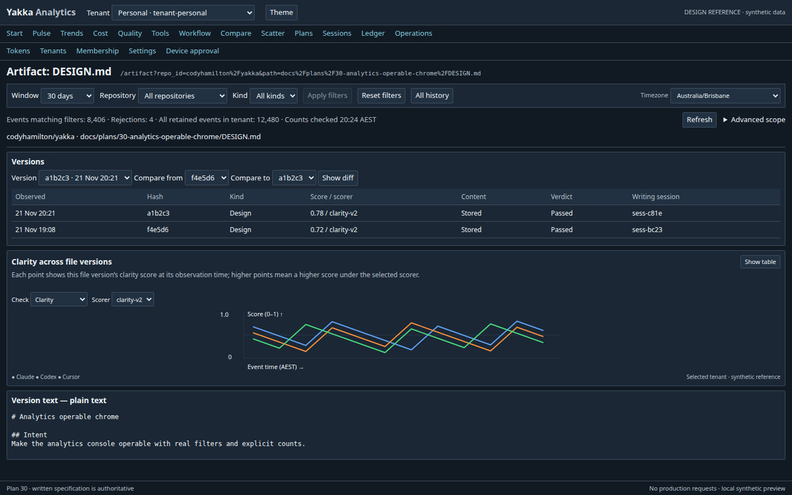
  [HTML source](mockups/src/artifact.html).
- Layout: V1 top row/nav/heading; C1–C11 shared toolbar and counts, then full-width identity strip; version chooser/history table; G-artifactscore; content/diff viewer below. Identity form on absent repo_id/path: Repository select from facets and Path text input required, Open artifact link sets exact repo_id/path; no fake aggregate Artifact list. URL repo_id,path encode exactly once; shared repo filter must match identity or F5 outside-filter notice. Version select default newest served version, labels timestamp/hash, URL hash → content?repo_id=&path=&hash=. Compare from/to selects from served hashes, defaults previous/latest, URL compare/hash respectively → two content reads after Show diff button. Version table: Observed (150px), Hash (180), Kind (80), Score/scorer (180), Content state (110), Screen verdict (110), Writing session (remaining); observed DESC/hash ASC, T4 Load more versions. Existing entity version route supplies metadata; text content is plain text not rendered HTML. Missing/too-large/integrity errors retain exact error state and do not diff prefixes. Viewer width W, monospace 12px, line height 18px (source text is not a data table), local Copy text button and Download text link only for complete available bytes; no secret in URLs. Content/Diff tabs local state default Content; Show diff fetches chosen immutable hashes, no global time rewrite. Check/Scorer controls P5 govern score chart only.
```text
| identity / tenant / theme (full width)          |
| analytics nav                                 |
| account nav                                   |
| title                                         |
| editable filters + counts (full width)         |
| Exact file + version controls W               |
| Version history W                             |
| G-artifactscore W                             |
| Content / diff W                              |
```
- Acceptance S-artifact: enter `/artifact?repo_id=codyhamilton%2Fyakka&path=docs%2Fplans%2F30-analytics-operable-chrome%2FDESIGN.md` directly; verify the exact region order/widths, specified controls/defaults/URL or API fields, table columns/order and T1–T4, all referenced G proofs, keyboard access and V1–V5. Apply 1d/repo/Brief and change tenant; each region updates or shows the explicit F exception, never stale data.

### S-ops — Operations

- Route: `/ops`. Nav entry: Operations.
- Visual reference: 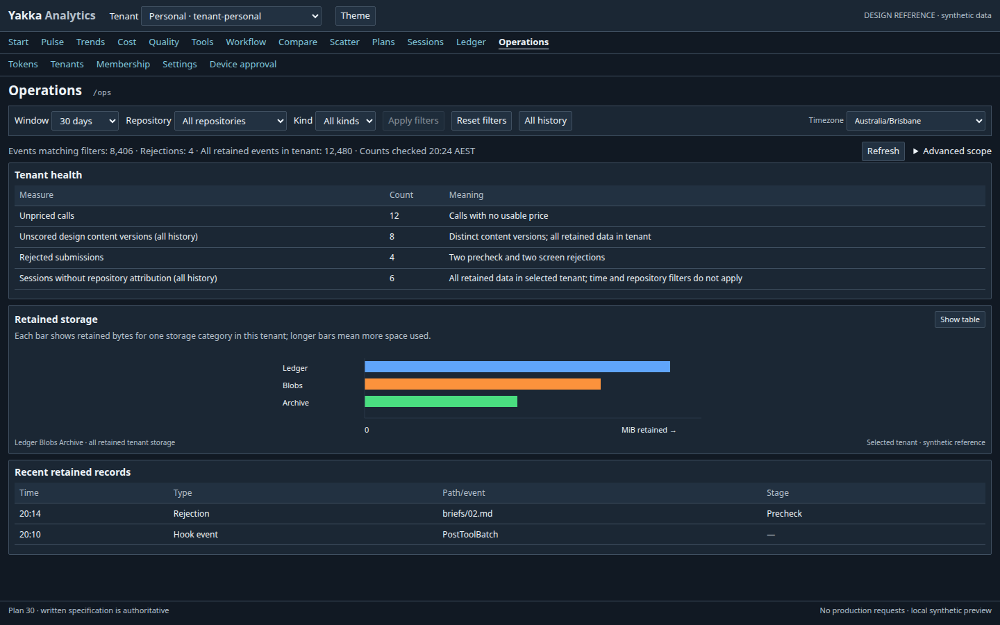
  [HTML source](mockups/src/ops.html).
- Layout: V1 top row/nav/heading; C1–C11 shared toolbar and counts, then full-width Tenant health table; full-width G-footprint; full-width Recent retained records table. Health columns Measure (240px), Count (120), Meaning (remaining); fixed unpriced calls/unscored-kind content/rejected submissions/unattributed sessions order, sources exactly: unpriced calls=summary.unpriced_calls; rejected submissions=event-counts.matched.rejections. The second row is explicitly “Unscored {kind} content versions (all history)” = schema.coverage.scored_content_by_kind[kind].total minus .scored, selected global kind else Design; do not sum kinds because hashes may overlap. The fourth row is “Sessions without repository attribution (all history)” = schema.coverage.sessions.without_session_repo. Both metadata rows carry the notice “All retained data in selected tenant; analytics time and repository filters do not apply.” Missing fields show —, never zero. Every denominator is labeled and F applies. Recent retained records columns Time (150px), Type (120px), Path/event (remaining), Stage (100px); existing /explore with global scope, keyset time DESC/source type ASC/source key ASC, T4 Load more events. It lists both accepted facts and rejections, not a fake rejection-only query; no reason column because /explore does not return reasons. Do not manufacture a type filter that the API does not support. Source health summary/schema coverage (apply per-measure F); footprint existing /v1/admin/status selected-tenant entry. This is an administrator-session read, not an owner entitlement or new analytics endpoint; 403 shows “Storage information is available to server administrators only.” No inference from Owner membership grants admin access. Server-wide/all-tenant panels are removed from this analytics screen; this does not remove any existing server admin API. Buttons Refresh=C9 and Retry=P8 only. Open rejected artifact only if a stored referenced identity exists; rejection is not stored content.
```text
| identity / tenant / theme (full width)          |
| analytics nav                                 |
| account nav                                   |
| title                                         |
| editable filters + counts (full width)         |
| Tenant health W                               |
| G-footprint W                                 |
| Recent retained records W                           |
```
- Acceptance S-ops: enter `/ops` directly; verify the exact region order/widths, specified controls/defaults/URL or API fields, table columns/order and T1–T4, all referenced G proofs, keyboard access and V1–V5. Apply 1d/repo/Brief and change tenant; each region updates or shows the explicit F exception, never stale data.

### S-profile — Account, tenants & tokens

- Route: `/profile`. Nav entry: Tokens → /profile#tokens; Tenants → /profile#tenants; Membership → /profile#membership.
- Visual reference: 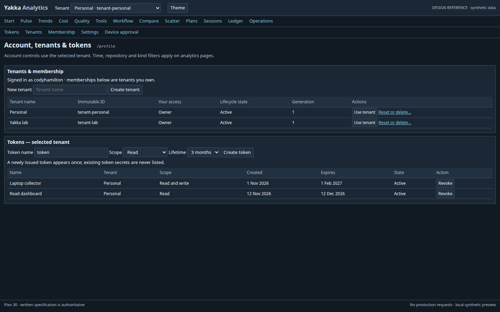
  [HTML source](mockups/src/profile.html).
- Layout: V1 top row/nav/heading; C1 tenant field and C10 Theme; no analytics filter bar, then full-width signed-in identity line; Tenants & membership table/form; Tokens form/table, in that order. Both #tenants and #membership anchors target the same owned-tenant section, #tokens targets tokens. Membership is an ownership inventory, not a second member list. Controls, columns and exceptional empty/error states are A1–A6 below. No chart.
```text
| identity / tenant / theme (full width)          |
| analytics nav                                 |
| account nav                                   |
| title                                         |
| account context / exact identity              |
| Identity W                                    |
| Tenants & membership W                        |
| Token form + token table W                    |
```
- Acceptance S-profile: enter `/profile` directly; verify the exact region order/widths, specified controls/defaults/URL or API fields, table columns/order and T1–T4, all referenced G proofs, keyboard access and V1–V5. Verify every account action with a stub API, including 401/403/failure; no analytics filters or invented membership controls are present.

### S-settings — Connection settings

- Route: `/settings`. Nav entry: Settings.
- Visual reference: 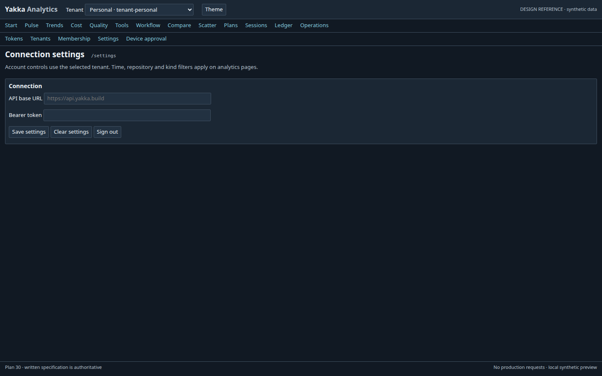
  [HTML source](mockups/src/settings.html).
- Layout: V1 top row/nav/heading; C1 tenant field and C10 Theme; no analytics filter bar, then full-width Connection section, all fields left aligned in 480px input column with remaining width empty (not a centered card); existing fields API base URL text (stored base, blank default means transport default), Bearer token password (stored key, never plaintext rendered), Save settings, Clear settings, Sign out. Save writes yakka-analytics-base trimmed/no trailing slash and yakka-analytics-key, invalidates transport/session caches and reloads same safe route. Clear removes those two keys and resets connection; neither clears owned server tokens. Sign out POST /logout JSON {}, credentials include; success /login; failure inline and no optimistic logout. No table/chart. API base validated absolute http(s), browser unsafe protocols rejected. No query field carries credentials.
```text
| identity / tenant / theme (full width)          |
| analytics nav                                 |
| account nav                                   |
| title                                         |
| account context / exact identity              |
| Connection fields 480px | unused remaining W  |
```
- Acceptance S-settings: enter `/settings` directly; verify the exact region order/widths, specified controls/defaults/URL or API fields, table columns/order and T1–T4, all referenced G proofs, keyboard access and V1–V5. Verify every account action with a stub API, including 401/403/failure; no analytics filters or invented membership controls are present.

### S-lifecycle — Tenant lifecycle

- Route: `https://api.yakka.build/profile/lifecycle`. Nav entry: Tenants → Reset or delete… (same-tab API-origin link).
- Visual reference: 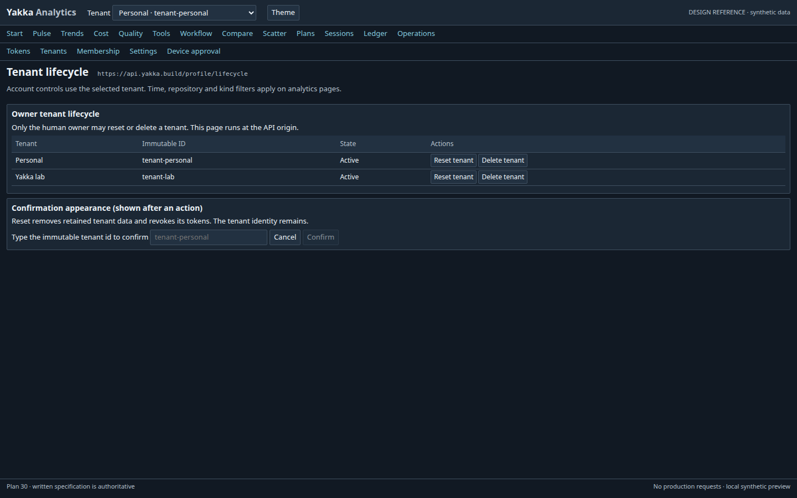
  [HTML source](mockups/src/lifecycle.html).
- Layout: V1 top row/nav/heading; C1 tenant field and C10 Theme; no analytics filter bar, then API-origin existing owner lifecycle screen, full width W, tenant table then confirmation dialog (left-anchored inset 12px, width min(600px,W), no centered modal); keep existing form effects and security. No analytics toolbar. C1 selection uses /me owned tenants, highlights selected row, no cross-origin storage assumption. A6 defines all lifecycle controls. Table Tenant name (240px), Immutable ID (260), Lifecycle state (180), Generation (100), Actions (remaining); /me order, 30px rows. Style existing lifecycle_profile.html with equivalent real theme token values, no remote dependency or broad CSP change. No new destructive endpoint or handler. No chart.
```text
| identity / tenant / theme (full width)          |
| analytics nav                                 |
| account nav                                   |
| title                                         |
| account context / exact identity              |
| Tenant table W                                |
| Left-anchored confirmation width 600px        |
```
- Acceptance S-lifecycle: enter `https://api.yakka.build/profile/lifecycle` directly; verify the exact region order/widths, specified controls/defaults/URL or API fields, table columns/order and T1–T4, all referenced G proofs, keyboard access and V1–V5. Verify every account action with a stub API, including 401/403/failure; no analytics filters or invented membership controls are present.

### S-login — Sign in

- Route: `/login`. Nav entry: 401 → Sign in.
- Visual reference: 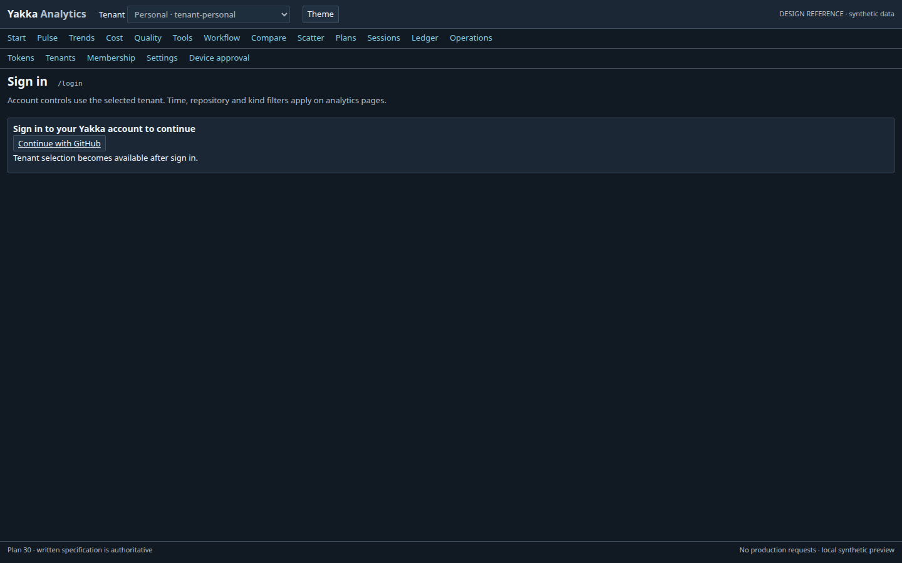
  [HTML source](mockups/src/login.html).
- Layout: V1 top row/nav/heading; C1 tenant field and C10 Theme; no analytics filter bar, then full-width Sign in section with text “Sign in to your Yakka account to continue.” and link Continue with GitHub → existing oauthLoginPath(safe return). No enabled tenant selector until /me authenticates; top tenant field reads “Sign in to select a tenant”. Theme allowed. URL return validated by existing return-path contract, no external redirect. Failure error text escaped. No tables/charts or filter bar.
```text
| identity / tenant / theme (full width)          |
| analytics nav                                 |
| account nav                                   |
| title                                         |
| account context / exact identity              |
| Sign in message + GitHub link W               |
```
- Acceptance S-login: enter `/login` directly; verify the exact region order/widths, specified controls/defaults/URL or API fields, table columns/order and T1–T4, all referenced G proofs, keyboard access and V1–V5. Verify every account action with a stub API, including 401/403/failure; no analytics filters or invented membership controls are present.

### S-callback — Completing sign in

- Route: `/oauth/callback`. Nav entry: GitHub OAuth return.
- Visual reference: 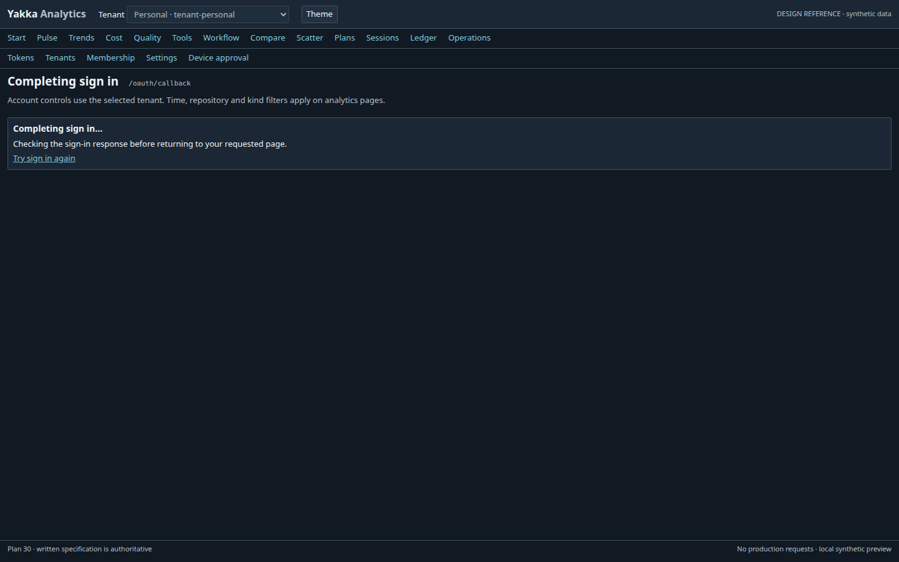
  [HTML source](mockups/src/callback.html).
- Layout: V1 top row/nav/heading; C1 tenant field and C10 Theme; no analytics filter bar, then full-width noninteractive status “Completing sign in…”; callback API request uses existing manual redirect contract and validates safe response target. Success immediately navigates to safe return; failure shows “Sign in failed. Please try again.” and Try sign in again → /login preserving only safe return. Tenant unavailable until session resolves. No tables/charts/filter bar. Never show code/state/query credentials in status.
```text
| identity / tenant / theme (full width)          |
| analytics nav                                 |
| account nav                                   |
| title                                         |
| account context / exact identity              |
| Sign-in status / failure recovery W           |
```
- Acceptance S-callback: enter `/oauth/callback` directly; verify the exact region order/widths, specified controls/defaults/URL or API fields, table columns/order and T1–T4, all referenced G proofs, keyboard access and V1–V5. Verify every account action with a stub API, including 401/403/failure; no analytics filters or invented membership controls are present.

### S-device — Device approval

- Route: `/device`. Nav entry: Device approval.
- Visual reference: 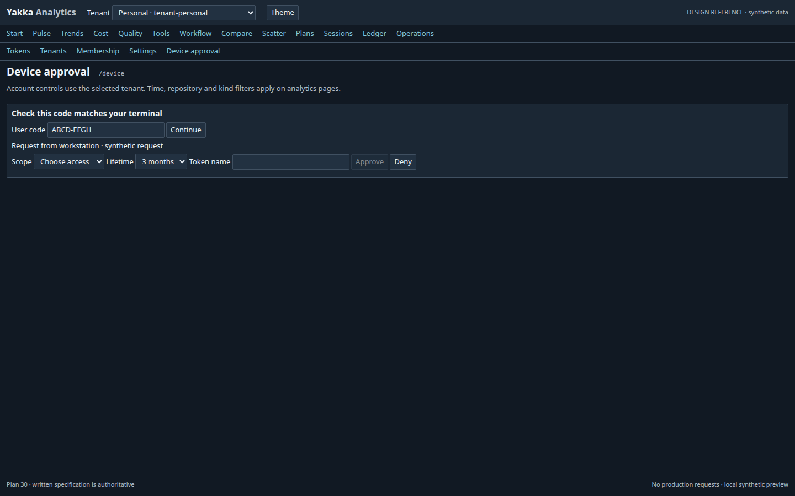
  [HTML source](mockups/src/device.html).
- Layout: V1 top row/nav/heading; C1 tenant field and C10 Theme; no analytics filter bar, then full-width Code entry form then approval form in left 480px column. User code text prefilled URL user_code normalized uppercase; Continue GET /v1/device/grant?user_code=. Global tenant C1 sets approval tenant (mandatory owned active tenant), Scope select Choose access (default, approval disabled), Read=read, Read and write=read_write; Lifetime select 1d/1w/1m/3m/6m/1y default 3m; Token name optional text default blank. Approve POST /v1/device/authorize {user_code,tenant,scope,lifetime,name?}; Deny POST same endpoint {user_code,action:deny}, no scope required. Use existing device route contract in flows.js; do not echo issued bearer. State success “Device approved.” or “Device denied.”; expired/unknown code keeps form and inline reason. No tables/charts/filter bar.
```text
| identity / tenant / theme (full width)          |
| analytics nav                                 |
| account nav                                   |
| title                                         |
| account context / exact identity              |
| Code entry 480px                              |
| Approval fields 480px                         |
```
- Acceptance S-device: enter `/device` directly; verify the exact region order/widths, specified controls/defaults/URL or API fields, table columns/order and T1–T4, all referenced G proofs, keyboard access and V1–V5. Verify every account action with a stub API, including 401/403/failure; no analytics filters or invented membership controls are present.

### S-notfound — Page not found

- Route: `/missing`. Nav entry: unknown URL.
- Visual reference: 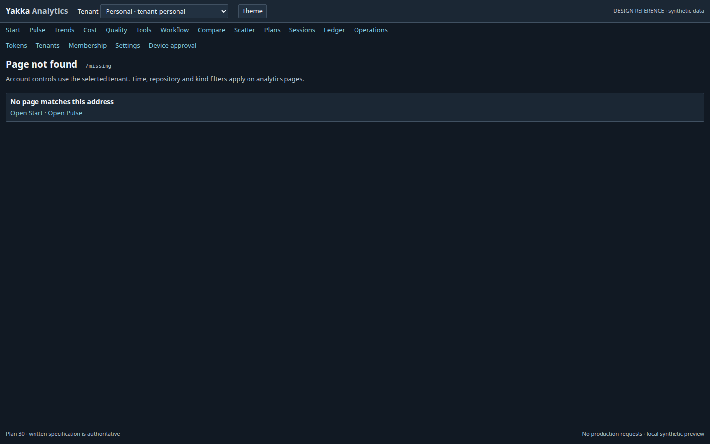
  [HTML source](mockups/src/notfound.html).
- Layout: V1 top row/nav/heading; C1 tenant field and C10 Theme; no analytics filter bar, then full-width “No page matches this address.” then links Open Start and Open Pulse preserving authorized tenant/scope. Navigation remains reachable, Theme and authenticated Tenant visible; no analytics reads or fake results. Unknown path displayed escaped, not injected. No tables/charts/filter bar.
```text
| identity / tenant / theme (full width)          |
| analytics nav                                 |
| account nav                                   |
| title                                         |
| account context / exact identity              |
| Explanation + navigation links W              |
```
- Acceptance S-notfound: enter `/missing` directly; verify the exact region order/widths, specified controls/defaults/URL or API fields, table columns/order and T1–T4, all referenced G proofs, keyboard access and V1–V5. Verify every account action with a stub API, including 401/403/failure; no analytics filters or invented membership controls are present.

## Account contracts (existing IAM only)

All account requests use the existing browser-session path in `transport.authInit`; no saved bearer is sent to tenant/token management. A local/key-only user sees existing connection settings and a “Sign in to manage account” link; never fabricate an owner from a token. A loading/error account state has the same left-aligned density as a data screen.

| ID | Controls, defaults and exact request/state | Table/states and observable Playwright proof |
|---|---|---|
| A1 owned membership | GET /v1/me; identity github_login, tenants[].id,name,lifecycle_state,lifecycle_generation. Table heading Tenants & membership, columns Name 240px, Immutable ID 260px, Your access 100px, Lifecycle state 160px, Generation 100px, Actions remaining. `/me` order. “Owner” derives only from the documented owned-tenant list, not a new role field. Use tenant button commits C1. | Empty “You do not own any tenants yet.”, Create tenant form remains available. Loading “Loading tenants…”. Error “Could not load tenants.” + Retry account. Test two owned tenants, no invitations/member editor; Use tenant updates header and token list. |
| A2 create tenant | Text input New tenant, required blank default, maxlength 64; trim, reject control characters, visible validation “Use 1–64 characters with no control characters.” Button Create tenant → POST /v1/tenants `{name}`. Disable during request. Success refresh /me, select returned tenant through C1, focus new row. 409 “You already have a tenant with this name.” leaves input. | Create with stub, assert exact JSON and fresh selection; invalid string sends no request. Never double-submit or create on selector change. Table A1 gains exact returned row. |
| A3 create token | Scope select Read=read default / Read and write=read_write; Lifetime select 1 day=1d, 1 week=1w, 1 month=1m, 3 months=3m default, 6 months=6m, 1 year=1y. Token name text default token; trimmed empty means omit name. Global C1 supplies mandatory tenant with adjacent immutable-ID text, no conflicting tenant form select. Create token POST /v1/tokens `{tenant,scope,lifetime,name?}`. No tenant selected→disabled plus “Create a tenant to issue a token.” | On success show plaintext token once in labeled read-only selectable output, notice “Copy this token now. It will not be shown again.”, buttons Copy token (clipboard only) and Dismiss token (erase DOM/local variable). Never localStorage, URL, logs or list responses; tenant switch/navigation clears plaintext. Copy failure “Select and copy the token manually.” No success toast that loses token. Stub test checks only synthetic token once and clears on navigation. |
| A4 token inventory | GET /v1/tokens returns all owned tokens; **client filters by exact token.tenant===selected tenant**. Columns Name 220px, Tenant 180px, Scope 140px, Created 160px, Expires 160px, State 120px, Action remaining; created_at DESC/id ASC; include revoked tokens as Revoked, no action. No secret column. Empty “No tokens for this tenant.”; loading/error T1/T3 named tokens. | Switch tenant A→B, no A token names remain; GET has no invented tenant filter; all rows display tenant_name and scope label. Expired vs revoked derived from real expires_at/revoked, no fake active state. |
| A5 revoke token | Per active token button Revoke → inline confirmation row (30px content may wrap below row, not stretch table row), text “Revoke {name}? Clients using it will lose access.” buttons Cancel and Revoke token; Cancel no request, Revoke token POST /v1/tokens/{encoded id}/revoke `{}`. Disable while pending, success 204 refetch inventory, failure keep row and Retry revoke requiring click. | Test Cancel no write, confirm one exact request, failed write not labeled revoked, no token secret appears. No bulk revoke or tenant reset as a shortcut. |
| A6 existing lifecycle | Per owned tenant link Reset or delete… → configured API-origin `/profile/lifecycle?tenant={id}` same tab; link label includes “API owner page”. Existing screen reads authoritative /me and its selected tenant; never rely on Pages localStorage across origins. Buttons Reset tenant and Delete tenant open existing confirmation with human-owner warning and complete existing effects text. Typed immutable-ID input blank, Confirm disabled until exact match, Cancel closes without request. Reset POST /v1/tenants/{id}/reset, Delete DELETE /v1/tenants/{id}, JSON `{confirm_tenant_id:id}`; credentials include, no Authorization, Content-Type application/json, X-Yakka-UI: tenant-lifecycle, browser Origin same configured API origin and Sec-Fetch-Site same-origin when present. | Preserve existing 204-only success, lifecycle generation/cache invalidation, pending/incomplete/recovery failure notices and **no automatic retry of destructive writes**. Reset keeps identity but removes tenant data/revokes tokens per existing engine; delete removes tenant. Re-read /me after response, clear deleted selection, offer Return to analytics with surviving tenant. Test entirely with contract-faithful browser stub; never run real lifecycle writes during design or automated production QA. Pages link only, no CORS/gate weakening. Existing lifecycle tests must remain green. |

A1–A6 inherit T's 30px rows, left alignment, statuses and V's theme rules. Account refresh uses a visible button Refresh account → fresh /me and tokens, no query field. Loading/failure must not automatically recreate/revoke anything. Device/login/callback/settings details in their screen sections remain existing authentication contracts, not an auth redesign.

## Files and components Executor must change

This is a surface/ownership map, not permission to change unrelated product behaviour. Every file listed is relative to repository root. New filenames are prescribed so small build agents do not invent parallel state systems.

| Owner surface | Files and components | Required contract / phase |
|---|---|---|
| Shared shell | `packages/yakka-analytics/web/index.html` topbar/two nav rows; `web/js/app.js` renderScopeBar replacement, render generation, session refresh, question links; new `web/js/core/scope-controls.js` createScopeControls; new `web/js/core/event-counts.js` createEventCountStrip | V/C/S1/N1; phase 1. Paths beginning web/ in this table are under packages/yakka-analytics/. |
| Scope and transport | `web/contract/url-state.js` reserved tenant and canonical codec; `web/contract/session-gate.js` authorized URL selection; `web/contract/transport.js` cache invalidation/management auth; `web/js/core/{read-context,router,chips,follow,saved-boards,request-scheduler}.js` | One committed context, no fake scope chips, safe saved-board restore/generation teardown; phase 1. |
| Exact counts | `packages/yakka/internal/serve/analytics.go` shared filter parsing; `serve/analytics_query.go` schema capability; route registration in `serve/serve.go`; new `serve/analytics_event_counts.go`; new `store/analytics_event_counts.go`; `store/analytics.go` and existing ExplorePage implementation for the explicitly bounded shared retained-record predicate correction/UNION reuse | event-counts contract, bounded SQL, auth and capabilities; phase 1. No page-loop counting. |
| Filter honesty/captions | new `web/js/core/filter-applicability.js`; new `web/js/panels/captions.js` dictionary + exact templates; `web/js/panels/{registry,panel-frame,p10-shared}.js`; `web/js/core/panel-state.js`; `web/js/charts/{table,legend,styles}.js` only as needed for shared contract | F/P/T; phase 2. Every registered panel has a caption function and supports unavailable state without marks. |
| All board charts | `web/js/panels/{index,p10-trends,p10-cost,p10-quality,p10-tools,p10-compare,p11-scatter,p12-workflow,river,pulse-strips,movers,calendar,coverage,trend-columns,trend-lines,trend-multiples,rhythm,rank,treemap,mix,dist-ranges,dist-hist,dist-ecdf,score-ranges,score-trend,score-strips,band-mix,shape-bars,plan-timeline,scatter-session,scatter-artifact,scatter-plan,scatter-day,scatter-shared,session-lanes,ops-footprint,ledger-table}.js`; `web/js/boards/board.js` | G catalogue defaults, exact readable captions, two-column/wide ordering, full correct scope; phase 2. Do not write unused second chart implementations. |
| All explorers | `web/js/explorers/{ledger,sessions,plans,artifact,artifact-content,artifact-diff}.js`; `web/js/ops.js` | S list/detail controls, tables, identity exceptions and counts; phase 2. Preserve read-only content integrity and current collection APIs. |
| Account | `web/js/identity/flows.js` existing profile/settings/device/auth functions; optionally extract prescribed `web/js/identity/account-console.js` renderAccountConsole; `web/js/core/router.js` anchors/account routes | A/S identity contracts; phase 3. No new member endpoints or separate token management backend. |
| Existing lifecycle | `packages/yakka/internal/serve/lifecycle_profile.html` density/theme/tenant deep-link and return link; `lifecycle_profile.go` only if required to serve existing template consistently | A6 styling/link reachability only; phase 3. Keep lifecycle_http gate and engine untouched. |
| Theme/layout | `web/css/{app,workspace,charts,pulse,trends,cost,quality,tools,workflow,scatter,plans,sessions,ledger,artifact,ops}.css`; new `web/css/scope-controls.css`; account/lifecycle minimal equivalent rules | V and explicit widths. Phase 1 shell; phase 2 panels/explorers; phase 3 account. No library/bundler/runtime dependency. |
| Proof | Existing `packages/yakka-analytics/tests/` fixture generator + Chromium suites; new `tests/operable-chrome/*.test.mjs`; Go serve/store count tests | Add meaningful manifest-backed integration checks for all named IDs; reuse existing browser harness and inspect(), no production fixture mode. Distributed across phases. |

## Architectural Implications

No architectural pivot: the Go tenant-bound store remains the source of truth, the framework-free SPA remains the view, auth stays browser-session/token-bound as before, and server and Pages deployments remain separate. New event_counts capability is additive and requires separate API deployment evidence during Executor QA. A Pages-only deployment must show the truthful unsupported count state. The namespace/read budget/cohort contracts in stable 09 still apply; no 30d default is allowed to masquerade as lifetime ingestion. The declared global filters are a visible query contract, not an instruction to invent repo attribution for hook events.

Stable-doc changes in this PR establish that 07 is historical and 09 owns current chrome. Executor's final close-out must promote the built field details of event-counts and caption/scope rules into 09, referencing the closed Plan 30 record rather than leaving a dangling build-folder link. Preserve the mockup HTML/PNG references when closing out; move them to a durable sibling asset directory and rewrite links, rather than deleting the only visual references.

## Decisions

Headless checkpoint is waived as requested. Three known-approach phases, in fixed order below. Every acceptance ID is included in a phase outcome; there is no separate discretionary UI sign-off requirement. Design work in this PR is documentation and mockups only; no implementation, merge or deployment is authorized here.

## Assumption Ledger

### Assumption 1 — default window

- Question: Change initial dashboard to all history or preserve 30 days?
- Answer chosen: Preserve 30d, display it as a real editable control, always show retained tenant total, and expose one-click All history.
- Rationale: The complaint concerns invisible limitations, not an explicit request for a different default; changing to all history makes trend defaults less useful and potentially more expensive.
- If wrong: Change C2/C7 default and fixture expectations; no API/ownership change.

### Assumption 2 — meaning of membership

- Question: Does membership require invites, users and editable roles?
- Answer chosen: Owned tenants from /me, clearly labeled Owner, tenant creation/lifecycle, and tokens. No invitation or role system.
- Rationale: Explicit user instruction and actual API inventory. An invented control would be another fake feature.
- If wrong: Requires a new signed design and real IAM contracts; not a builder extension to this plan.

### Assumption 3 — event total

- Question: Is “all events” the activity stream or the retained event ledger?
- Answer chosen: Display both and name the units; count every retained fact once, with rejections separate and activity observations separate.
- Rationale: Code proves activity is synthesized and cannot represent ingestion. Lifetime deliveries are unknowable from retained facts.
- If wrong: A receipt/delivery counter is a different ingest contract; never relabel these counts to imply it.

### Assumption 4 — filter support

- Question: Should repo/kind be attributed to data that has no such field?
- Answer chosen: Apply where published; explicitly refuse affected charts/metrics, while the ledger and valid views remain filterable.
- Rationale: No contract supports allocating hook events or spend to a document kind. False filtering is the reported defect.
- If wrong: Requires explicitly designed attribution and API changes, potentially additional phases; do not invent session-to-document allocation.

### Assumption 5 — screen reach and account filters

- Question: Must unrelated authentication/account pages have time/repo/kind filters?
- Answer chosen: They inherit navigation, tenant context and density; time/repo/kind controls are on analytics views only, not decorative controls on management forms. Before authentication tenant is truthfully unavailable.
- Rationale: Token lifecycle, sign-in and immutable content are not time-window analytics. A working filter cannot meaningfully filter an OAuth callback.
- If wrong: Add a navigation shortcut to a filtered analytics route, not an inert account filter; no secret/auth changes.

### Assumption 6 — UI prescription vs skill altitude

- Question: Defer detailed UI to refine?
- Answer chosen: No: all layout/caption/control/table contracts live here, with synthetic visual references, because the user explicitly requires prescriptive direction for Haiku/Luna/Composer builders.
- Rationale: User instruction overrides normal design altitude; uncertainty stays in ledger, not in builder judgement.
- If wrong: Reduce documentation in a future design; preserve these fixed contracts for this build.

### Assumption 7 — lifecycle origin

- Question: Implement reset/delete directly on Pages?
- Answer chosen: Restore link to existing API-origin owner UI and restyle it densely. Keep human-only typed confirmation and exact-origin gate.
- Rationale: Real implemented security contract; a cross-origin SPA write would fail or require weakening protection.
- If wrong: Any origin/security change requires a separately authorized design. This plan does not weaken it.

### Assumption 8 — live number and deploy proof

- Question: Can the exact production “16” be proven without a valid authenticated read?
- Answer chosen: No production count is asserted. Public asset parity and existing code explain plausible causes; deterministic fixtures prove the new denominators and controls. Executor validates deployed counts with a legitimate owner browser session only if available.
- Rationale: No supplied valid read credential and explicit ban on cookie scraping. API version dev is insufficient provenance.
- If wrong: Record a legitimate authenticated GET observation and its scope, without publishing credentials; design contracts do not change.

### Assumption 9 — count freshness

- Question: Require a new transactional snapshot shared across chart HTTP reads?
- Answer chosen: No. Exact counts in one read transaction, fixed request window and explicit checked timestamp; Refresh starts over. No invented distributed snapshot mechanism.
- Rationale: Scope of complaint needs honest totals and paging, not a new store snapshot subsystem.
- If wrong: Snapshot/receive-watermark semantics must be signed as an explicit API contract before implementation.

## Open Questions

None that block this design. Unknown live authenticated counts and unstamped API image provenance are bounded validation limits, not permission to choose UI behaviour. Headless ledger entries are reviewable assumptions, not invitations for a builder to reopen decisions.

## Phases

### Phase 1 — A selected tenant and filter set means one visible query with honest totals

- Outcome: From any analytics route → select another owned tenant or apply time/repo/kind → all shared inputs, URL, counts and read generations refer to exactly that authorized scope; Back/Forward restores it and no prior-tenant data returns. Pulse and Ledger distinguish retained facts/rejections, activity observations and rows displayed; All history exposes old facts. Unknown capability/error/empty states remain truthful. Proven by **S1, N1 (including record_filters/Explore predicate correction), C1–C11, V1/V4/V5 and T1–T4** across shell mounts, with temporary existing panels allowed only to show F refusal until phase 2 covers their full render paths.
- Surfaces: shared shell/context/control/count API/transport/route/theme and fixture surfaces named above. Preserve API-origin lifecycle boundary.
- Approach: **Known** — existing context, typed store queries, URL codec, scheduler and transport extended; no new attribution/IAM architecture.
- Depends on: nothing. Refine required: API/store and shell are distinct ownership units.

### Phase 2 — Every board and explorer answers its displayed question in plain language

- Outcome: Directly enter **S-start through S-ops** (all eight boards and every list/detail screen) → use each offered control/row/table/chart interaction → requests, visible scope, units, rows and literal captions agree; unsupported filters erase marks and explain why. Every chart has its prescribed caption/table in both themes, every list has exact 30px rows and working continuation, and default layout/order match references. Proven by **F1–F6, all G catalogue items, P1–P10, T1–T5, V1–V5 and each analytics S-screen check**. Deep links/saved boards and all-history comparisons are included, not just default presets.
- Surfaces: all chart/panel/frame/caption/applicability/explorer/theme and Chromium fixtures named above.
- Approach: **Known** — wire shared contracts into existing panels/read adapters and literal caption registry; no chart-library rewrite.
- Depends on: phase 1. Refine required: shared panel infrastructure, boards, and explorers have independently verifiable ownership.

### Phase 3 — Account operations are discoverable and preserve existing authority

- Outcome: From every board → Tokens, Tenants or Membership → manage owned tenants/tokens through real existing APIs; global tenant controls exact token inventory; owner lifecycle link reaches existing same-origin typed-confirmation UI; login/device/settings/error routes retain reachable navigation and dense theme. Proven by **A1–A6, F7, S-profile/S-settings/S-lifecycle/S-login/S-callback/S-device/S-notfound, C1/C10 and V1–V5**, including stubbed failed writes, no secret persistence and unchanged existing lifecycle security tests. Run final regression for the union of all three phase outcomes and separately record API/Pages deployment evidence or the explicit legacy-capability state; do not assert production totals without authenticated proof.
- Surfaces: account/identity/lifecycle style/link and tests named above, plus nav integration. No lifecycle engine/auth gate changes.
- Approach: **Known** — reuse current flows and owner UI. No invites, roles or membership-write API.
- Depends on: phases 1 and 2. Refine required: account console and lifecycle visual preservation can be bounded units.

## Provenance Notes

Plan 29's completed contract included density, theme propagation and D01–D18 read correctness. It did not design a discoverable management nav, a visible tenant input, an interactive filter bar or plain-language captions. Only its explicit All-history intent and its existing request/capability correctness obligations carry forward here. It is misleading to call this an unmerged Plan 29 build or reopen its folder. The count investigation also proves why a small observation stream cannot be called missing ingestion.

The HTML sources deliberately contain local synthetic preview interactions, not production account writes or sample-data branches. All PNGs are viewport screenshots at 1440×900 in headless Chromium; the authoritative production minimum chart height and exact source contracts are written above. The viewport can show only the top of long detail/account pages; all regions remain specified and scrollable. Regenerate images with the commands in mockups/README.md. Independent design challenge and service feedback are recorded in REVIEW-NOTES.md without credentials, scores or progress fields.
