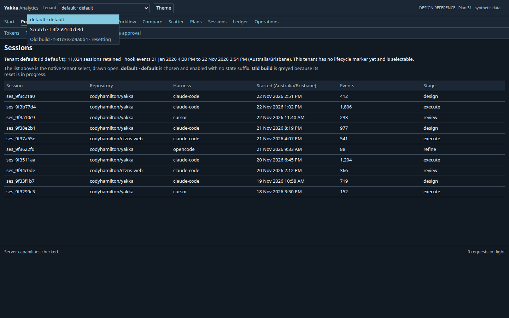
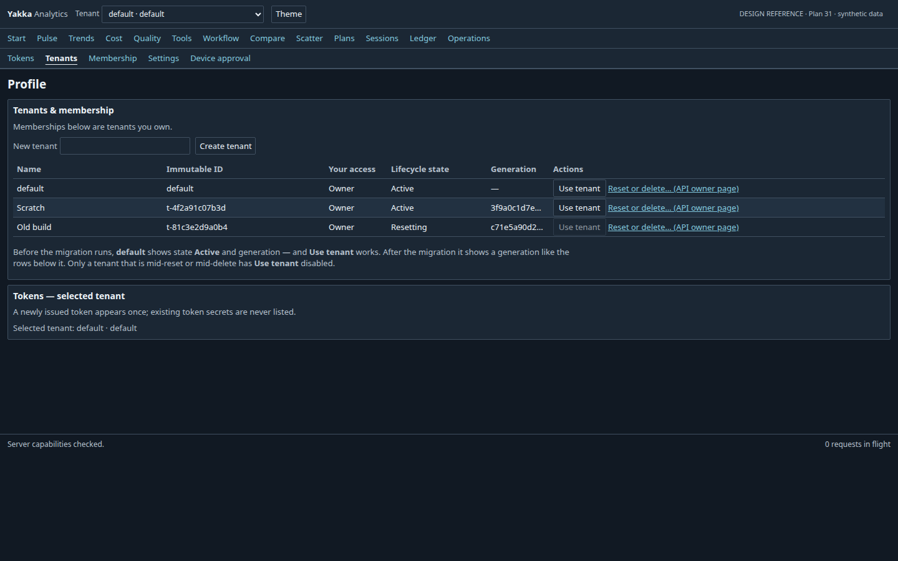
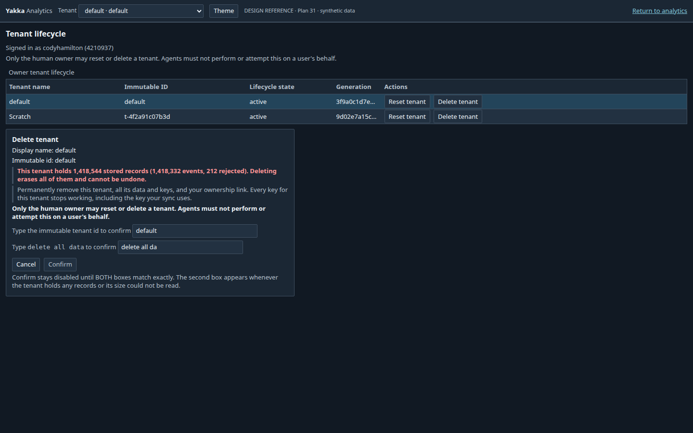

# Plan 31 — Legacy tenant adoption and a selector that never refuses an unmarked tenant

## Intent

User request, verbatim (the Cody decisions and the fixed scope; the surrounding run instructions are not repeated):

> Cody (22 Nov 2026), verbatim: "Just make it a normal tenant, and stop the ui from refusing to select them if they have no marker"
>
> Cody (22 Nov 2026), decided: the migration should simply mark ALL currently unmarked tenants as normal `active` (fresh marker plus generation). Make it a one-time idempotent migration, with no owner-confirmed adopt action. Drop the alternatives from scope and record his decision in the ledger.
>
> Cody (22 Nov 2026): the UI refuses to select the `default` tenant at all and doesn't understand why.
>
> Scope (fixed; do not reopen alternatives)
>
> 1. One-time idempotent migration, run through a built product mechanism (startup / registry open — pick the exact hook and justify it in the ledger). When the feature flag is on, every currently unmarked tenant that has an owner/name record receives a fresh random marker and generation and `state=active`. Already-marked tenants are unchanged. Re-running is a no-op. There is no owner-confirmed adopt action. Drop every alternative (manual adopt API, per-tenant confirmation, inferring a marker from the id, migrating only `default`) from scope, and record Cody's 22 Nov 2026 decision in the ledger. Update the comments in `registry_lifecycle.go` and the Plan 23 docs to record the changed policy and its date (22 Nov 2026).
> 2. After adoption, reset and delete on `default` (and any other adopted tenant) must keep their normal confirmations (typed immutable id, `X-Yakka-UI: tenant-lifecycle`, human-owner-only). Data safety matters because `default` holds all of Cody's data (11,024 sessions). If the current confirmations are thin, add an explicit extra guard or confirmation copy that names the scale of loss; do not weaken the existing typed-id gate.
> 3. Find every place in the UI and the AI/MCP surface that refuses, greys out, or blocks selecting a tenant whose `lifecycle_state` is `unsupported` or whose marker is missing, and make all of them selectable. Cover any remaining marker-less state defensively (flag off, or a tenant that has not yet been migrated): the UI must never refuse to select that tenant. Do not wait for the migration alone to fix selection.
> 4. Fix the copy and the AI wording so they stop calling the tenant "unsupported". Decide whether the `/v1/me` `lifecycle_state` value changes, and record it as a contract decision in the ledger. After a successful migration the adopted tenants should report as normal `active` with a generation. Recommend: the UI selection fix is unconditional (not flag-gated) so a marker-less tenant remains selectable; the feature flag gates the server migration that writes markers. Confirm or replace this split in the ledger.
> 5. Gate the migration (and any server contract change you flag-gate) behind a feature flag. Discover any existing Yakka flag pattern and use it; if none exists, specify a single named flag, default, how it is set on Fly, and tests for on/off/idempotent behaviour. Yakka UI follows Cody's dense, old-school style (full width, left-aligned, no decorative chips, no centre alignment, no white chart backgrounds).
>
> Out of scope: building or merging the implementation; production registry edits by hand, fly ssh, or any non-product mechanism; printing secrets; reopening Plan 30 as a new design (this is Plan 31, amending the live Plan 30 chrome and the Plan 23 lifecycle policy).

Builder rule (Cody, as for Plan 30): this design is prescriptive for Haiku, Luna or Composer. Every change names its file and lines as of origin/master `6f0a88e5`, every control and its effect, the exact copy, and a testable check. Where this document and a mockup differ, this document is authoritative.

## Problem

Plan 23's follow-up (#219, 10 Nov 2026) gave a lifecycle record (marker + generation + state) only to tenants created after it, and ruled that a tenant with an owner/name entry but no record is "legacy and must not be migrated, guessed at or have a marker inferred from its id" (`packages/yakka/internal/serve/registry_lifecycle.go:36-38`). `/v1/me` reports such a tenant as `lifecycle_state: "unsupported"` with a null generation (`packages/yakka/internal/serve/session.go:112-121`).

Plan 30 (PR #311, `6f0a88e5`, deployed 22 Nov 2026) then made the web UI treat only `lifecycle_state === 'active'` as selectable. Cody's production tenant has the immutable id `default` (from before the id/name split) and holds his whole ledger (11,024 sessions; hook events 21 Jan 2026 4:28 PM to 22 Nov 2026 2:54 PM Australia/Brisbane). It has no marker, so the shell cannot select it: with `default` as the only tenant the selector has no selectable option and the page says "This tenant is unavailable to your account."; with a second `active` tenant the shell skips `default` and may open the empty one. Nothing on screen says why.

The server never refused `default`: MCP tools, analytics reads and token minting all work for an unmarked tenant (`device_grants.go:106-111`, `serve.go:502-511`). Only reset and delete are refused (`tenant_lifecycle_http.go:102-105`). The refusal is entirely a client predicate, plus a policy label ("unsupported") that makes a normal tenant read as broken.

Cody has overruled the never-infer rule (22 Nov 2026): an unmarked tenant is a normal tenant.

## Solution Shape

Three changes, independent enough to ship in order.

1. The web UI and the API-origin lifecycle page stop treating "has no marker" as a reason to refuse. Selectability becomes a deny-list of exactly the two mid-cleanup states (`resetting`, `deleting`). This is unconditional (not flag-gated), so an unmarked tenant is selectable today, with the flag off, and before any migration runs.
2. On startup, when `YAKKA_ADOPT_UNMARKED_TENANTS` is truthy, the server gives every owned tenant that has no marker a fresh random marker and generation with `state=active`, saves the registry once, and logs it. Re-running changes nothing. There is no adopt endpoint, button or confirmation. `/v1/me` stops emitting `unsupported`: the derived marker-less value becomes `unmarked` (reported only when the flag is off or adoption failed), and adopted tenants report `active` with a generation.
3. Because `default` holds all of Cody's data and its typed id (`default`) equals its display name, the reset/delete confirmation gains a second guard on the lifecycle page: a line naming how many stored records will be erased, and a second typed phrase. The server-side gates are unchanged.

### Domain: Selection (web UI and lifecycle page)

- Owns: which owned tenants the browser may select; the copy shown for each tenant state.
- Contract: a tenant is **selectable** unless its `lifecycle_state` is `resetting` or `deleting`. A missing `lifecycle_state`, `active`, `unmarked`, `unsupported` (an older API), `pending` or any unknown value is selectable. A null `lifecycle_generation` never affects selection.
- Non-goals: data-aware auto-selection; changing `rememberedTenant`/`formTenant`; any change to the generation-revalidation rule at `app.js:241-260` (it already ignores an empty "before" generation).

### Domain: Lifecycle records (registry and `/v1/me`)

- Owns: marker, generation and state per tenant in `registry.json`; the adoption migration; the `/v1/me` `lifecycle_state` enum.
- Contract:
  - `/v1/me` `tenants[].lifecycle_state` is one of `active`, `resetting`, `deleting`, `unmarked`. `unmarked` always comes with `lifecycle_generation: null`; every other value comes with a non-null generation. `unsupported` is retired. (`pending` is not emitted and is removed from the docs.)
  - `Registry.AdoptUnmarkedTenants() ([]string, error)`: under `r.mu.Lock`, finds every id in `r.owners` whose `r.lifecycle[id]` is absent or has `Marker == ""`; if none, returns `nil, nil` without writing; otherwise sets each to `{Marker: <fresh 32-hex>, Generation: <fresh 32-hex>, State: "active"}` (no Operation), sets `r.dirty`, calls `saveLocked` once, restores the prior in-memory state and returns the error if the save fails, and returns the adopted ids sorted ascending.
  - `Config.AdoptUnmarkedTenants bool` from env `YAKKA_ADOPT_UNMARKED_TENANTS`; `New()` calls `AdoptUnmarkedTenants` immediately after `OpenRegistry` only when it is true.
  - Unchanged wire contract: `409 legacy_tenant_cleanup_unsupported` stays the response for reset/delete on a tenant that still has no marker (flag off, or adoption failed). Only its human copy changes.
- Non-goals: adopt endpoint, per-tenant confirmation, id-derived markers, migrating only `default`, un-adopting.

### Domain: Destructive confirmation (lifecycle page)

- Owns: what a human sees and types before reset/delete.
- Contract: the existing gates stay exactly as they are (owner session cookie, exact API Origin, `X-Yakka-UI: tenant-lifecycle`, JSON body `{"confirm_tenant_id": <id>}`, typed immutable id). Added on top, in the page only: a scale line from `GET /v1/analytics/event-counts?tenant=<id>` (existing, owner cookie, `tenant_total`) and a second typed phrase (`reset all data` or `delete all data`) required whenever the tenant holds any stored record or its size could not be read.
- Non-goals: any change to `tenant_lifecycle_http.go`; a server-bound count; a new endpoint; a session count (no cheap owner-readable one exists).

## Architectural Implications

- Reverses the Plan 23 follow-up rule that legacy tenants are never migrated. Dated 22 Nov 2026 in `registry_lifecycle.go`, the Plan 23 record, and design docs 03, 07 and 09 (Phase 3 lists every line).
- `docs/design/03-remote-service.md` (config table lines 66-72; lifecycle text 215-218, 246-247, 258-265), `docs/design/07-analytics-site.md` (lines 72-73) and `docs/design/09-analytics-workspace-contracts.md` (line 168) describe `unsupported`, `pending` and "first active owned tenant". They are stale after this plan and are fixed by Phase 3. `docs/OVERVIEW.md` and `docs/ARCHITECTURE.md` do not mention tenant lifecycle and need no change.
- Adoption changes a tenant's generation from empty to a value. Verified safe: API tokens carry no generation (`registry.go:51-61`); device grants live only in memory (`device_grants.go:51`, built in `New()`), so none survive the restart that runs the migration; the browser compares generations only when both are non-empty (`app.js:252`). One accepted effect: a review-list cursor held by a client from before the migration carries generation `""` and fails once with `cursor generation mismatch` (`review_cursor.go:175`); the client restarts its walk.
- Deploy order is free. With the new UI first, an old API's `unsupported` is already selectable. With the migration first, an old UI sees `active`.
- Reset/delete of an adopted tenant purges every token for it (`CompleteTenantReset`/`CompleteTenantDelete` call `purgeTenantTokensLocked`), including the token Cody's sync uses. The new confirmation copy says so.

## Decisions

Cody's decisions are the Intent. Every other decision is in the Assumption Ledger.

## Assumption Ledger

### Assumption 1 — Cody's decision: adopt all, once, no adopt action

- Question: how are legacy unmarked tenants handled?
- Answer chosen: Cody, 22 Nov 2026, decided: mark ALL currently unmarked tenants as normal `active` (fresh marker plus generation) in a one-time idempotent migration. No owner-confirmed adopt action. Manual adopt API, per-tenant confirmation, inferring a marker from the id, and migrating only `default` are dropped from scope.
- Rationale: his words are the Intent; a stated owner decision, not an assumption.
- If wrong: only Cody can reverse it; nothing here depends on guessing his intent.

### Assumption 2 — The never-infer rule is reversed, with a date

- Question: does this contradict Plan 23's "must not be migrated, guessed at or have a marker inferred"?
- Answer chosen: yes, deliberately, by Cody's 22 Nov 2026 decision. The marker is fresh random, not inferred from the id, so "inferred" is not violated in letter; "migrated" is reversed. Comments in `registry_lifecycle.go` and the Plan 23 record say so with the date.
- Rationale: leaving the old comment would let a later reader "fix" the migration back out.
- If wrong: reviewers restore the comment; behaviour is already flag-gated.

### Assumption 3 — Migration hook: `New()` right after `OpenRegistry`

- Question: which product mechanism runs the migration?
- Answer chosen: a `Registry.AdoptUnmarkedTenants()` method called from `serve.New` (`serve.go:298-301`) immediately after `OpenRegistry`, before `resumeTenantLifecycles` (`serve.go:321`) and before any listener exists.
- Rationale: `New` is the only production caller of `OpenRegistry` (tests aside) and has the `Config` that carries the flag; nothing else can touch the registry yet, so there is no concurrency; Fly runs one machine with one volume (`fly.toml` `min_machines_running = 1`). Putting it inside `OpenRegistry`/`load()` would make every test and tool that opens a registry write to disk and would have no flag.
- If wrong: moving the call is a one-line change; the method is hook-agnostic.

### Assumption 4 — Flag: new env var, default off in code, on in `fly.toml`

- Question: which flag, what default, how is it set on Fly?
- Answer chosen: no feature-flag system exists (recon: `Getenv`/`LookupEnv` over `packages/yakka`, `fly.toml`, `docs/design`; the only config pattern is env vars parsed in `ConfigFromEnv`, `serve.go:85-123`). Add `YAKKA_ADOPT_UNMARKED_TENANTS`; truthy values (case-insensitive, trimmed) are `1`, `true`, `yes`, `on`; anything else, including unset, is off. Default off in code. Set `YAKKA_ADOPT_UNMARKED_TENANTS = "true"` in `fly.toml` `[env]` in the implementation PR so the deploy runs the migration; it is not a secret.
- Rationale: off by default keeps every other deployment and every existing test unchanged; on in Fly's `[env]` is how the other non-secret settings are set (`fly.toml:15-19`).
- If wrong: set it to `"false"` and redeploy; adoption already done stays (Assumption 12).

### Assumption 5 — UI fix unconditional; flag gates only the server migration

- Question: confirm Cody's suggested split?
- Answer chosen: confirmed. Phase 1 has no flag. The flag gates only the registry write in Phase 3. The `unsupported` to `unmarked` rename (Assumption 7) is also unconditional.
- Rationale: Cody wants selection fixed without waiting for a migration; a marker-less tenant exists whenever the flag is off or adoption failed.
- If wrong: gating the UI would re-create the bug for flag-off deployments.

### Assumption 6 — Deny-list selectability; mid-cleanup stays unselectable

- Question: do `resetting` and `deleting` remain unselectable?
- Answer chosen: yes, and they are the only unselectable states. Everything else (missing, `active`, `unmarked`, `unsupported`, `pending`, unknown) is selectable.
- Rationale: the server answers `tenant_busy` for reads of a mid-cleanup tenant (`serve.go:502-511`), so selecting it would only error. Unknown values default to selectable because the bug being fixed is a UI refusing a tenant for a label it did not understand.
- If wrong: adding a state to the `CLEANUP_STATES` set in `session-gate.js` is one line.

### Assumption 7 — `/v1/me` value: `unsupported` becomes `unmarked`

- Question: does the `lifecycle_state` value change?
- Answer chosen: yes. The derived marker-less value is renamed `unsupported` to `unmarked`, unconditionally. After a successful migration no tenant reports it; adopted tenants report `active` with a non-null generation. The error code `legacy_tenant_cleanup_unsupported` and Go error `ErrLegacyTenantCleanupUnsupported` keep their names (wire contract; they describe the refused cleanup action, which is true while a tenant has no marker); their human copy changes.
- Rationale: Cody asked that the tenant stop being called unsupported; `unmarked` states the fact. Only the shipped UI and lifecycle page read the field, and both treat it by deny-list, so old and new clients both work. Not flag-gated because with the flag on the value is simply never emitted, and with it off honesty is better than the old label.
- If wrong: reverting is the constant and one test.

### Assumption 8 — Which tenants are adopted

- Question: exactly which records?
- Answer chosen: every id that is a key of `registry.owners` and has no lifecycle record or a record with an empty `Marker`, regardless of other fields in that record (an empty-marker record is overwritten with a clean `active` one). Names with no owner entry are not adopted (nobody can see or clean them; `tenantsOwnedBy` ranges over `owners`). Tenant directories on disk that are not in the registry are untouched.
- Rationale: "every currently unmarked tenant that has an owner/name record". Owner is what makes a tenant actionable.
- If wrong: an ownerless name stays inert, as today.

### Assumption 9 — Adoption failure logs and continues

- Question: panic, or serve unmigrated?
- Answer chosen: if `AdoptUnmarkedTenants` returns an error, `New` writes `yakka serve: adopt unmarked tenants: <err>` to stderr and continues. The method has restored in-memory state, so the registry is exactly as before. It retries on the next start.
- Rationale: a panic on a single-machine Fly app is a crash loop that takes the whole service down; the Phase 1 UI fix keeps the tenant usable meanwhile.
- If wrong: fail-fast is a `panic` in one branch.

### Assumption 10 — Extra confirmation guard is UI-only, uses existing event-counts

- Question: are the current confirmations thin for `default`, and what is added?
- Answer chosen: yes, thin. The typed id is `default`, a common word equal to the display name, and the current effect copy does not say what is lost. Add (a) a scale line from the existing `GET /v1/analytics/event-counts?tenant=<id>` (`tenant_total.events`, `.rejections`, `.rows`; unfiltered `COUNT(*)`, owner cookie works, `analytics_event_counts.go:39-48`), and (b) a second typed phrase when rows > 0 or the count could not be read. The effect copy now says every key stops working, including the key sync uses. The existing typed-id check and every server gate are unchanged.
- Rationale: stored records is the only owner-readable scale that is cheap (a session count needs a full scan and has no owner endpoint; the ops footprint is admin-only). A server-bound count was rejected: `default` receives hook events continuously, so a count typed at open time would be stale at submit. The server gate for agents is the UI header and the Authorization refusal, which are unchanged; a second phrase is a human speed-bump, not a security boundary.
- If wrong: dropping Phase 2 leaves the original gates intact.

### Assumption 11 — Auto-selection order is not made data-aware

- Question: when nothing is remembered and several tenants are selectable, which opens?
- Answer chosen: unchanged: URL, then remembered, then the first selectable tenant in `/v1/me` order (name, then id). Cody picks `default` once and it is remembered.
- Rationale: "which tenant has the most data" needs a read per tenant and is a separate design.
- If wrong: a follow-up can reorder; selection stays explicit.

### Assumption 12 — No un-adopt

- Question: is the migration reversible?
- Answer chosen: no. Setting the flag false stops future runs; it does not remove markers. Toggling the flag is harmless because the method is idempotent.
- Rationale: Cody decided "normal tenant"; an un-adopt would recreate the state he rejected.
- If wrong: a tenant's record can be removed only by deleting the tenant.

### Assumption 13 — Fixture `pending` is renamed `resetting`

- Question: what about the `pending` state in tests and docs?
- Answer chosen: the server never emits `pending` (`registry_lifecycle.go:13-18`). Test fixtures that used it (`scope-unit.test.mjs:17`, `phase3-harness.mjs:148` and `:284`) become `resetting`; docs that list `pending` drop it.
- Rationale: the deny-list needs a real mid-cleanup value.
- If wrong: none; `pending` is selectable by Assumption 6.

### Assumption 14 — Test commands

- Question: how are JS and Go tests run?
- Answer chosen: Go: `go test ./internal/serve -count=1` from `packages/yakka`. JS: each file in its own process, `PUBLIC_CANVAS_TEST_MODE=true NODE_OPTIONS=--max-old-space-size=8192 node --test <file>` from `packages/yakka-analytics` (the Plan 30 close-out record `docs/plans/30-analytics-operable-chrome.md:62-71`). Browser tests need the Playwright path in `tests/charts-time/browser.mjs:10`, present on this machine. No `package.json` exists for the analytics package.
- Rationale: copied from the Plan 30 QA section.
- If wrong: the builder uses whichever invocation Plan 30 used.

### Assumption 15 — Live data not re-read

- Question: were the 11,024 sessions and the sync cursor re-verified?
- Answer chosen: no. They come from the owner's investigation in the brief. Mockup numbers are synthetic and say so. No token was read or printed.
- Rationale: the design does not depend on the exact count.
- If wrong: nothing in the spec changes.

### Assumption 16 — Mockup method

- Question: how were the PNGs made?
- Answer chosen: as Plan 30: static HTML, product CSS (`app.css`, `workspace.css`, `scope-controls.css`, `charts.css`, `account.css`) copied verbatim by `generate.py` on every run, header markup extracted verbatim from `web/index.html`, the lifecycle page `<style>` extracted verbatim from `lifecycle_profile.html`. Dark theme, 1440x900, 28-32px rows (checked by `capture.mjs`), no white surface.
- Rationale: the only way the mockup cannot drift from the real tokens.
- If wrong: regenerate with the two commands in `mockups/README.md`.

### Assumption 17 — Phase order: the guard ships before the flag is turned on

- Question: in what order do the phases ship?
- Answer chosen: Phase 1 (UI selection), Phase 2 (reset/delete guard), Phase 3 (server adoption, rename, docs, and the `fly.toml` flag line). The `fly.toml` line is the switch that makes `default` resettable and deletable, so it lands only with Phase 3, after the second-phrase guard exists.
- Rationale: Cody's scope item 2 (data safety for `default`) must hold from the first moment adoption is live.
- If wrong: reordering only moves the `fly.toml` line.

### Assumption 18 — The flag line is temporary

- Question: does `YAKKA_ADOPT_UNMARKED_TENANTS = "true"` stay in `fly.toml` forever?
- Answer chosen: it may stay while the migration is idempotent and harmless; removing it is a later cleanup (and the flag and `unmarked` value can then be deleted from the code) once `/v1/me` has shown no `unmarked` tenant in production. Not part of this plan.
- Rationale: Cody asked for a one-time migration; idempotence makes leaving it on safe.
- If wrong: nobody is hurt; the line is inert after the first run.

### Assumption 19 — Headless posture

- Question: is there a human checkpoint?
- Answer chosen: none. Headless; the checkpoint is waved through; no PROVENANCE.md. Downstream review challenges this ledger.
- Rationale: invoker's instruction.
- If wrong: n/a.

## Open Questions

None.

## Phases

Three phases, fixed at sign-off. All approaches are known. Phases 1 to 3 can each be one PR; Phase 1 can ship alone and fixes Cody's visible bug.

### Phase 1 — An unmarked tenant is selectable everywhere in the UI

- Outcome: entry point: the analytics shell at `/b/pulse` (also `/profile`, `/sessions`), the Tenant select, and the API-origin page `/profile/lifecycle`. Action: sign in as an owner whose `/v1/me` lists tenant `default` with `lifecycle_state` `unsupported` (or `unmarked`, or no `lifecycle_state`) and `lifecycle_generation: null`, alone or beside other tenants. Observable result: `default · default` is an enabled option, is chosen by URL `?tenant=default`, by a remembered selection, by the Use tenant button and by the select; the page shows its data with no "This tenant is unavailable to your account."; the token form targets it; only a tenant whose state is `resetting` or `deleting` is greyed. Works with no server change and with the flag off.
- Surfaces: `packages/yakka-analytics/web/contract/session-gate.js`, `web/js/app.js`, `web/js/identity/account-console.js`, `packages/yakka/internal/serve/lifecycle_profile.html`; tests `tests/operable-chrome/scope-unit.test.mjs`, `phase3-harness.mjs`, `phase3-acceptance.test.mjs`, `tests/identity/browser.test.mjs`, `lifecycle_profile_phase3_test.go`.
- Approach: known
- Depends on: nothing

Units:

| Unit | Brief | Depends on | Runs alongside |
| --- | --- | --- | --- |
| 01 Lifecycle page selects any non-cleanup tenant | `briefs/phase1-01-lifecycle-page-selection.md` | nothing | 02 |
| 02 Web UI: an unmarked tenant is selectable | `briefs/phase1-02-web-ui-selection.md` | nothing | 01 |
| 03 Phase 1 real-browser acceptance (A2–A7, A9) | `briefs/phase1-03-browser-acceptance.md` | 01, 02 | nothing |

### Phase 2 — Reset and delete name the scale of loss and need a second phrase

- Outcome: entry point: `/profile/lifecycle` on the API origin, Reset or Delete on any tenant row. Action: open the dialog for a tenant that holds records. Observable result: the dialog shows "This tenant holds N stored records (E events, R rejected). Deleting erases all of them and cannot be undone." (or "Resetting erases…"), Confirm is disabled until both the immutable id and the phrase match exactly, an empty tenant shows "This tenant holds no stored records." and asks only for the id, an unreadable count shows "The size of this tenant could not be read. Assume it holds data." and asks for both; the request sent is unchanged (`{confirm_tenant_id}`, `X-Yakka-UI: tenant-lifecycle`).
- Surfaces: `packages/yakka/internal/serve/lifecycle_profile.html`; tests `lifecycle_profile_test.go`, `lifecycle_profile_phase3_test.go`, `tests/operable-chrome/phase3-acceptance.test.mjs` (lifecycle flows).
- Approach: known
- Depends on: Phase 1 (same file; the row copy and selection predicate are written there)

Units:

| Unit | Brief | Depends on | Runs alongside |
| --- | --- | --- | --- |
| 01 Lifecycle dialog names the scale of loss and needs a second phrase | `briefs/phase2-01-lifecycle-dialog-guard.md` | nothing | nothing (`phase2-02` has disjoint paths but needs this unit's product code at run time) |
| 02 Phase 2 real-browser acceptance (C1–C6) | `briefs/phase2-02-browser-acceptance.md` | 01 (real-browser evidence) | nothing |

### Phase 3 — The server adopts every unmarked tenant once, behind a flag

- Outcome: entry point: `yakka serve` start-up with `YAKKA_ADOPT_UNMARKED_TENANTS=true` and a `registry.json` holding owned tenants with no lifecycle record. Action: start, then `GET /v1/me` as the owner. Observable result: every previously unmarked tenant reports `lifecycle_state: "active"` with a 32-hex `lifecycle_generation`; already-marked tenants are byte-identical; a second start changes `registry.json` by zero bytes; with the flag unset the same registry reports `unmarked` with a null generation and still serves reads and mints tokens; reset/delete of an adopted tenant succeeds with the normal confirmations and is refused without them; no tenant-lifecycle text says "unsupported" except the retained error code.
- Surfaces: `packages/yakka/internal/serve/registry_lifecycle.go`, `registry.go`, `session.go`, `serve.go`, `review_cursor.go`, `device_grants.go` (comments), `fly.toml`; docs `docs/plans/23-llm-review-shadow.md`, `docs/design/03-remote-service.md`, `07-analytics-site.md`, `09-analytics-workspace-contracts.md`; tests under `packages/yakka/internal/serve/`.
- Approach: known
- Depends on: Phase 2 (the guard must be live before the `fly.toml` flag line ships; the Go code itself does not need it to compile or test). Ship Phase 1 first for the visible fix.

Units:

| Unit | Brief | Depends on | Runs alongside |
| --- | --- | --- | --- |
| 01 Server adoption, the flag and the `unmarked` rename | `briefs/phase3-01-product-adoption.md` | nothing | 03 |
| 02 Go tests: adoption, flag, regression lock, start idempotence | `briefs/phase3-02-go-tests.md` | 01 (new symbols at run time) | 03 (disjoint paths; both need 01 landed) |
| 03 Dated policy amendment and lifecycle docs | `briefs/phase3-03-docs-amendment.md` | nothing to edit; B2’s combined grep needs 01 landed | 01, 02 |

---

## Phase 1 specification

Mockups (dark theme, real tokens; the selector list is drawn open because a native select cannot be captured open):

- `mockups/tenant-selector.png` — shell with `default · default` chosen and enabled, `Old build … · resetting` greyed.
- `mockups/profile-tenants.png` — Profile tenants table: `default` shows Active, generation `—`, Use tenant enabled; the resetting row's Use tenant is disabled.





### 1.1 `packages/yakka-analytics/web/contract/session-gate.js`

Lines as of `6f0a88e5`.

1. After line 36 (end of `lifecycle()`), insert exactly:

   ```js
   // Only these two states are mid-cleanup: the server answers tenant_busy for them.
   // Every other value, including a missing marker (unmarked, unsupported, unknown),
   // is selectable. Policy: Plan 31, 22 Nov 2026.
   const CLEANUP_STATES = new Set(['resetting', 'deleting']);

   export function tenantCleanupState(tenant) {
     const state = lifecycle(tenant);
     return CLEANUP_STATES.has(state) ? state : '';
   }

   export function tenantSelectable(tenant) {
     return Boolean(tenant && tenant.id) && !tenantCleanupState(tenant);
   }
   ```

2. Replace `activeTenants` (lines 38-41) with:

   ```js
   export function selectableTenants(me) {
     const tenants = Array.isArray(me?.tenants) ? me.tenants : [];
     return tenants.filter(tenantSelectable);
   }
   ```

   `activeTenants` is no longer exported. Its importers are `app.js:6` and `tests/operable-chrome/scope-unit.test.mjs`; both change in this phase. `lifecycle()` itself is unchanged.
3. Replace the comment at lines 43-45 with: `// S1 collector precedence: a URL tenant found in /me.tenants wins, then a valid remembered tenant, then the first selectable owned tenant. A supplied tenant that is foreign or mid-cleanup stops reads instead of falling back. A tenant with no lifecycle marker is selectable.`
4. Line 52 becomes `if (found && tenantSelectable(found)) return { tenant: found.id, unavailable: false, source: 'url' };`
5. Line 53 becomes `return found ? { tenant: '', unavailable: true, source: 'url', reason: 'cleanup' } : { tenant: '', unavailable: true, source: 'url' };` (the foreign result keeps its exact current shape).
6. Line 55 becomes `const validRemembered = tenants.find(tenant => tenant.id === remembered && tenantSelectable(tenant));`
7. Line 57 becomes `const first = tenants.find(tenantSelectable);`
8. Lines 48, 56, 58, 59, 62-66 are unchanged.

### 1.2 `packages/yakka-analytics/web/js/app.js`

1. Line 6: in the import from `../contract/session-gate.js` replace `activeTenants` with `selectableTenants, tenantCleanupState`. Keep the other names.
2. Lines 109-116 (the `for (const tenant of tenants)` option loop) are replaced by:

   ```js
   for (const tenant of tenants) {
     const cleanup = tenantCleanupState(tenant);
     const option = element('option', '', cleanup ? `${tenantOptionLabel(tenant)} · ${cleanup}` : tenantOptionLabel(tenant));
     option.value = tenant.id;
     option.selected = tenant.id === selected;
     option.disabled = Boolean(cleanup);
     tenantSelect.append(option);
   }
   ```

   Effect: an unmarked tenant reads `default · default`, is enabled, has no suffix. `resetting`/`deleting` read `Name · id · resetting` and are disabled.
3. Line 118: `const first = activeTenants(me)[0];` becomes `const first = selectableTenants(me)[0];`
4. Line 976: the paragraph text becomes `auth.reason === 'cleanup' ? 'This tenant is being reset or deleted. Choose it again when that finishes.' : 'This tenant is unavailable to your account.'`. The class `tenant-unavailable` and the foreign-tenant copy stay exactly as they are (Plan 30 test N1 asserts the foreign copy).
5. Not changed: lines 103-108 (`${selected} · unavailable` option for a foreign or lifecycle-cleared selection), 186-209 (`changeTenant`, `selectAccountTenant`), 237-260 (`revalidateSession`).

### 1.3 `packages/yakka-analytics/web/js/identity/account-console.js`

1. Add after line 2: `import { tenantSelectable, tenantCleanupState } from '../../contract/session-gate.js';`
2. Delete lines 65-66 (`tenantState`, `activeTenant`).
3. Line 171: `const state = tenantState(tenant);` becomes `const state = tenantCleanupState(tenant) || 'active';`. Line 175 is unchanged in text (`stateLabel(state)`, class `account-state account-state-${state}`), so an unmarked tenant shows **Active** and a mid-cleanup tenant shows **Resetting** or **Deleting**. Line 176 is unchanged: a null generation renders `—`.
4. After line 179 (the `use.addEventListener` line) insert: `if (!tenantSelectable(tenant)) { use.disabled = true; use.title = 'Reset or delete in progress'; }`. Control: the Use tenant button is enabled for every tenant except one mid-cleanup. The "Reset or delete… (API owner page)" link on line 182 is unchanged and stays on every row.
5. Line 262: `activeTenant(tenant)` becomes `tenantSelectable(tenant)`.
6. Line 265: the else-branch text becomes `tenants.length ? 'Choose a tenant to issue a token.' : 'Create a tenant to issue a token.'`. The empty-list text is unchanged (asserted by `identity/browser.test.mjs:274`).

### 1.4 `packages/yakka/internal/serve/lifecycle_profile.html`

1. Line 163-164: keep `tenantLifecycle`; replace `activeTenants` with:

   ```js
   function tenantSelectable(tenant) { const s = tenantLifecycle(tenant); return s !== "resetting" && s !== "deleting"; }
   function selectableTenants(list) { return (list || []).filter(tenantSelectable); }
   ```

2. Lines 223-224 (inside `renderSelect`): the option text becomes `tenantSelectable(tenant) ? tenantLabel(tenant) : tenantLabel(tenant) + " · " + lifecycle` and `option.disabled = !tenantSelectable(tenant);`.
3. Line 238: `tenantLifecycle(tenant) === "active"` becomes `tenantSelectable(tenant)`. Update the comment at 236-237 to say "foreign, deleted or mid-cleanup". The refusal behaviour for a foreign `?tenant=` is unchanged.
4. Line 248 and line 359: `activeTenants(` becomes `selectableTenants(`.
5. Line 288: `"none (legacy)"` becomes `"not assigned yet"`.
6. Lines 294-297 (the `lifecycle === "unsupported"` branch): the condition becomes `lifecycle === "unmarked" || lifecycle === "unsupported"` and the note text becomes exactly: `No lifecycle marker yet, so reset and delete are not offered. This tenant can still be selected and used. It gets a marker when the server next starts with adoption enabled.` No Reset or Delete button is rendered for that row. Lines 298-302 (mid-cleanup note) and 291-293 (active buttons) are unchanged.
7. Line 386: the `legacy_tenant_cleanup_unsupported` message becomes `legacy_tenant_cleanup_unsupported: this tenant has no lifecycle marker yet, so reset and delete are not available. It can still be selected and used.`

### 1.5 Test changes (Phase 1)

- `tests/operable-chrome/scope-unit.test.mjs`: change fixture lines 13-19 to: tenant-a `active`, tenant-b `active`, tenant-c `resetting`, plus `tenant-u` (`lifecycle_state: 'unsupported'`, `lifecycle_generation: null`), `tenant-m` (`'unmarked'`), `tenant-x` (no `lifecycle_state` key). Import `selectableTenants` instead of `activeTenants`. Replace lines 44-46 with the assertions in A1 below.
- `tests/operable-chrome/phase3-harness.mjs:148` and `:284`: `lifecycle_state: 'pending'` becomes `'resetting'`; names `Pending` become `Resetting`. Do NOT add `default` to these shared lists: existing assertions count their rows (`phase3-acceptance.test.mjs:94,111,144,191,217,450` for the profile, `:380,413,422` for the lifecycle page). A test that needs `default` assigns it before navigating: `account.state.tenants = [...]` (stub from `installAccountStub`, `phase3-harness.mjs:176`) or `lifecycle.state.tenants = [...]` (stub from `installLifecycleStub`, `:297`). The fixture shape is `{ id: 'default', name: 'default', lifecycle_state: 'unsupported', lifecycle_generation: null }` (and the same with `'unmarked'`, and with the `lifecycle_state` key absent).
- `tests/operable-chrome/phase3-acceptance.test.mjs:645` and `:773`: tuples become `['Resetting · tenant-p · resetting', true]` and `['Resetting · t-p · resetting', true]` (rename only; row counts stay as they are).
- `lifecycle_profile_phase3_test.go:75`: the expected string becomes `option.disabled = !tenantSelectable(tenant)` (key renamed "C1 disabled mid-cleanup options").

### 1.6 Acceptance checks (Phase 1)

- **A1 (unit, `scope-unit.test.mjs`)** with `localStorage` stubbed as in the existing test:
  - `authorizedTenant({ me: ME, urlTenant: 'tenant-u' })`, `'tenant-m'` and `'tenant-x'` each deepEqual `{ tenant: <id>, unavailable: false, source: 'url' }`.
  - `urlTenant: 'tenant-c'` deepEquals `{ tenant: '', unavailable: true, source: 'url', reason: 'cleanup' }`; `urlTenant: 'foreign'` still deepEquals `{ tenant: '', unavailable: true, source: 'url' }`.
  - `selectableTenants(ME).map(t => t.id)` deepEquals `['tenant-a','tenant-b','tenant-u','tenant-m','tenant-x']`.
  - With `ME_ONLY = { tenants: [{ id: 'default', name: 'default', lifecycle_state: 'unsupported', lifecycle_generation: null }] }`: no URL and nothing remembered gives `{ tenant: 'default', unavailable: false, source: 'first' }`; remembered `default` gives source `remembered`.
- **A2 (browser)** set `account.state.tenants` to just the `default` fixture (`unsupported`, null generation), open `/b/pulse`: `#tenant-select` is not disabled, has exactly one option `default · default`, enabled and selected; the URL gains `tenant=default`; there is no `.tenant-unavailable`; every analytics request in the harness request log carries `tenant=default`. Analytics response bodies are not asserted (the fixture upstream has no `default` tenant).
- **A3 (browser)** repeat A2 with `lifecycle_state: 'unmarked'` and with the key absent.
- **A4 (browser)** `account.state.tenants = [{ id: 't-new', name: 'Aaa', lifecycle_state: 'active', lifecycle_generation: 1 }, <default fixture>]` (so the first selectable by name is `t-new`): with `yakka-analytics-tenant=default` remembered the select shows `default`; opening `/b/pulse?tenant=default` selects it; choosing `t-new` then `default` from the select updates the URL each time.
- **A5 (browser)** the unchanged shared fixture's `resetting` tenant `tenant-p`: its option is disabled with text `Resetting · tenant-p · resetting`; opening `?tenant=tenant-p` shows exactly `This tenant is being reset or deleted. Choose it again when that finishes.`; a foreign `?tenant=` still shows `This tenant is unavailable to your account.`.
- **A6 (browser, `/profile`)** with the `default` fixture appended to `account.state.tenants`, the `default` row shows `Active` and `—`; `use-tenant-default` is enabled; clicking it stores `yakka-analytics-tenant=default`; the token section reads `Selected tenant: default · default` and `create-token` is enabled; the `resetting` row's use-tenant button is disabled; with tenants present but none selected the token line is `Choose a tenant to issue a token.`.
- **A7 (browser, lifecycle page via the Go template as `phase3-acceptance` does, with the `default` fixture appended to `lifecycle.state.tenants`)** `/profile/lifecycle?tenant=default`: `#tenant-select` value is `default`; `#selection-note` is hidden; the `default` row shows state `unmarked` (or `unsupported` from an old API), generation `not assigned yet`, the exact note in 1.4(6), and no Reset/Delete buttons; a `?tenant=` naming a tenant the owner does not own still shows the selection note.
- **A8 (Go)** `go test ./internal/serve -run LifecycleProfile -count=1` passes with the updated string.
- **A9 (grep)** `grep -rn "activeTenants\|lifecycle !== 'active'\|lifecycle !== \"active\"\|=== 'active'" packages/yakka-analytics/web packages/yakka/internal/serve/lifecycle_profile.html` returns no tenant-selection hit (the row branch `lifecycle === "active"` at `lifecycle_profile.html:291` that renders Reset/Delete buttons is the only allowed `"active"` comparison).

## Phase 2 specification

Mockup: `mockups/lifecycle-confirm.png` (the dialog drawn open; the page's own CSS, dark theme).



Layout: unchanged dialog (left aligned, full width of its box, no decoration). New elements are plain `<p>` and `<label>` in the existing `.effect` and label styles; no chips, no colour except the existing danger colour on the scale line.

### 2.1 `packages/yakka/internal/serve/lifecycle_profile.html`

1. Constants, lines 148-149 become:
   - `RESET_EFFECT`: `Erase all tenant data and revoke its keys, including the key your sync uses. Keep this tenant and your ownership; issue a new key to reuse it.`
   - `DELETE_EFFECT`: `Permanently remove this tenant, all its data and keys, and your ownership link. Every key for this tenant stops working, including the key your sync uses.`
   - Add `const PHRASES = { reset: "reset all data", delete: "delete all data" };`
2. Style: add `dialog [hidden]{display:none}` to the page `<style>` block directly after line 97 (`dialog label{display:block;…}`); without it that author `display:block` overrides the HTML `hidden` attribute and the phrase box could not be hidden. The dialog width stays 600px (asserted at `phase3-acceptance.test.mjs:393`); the new elements add no width. Dialog markup: after line 139 (`#op-effect`) insert `<p id="op-scale" class="effect" data-testid="op-scale"></p>`. After line 141 (the typed-id label) insert `<label id="phrase-label" hidden>Type <code id="phrase-text"></code> to confirm <input id="typed-phrase" data-testid="typed-phrase" autocomplete="off" spellcheck="false"></label>`.
3. `openConfirm` (lines 316-325): after `byId("op-effect")…` set `byId("op-scale").textContent = "Checking how much data this tenant holds…"`; set `state.pending.scale = { status: "loading" }`; clear `typed-phrase`; hide `phrase-label`; keep Confirm disabled; call `showModal()`; then call `loadScale(state.pending)`.
4. New function:

   ```js
   async function loadScale(pending) {
     let scale = { status: "unknown" };
     try {
       const res = await fetch("/v1/analytics/event-counts?tenant=" + encodeURIComponent(pending.tenant.id),
         { method: "GET", credentials: "include", headers: { "Accept": "application/json" }, signal: AbortSignal.timeout(15000) });
       if (res.ok) {
         const body = await res.json(); const t = body && body.tenant_total;
         if (t && Number.isFinite(t.rows) && Number.isFinite(t.events) && Number.isFinite(t.rejections)) {
           scale = { status: t.rows > 0 ? "ok" : "empty", rows: t.rows, events: t.events, rejections: t.rejections };
         }
       }
     } catch (e) { /* unreadable: stay unknown */ }
     if (state.pending !== pending) return;
     pending.scale = scale; paintScale(pending); updateConfirm();
   }
   ```

   (15 seconds covers an unfiltered `COUNT(*)` on a very large tenant; `AbortSignal.timeout` is used because `TestLifecycleProfileScriptContract`, `lifecycle_profile_test.go:110`, forbids `setTimeout` in the page.)
5. `paintScale(pending)` sets `op-scale` text (numbers via `toLocaleString("en-US")`, verb `Resetting` for reset and `Deleting` for delete) and shows `phrase-label` with `phrase-text` set to `PHRASES[pending.op]`:
   - `ok`: `This tenant holds {rows} stored records ({events} events, {rejections} rejected). {Resetting|Deleting} erases all of them and cannot be undone.` Phrase box shown.
   - `empty`: `This tenant holds no stored records.` Phrase box hidden.
   - `unknown`: `The size of this tenant could not be read. Assume it holds data.` Phrase box shown.
6. `updateConfirm()` replaces the body of the typed-id input handler (lines 326-330); both `typed-id` and `typed-phrase` `input` events call it. Confirm is enabled only when: `state.pending` exists; `pending.scale.status !== "loading"`; `byId("typed-id").value === pending.tenant.id`; and, when status is `ok` or `unknown`, `byId("typed-phrase").value === PHRASES[pending.op]`; and `!state.busy && !state.recoveryFailed`. Matching is exact and case-sensitive, with no trimming.
7. `submitConfirmed` (line 339): after the existing typed-id re-check add the same phrase re-check; if either fails, return without closing the dialog. Everything else (lines 340-366) is unchanged: same URL, method, headers and body `{ confirm_tenant_id }`.
8. Cancel (lines 331-334) sets `state.pending = null`, as now. Also add `byId("confirm-dialog").addEventListener("close", function () { state.pending = null; });` so Esc does the same; a late `loadScale` result is then dropped by the `state.pending !== pending` guard. (`submitConfirmed` already clears `pending` before closing.)

### 2.2 Tests (Phase 2)

- `lifecycle_profile_test.go:10-14`: update the reset and delete copy constants to the 2.1(1) strings. The tests that compare them keep their structure.
- `lifecycle_profile_phase3_test.go`: add required substrings to the C1/C-group list: `op-scale`, `typed-phrase`, `phrase-label`, `PHRASES`, `loadScale`, `/v1/analytics/event-counts?tenant=`, `AbortSignal.timeout`, `Checking how much data this tenant holds…`, `This tenant holds no stored records.`, `The size of this tenant could not be read. Assume it holds data.`, `reset all data`, `delete all data`; and assert the page still contains `confirm_tenant_id`, `X-Yakka-UI`, `tenant-lifecycle` and does not contain `setTimeout`.
- `tests/operable-chrome/phase3-harness.mjs`: amend the header comment (lines 7-8, 15) to say the lifecycle stub also fulfils the lifecycle page's `GET /v1/analytics/event-counts` read and nothing else analytics. In `installLifecycleStub` (line 297) add `state.counts = { status: 200, body: { matched: {events:0,rejections:0,rows:0}, tenant_total: { events: 0, rejections: 0, rows: 0 }, unit: 'retained_record' } }`, an array `state.countRequests`, and a second route `page.route(/\/v1\/analytics\/event-counts/, …)` (the existing `API_ROUTE` at line 159 does not match it) that records the request in `state.countRequests` (NOT `state.requests`, because `phase3-acceptance.test.mjs:395` asserts opening and typing issue no lifecycle request) and fulfils `state.counts`. `state.counts.abort = true` aborts the request. `reset()` restores the defaults.
- `tests/operable-chrome/phase3-acceptance.test.mjs` lifecycle flows (lines 365-442): add a helper `openDialogReady(page)` that waits until `#op-scale` text no longer starts with `Checking` and call it after every dialog open before typing or asserting `#confirm-action` (Confirm is disabled while counts load, so assertions such as `:395-396` would otherwise race). With the default zero counts the existing flows still type only the id.

### 2.3 Acceptance checks (Phase 2)

- **C1** Stub counts `{events: 1418332, rejections: 212, rows: 1418544}` for tenant `default`. Click Delete tenant: `op-scale` reads exactly `This tenant holds 1,418,544 stored records (1,418,332 events, 212 rejected). Deleting erases all of them and cannot be undone.`; `op-effect` reads the 2.1(1) delete string; the phrase label reads `Type delete all data to confirm`. Reset shows `Resetting erases all of them…` and phrase `reset all data`.
- **C2** Confirm stays disabled while counts are loading, after typing only `default`, after typing only the phrase, and after typing the phrase with one wrong character (`delete all dat`); it enables only when both match exactly; changing either box afterwards disables it again.
- **C3** Submitting sends exactly one `DELETE /v1/tenants/default` with headers `Content-Type: application/json` and `X-Yakka-UI: tenant-lifecycle` and body `{"confirm_tenant_id":"default"}`; Cancel sends no request.
- **C4** Stub counts all zero: `op-scale` reads `This tenant holds no stored records.`, the phrase label is hidden, and typing only the id enables Confirm.
- **C5** Make the counts request fail (network error, 500, or non-numeric body): `op-scale` reads `The size of this tenant could not be read. Assume it holds data.`; the phrase is required.
- **C6** Open the dialog, cancel it, open it for another tenant while the first count is still pending: the first count's result does not change the second dialog (stale-result guard).
- **C7** `go test ./internal/serve -run LifecycleProfile -count=1` passes with the updated constants and substrings.

## Phase 3 specification

### 3.1 `packages/yakka/internal/serve/registry_lifecycle.go`

1. Lines 10-18: replace the comment and the `lifecycleStateUnsupported` constant with:

   ```go
   // Lifecycle states reported for an owned tenant. Only active, resetting and
   // deleting are persisted; unmarked is derived for a tenant that has an owner
   // entry but no lifecycle record yet (see AdoptUnmarkedTenants).
   const (
   	lifecycleStateActive    = "active"
   	lifecycleStateResetting = "resetting"
   	lifecycleStateDeleting  = "deleting"
   	lifecycleStateUnmarked  = "unmarked"
   )
   ```

2. Lines 36-38: replace the `TenantLifecycleRecord` comment with: `// TenantLifecycleRecord is the persistent lifecycle/ownership record for one tenant. Policy change, 22 Nov 2026 (Cody): a tenant with an owner/name entry but no record is not legacy-unsupported. It is adopted once at startup (AdoptUnmarkedTenants, behind YAKKA_ADOPT_UNMARKED_TENANTS) with a fresh random marker and generation and state active. This reverses the Plan 23 follow-up rule (#219, 10 Nov 2026) that such tenants "must not be migrated, guessed at or have a marker inferred from its id". The marker is never derived from the id.`
3. Lines 55-56 (`TenantLifecycle` comment): `It is false for absent tenants and for tenants not yet adopted.`
4. Add after `TenantGeneration` (after line 75):

   ```go
   // AdoptUnmarkedTenants gives every owned tenant with no lifecycle marker a fresh
   // marker and generation and state active, saves once, and returns the adopted ids
   // sorted. It is idempotent: with nothing to adopt it returns nil and does not write.
   // On a save error the in-memory registry is restored and the error returned.
   func (r *Registry) AdoptUnmarkedTenants() ([]string, error) {
   	r.mu.Lock()
   	defer r.mu.Unlock()
   	var ids []string
   	for id := range r.owners {
   		if rec, ok := r.lifecycle[id]; !ok || rec.Marker == "" {
   			ids = append(ids, id)
   		}
   	}
   	if len(ids) == 0 {
   		return nil, nil
   	}
   	sort.Strings(ids)
   	type prior struct {
   		rec TenantLifecycleRecord
   		had bool
   	}
   	prev := make(map[string]prior, len(ids))
   	prevDirty := r.dirty
   	next := make(map[string]TenantLifecycleRecord, len(ids))
   	for _, id := range ids {
   		rec, err := newActiveLifecycleRecord()
   		if err != nil {
   			return nil, err
   		}
   		next[id] = rec
   	}
   	for _, id := range ids {
   		old, had := r.lifecycle[id]
   		prev[id] = prior{old, had}
   		r.lifecycle[id] = next[id]
   	}
   	r.dirty = true
   	if err := r.saveLocked(); err != nil {
   		for _, id := range ids {
   			if p := prev[id]; p.had {
   				r.lifecycle[id] = p.rec
   			} else {
   				delete(r.lifecycle, id)
   			}
   		}
   		r.dirty = prevDirty
   		return nil, err
   	}
   	return ids, nil
   }

   // newActiveLifecycleRecord is the one place a fresh marker and generation are made.
   func newActiveLifecycleRecord() (TenantLifecycleRecord, error) {
   	marker, err := newLifecycleValue()
   	if err != nil {
   		return TenantLifecycleRecord{}, err
   	}
   	generation, err := newLifecycleValue()
   	if err != nil {
   		return TenantLifecycleRecord{}, err
   	}
   	return TenantLifecycleRecord{Marker: marker, Generation: generation, State: lifecycleStateActive}, nil
   }
   ```

   Add `"sort"` to the import block (lines 3-8).
5. Not changed: `beginTenantLifecycle` lines 99-102 (a tenant that still has no marker still returns `ErrLegacyTenantCleanupUnsupported`), the error name, and `incompleteLifecycles` (skips marker-less records).

### 3.2 `packages/yakka/internal/serve/registry.go`

Lines 303-317 (`createTenantLocked`): replace the two `newLifecycleValue` calls and the record literal with `rec, err := newActiveLifecycleRecord(); if err != nil { return "", err }` and `r.lifecycle[id] = rec`. Behaviour is identical; new tenants and adopted tenants now share one constructor.

### 3.3 `packages/yakka/internal/serve/session.go`

Line 120: `lifecycleStateUnsupported` becomes `lifecycleStateUnmarked`. Nothing else in `tenantsOwnedBy` (lines 104-132) changes.

### 3.4 `packages/yakka/internal/serve/serve.go`

1. `Config` (lines 36-49): add after `ReviewModel` (line 48): `// AdoptUnmarkedTenants is YAKKA_ADOPT_UNMARKED_TENANTS: when true, New gives every owned tenant with no lifecycle marker a fresh marker and generation (state active) once at startup. Plan 31.` and `AdoptUnmarkedTenants bool`.
2. `ConfigFromEnv`: after line 91 (`c.ReviewModel = …`) and before the `c.Addr == ""` default (line 92), add `c.AdoptUnmarkedTenants = envTruthy(getenv("YAKKA_ADOPT_UNMARKED_TENANTS"))`. Add below the function:

   ```go
   func envTruthy(v string) bool {
   	switch strings.ToLower(strings.TrimSpace(v)) {
   	case "1", "true", "yes", "on":
   		return true
   	}
   	return false
   }
   ```

   The read is before the loopback early return (line 107-109), so it works in every mode.
3. `New`: after the `OpenRegistry` error check (lines 298-301) and before `s := &Server{…}`, insert:

   ```go
   if cfg.AdoptUnmarkedTenants {
   	adopted, aerr := reg.AdoptUnmarkedTenants()
   	switch {
   	case aerr != nil:
   		fmt.Fprintf(os.Stderr, "yakka serve: adopt unmarked tenants: %v\n", aerr)
   	case len(adopted) > 0:
   		fmt.Fprintf(os.Stderr, "yakka serve: adopted %d unmarked tenants as active: %s\n", len(adopted), strings.Join(adopted, ","))
   	}
   }
   ```

   Tenant ids are not secrets. `fmt`, `os`, `strings` are already imported by `serve.go`.

### 3.5 Comments

- `review_cursor.go:105-106`: `Keyed/local tenants and unmarked tenants (flag off, or adoption failed) have no trustworthy record, so their generation is empty and a reset cannot apply to them.`
- `tenant_lifecycle.go:23-24`: `Legacy tenants do;` becomes `Unmarked tenants do;`. `tenant_lifecycle.go:168`: `legacy marker` becomes `missing marker`.
- `device.go:204` and `:277` read the generation and need no edit.
- `device_grants.go:104-105`: `A tenant without a record (not yet adopted) accepts only an empty approval while it still has none.` and line 35: `empty for tenants without a record`.

### 3.6 `fly.toml`

Add under `[env]` (after line 19): `  YAKKA_ADOPT_UNMARKED_TENANTS = "true"`. Add a comment line above `[env]` or in the header: `# YAKKA_ADOPT_UNMARKED_TENANTS=true adopts every unmarked tenant once at startup (Plan 31). It is not a secret.` Rollback is `"false"` plus a redeploy; adopted markers stay.

### 3.7 Docs (exact edits)

- `docs/plans/23-llm-review-shadow.md`: add a final section `## Policy amendment — 22 Nov 2026 (Plan 31)` after `## Follow-ups` (the file's last section, line 147): "Cody, 22 Nov 2026, decided that an owned tenant with no lifecycle record is a normal tenant. The Follow-up Phase 2 rule that such legacy tenants are not migrated, guessed at or given an inferred marker is reversed: at startup, behind `YAKKA_ADOPT_UNMARKED_TENANTS`, every unmarked tenant gets a fresh random marker and generation and state `active`, once. `/v1/me` no longer reports `unsupported`; the marker-less value is `unmarked`. Reset and delete keep every confirmation. See Plan 31." Do not edit the earlier record text.
- `docs/design/03-remote-service.md`: add a row to the config table (after line 69): `| `YAKKA_ADOPT_UNMARKED_TENANTS` | `1`, `true`, `yes` or `on` adopts every owned tenant that has no lifecycle marker once at startup (fresh marker and generation, state `active`); unset or any other value leaves them unmarked. Set in `fly.toml`. |`. Lines 246-247: `legacy tenants without a trustworthy ownership/creation marker` (lines 246-247) becomes `tenants that have no lifecycle marker yet (flag off or adoption failed)`. Lines 258-260: the enum becomes (`active`, `resetting`, `deleting`, `unmarked`) and `null for unsupported legacy` becomes `null only while unmarked`; remove the word `Pending` at line 261 (the sentence "Pending entries remain owner-visible until completion" becomes "In-progress entries remain owner-visible until completion"). Line 264-265: replace the sentence `An eligible remembered selection lacking a generation requires explicit re-selection.` with `A remembered selection whose tenant has no marker yet stays valid; an empty generation is not a change.` Add one sentence after line 218: "Since 22 Nov 2026 (Plan 31) tenants created before the follow-up are adopted at startup rather than left unsupported."
- `docs/design/07-analytics-site.md` lines 72-73: the enum becomes (`active`, `resetting`, `deleting`, `unmarked`) and `null for unsupported legacy` becomes `null only while unmarked`. Line 74-75: "Pending entries remain owner-visible" becomes "In-progress entries remain owner-visible". Lines 77-78: replace `Eligible remembered selections lacking a generation require explicit re-selection.` with `A remembered selection whose tenant has no marker yet stays valid; an empty generation is not a change.`
- `docs/design/09-analytics-workspace-contracts.md` line 168 (the "Authorized tenant scope" bullet): `the first active owned tenant` becomes `the first selectable owned tenant`; `A foreign, deleted or pending URL tenant stops reads` becomes `A foreign URL tenant, or one that is resetting or deleting, stops reads`; append the sentence `Selectable means not resetting or deleting; a tenant with no lifecycle marker is selectable.` after the “…never falls back silently.” sentence. The document has no lifecycle enum, so nothing else changes.

### 3.8 Tests (Go, package `serve`, new tests named exactly)

- `registry_lifecycle_test.go:88-120` `TestLegacyTenantReportsUnsupported` is renamed `TestUnmarkedTenantReportsUnmarked`; the expected state is `lifecycleStateUnmarked`; everything else in it is unchanged (null generation, no record, reset/delete return `ErrLegacyTenantCleanupUnsupported`, owner and not-found errors).
- New `TestAdoptUnmarkedTenants` (same file): write `registry.json` with `owners` `{"default":"204","t-legacy":"204","t-marked":"204"}`, `names` for all three, and a `lifecycle` entry only for `t-marked` (fixed marker/generation strings). `OpenRegistry`; call `AdoptUnmarkedTenants`. Assert: returns `["default","t-legacy"]`; each now has a 32-char hex marker and generation, state `active`, empty Operation; the two markers differ and the two generations differ; `t-marked` equals its original record; re-open from disk gives identical records; a second call returns `nil, nil` and `registry.json` bytes are identical before and after; `BeginTenantReset(204, "default")` returns nil; `tenantsOwnedBy(204)` lists all three as `active` with non-nil generation.
- New `TestAdoptSkipsNamesWithoutOwner`: a `names` entry with no `owners` entry gets no lifecycle record.
- New `TestAdoptSaveFailureRestoresMemory`: follow `TestLifecycleSaveFailureRestoresMemory` (line 252) to force `saveLocked` to fail; assert the error, no new lifecycle entries, `r.dirty` as before, and a later successful call adopts.
- New `adopt_startup_test.go` using the legacy-registry setup of `lifecycle_http_test.go:482-507`:
  - `TestNewAdoptsWhenFlagOn`: `Config.AdoptUnmarkedTenants = true`; after `New`, `GET /v1/me` as the owner lists the tenant `active` with a non-empty `lifecycle_generation`; a token record seeded into the original `registry.json` (`token_hashes: [{id, tenant: <id>, scope: "read", hash: hashTokenPlaintext(<plaintext>) (registry.go:261), github_id: <owner>, expires_at: <future>, revoked: false, created_at}]`) still authorizes `GET /v1/analytics/event-counts?tenant=<id>` with 200.
  - `TestNewLeavesUnmarkedWhenFlagOff`: default `Config`; `/v1/me` lists `unmarked` with null generation; the same tenant still serves an analytics read and an MCP `tools/list` for a token bound to it, and an owner `POST /v1/tokens` for it succeeds, and `registry.json` is unchanged. Because `New` ends with `reg.Persist()` in remote mode (`serve.go:322-326`) and the hand-written fixture is compact JSON, first normalise the fixture (`OpenRegistry`, `Persist`, `Close`) and compare bytes against that normalised file.
  - `TestConfigAdoptFlag` (in the file that tests `ConfigFromEnv`; find with `grep -n "ConfigFromEnv(" *_test.go`): unset is false; `"true"`, `"1"`, `" TRUE "` are true; `"false"`, `"0"`, `"maybe"` are false.
- `lifecycle_http_test.go:482-507` `TestLifecycleHTTPLegacyTenantRefused` stays (flag off, 409). Add `TestLifecycleHTTPAdoptedTenantKeepsConfirmations` on the same fixture with the flag on and the owner cookie from `putLifecycleSession`: reset with the right id, Origin and `X-Yakka-UI` returns 204; a body id that differs returns 400 `tenant_confirmation_mismatch`; a missing `X-Yakka-UI` returns 403 `tenant_lifecycle_ui_only`; an `Authorization: Bearer` header with a valid owner cookie returns 403 `tenant_lifecycle_ui_only`; a non-owner session returns 403 `tenant_owner_required`. Each refusal leaves the tenant directory and registry untouched.
- `lifecycle_conformance_test.go:344-359` stays (flag-off 409 case).

### 3.9 Acceptance checks (Phase 3)

- **B1** `go test ./internal/serve -count=1` from `packages/yakka` passes, including every test named in 3.8, and `go vet ./...` is clean.
- **B2 (grep)** `grep -niE 'lifecycleStateUnsupported|unsupported legacy|`unsupported`|legacy tenants' packages/yakka/internal/serve/registry_lifecycle.go packages/yakka/internal/serve/session.go packages/yakka/internal/serve/review_cursor.go packages/yakka/internal/serve/device_grants.go docs/design/03-remote-service.md docs/design/07-analytics-site.md docs/design/09-analytics-workspace-contracts.md` returns no lines. (The retained `ErrLegacyTenantCleanupUnsupported`, `legacy tenant cleanup unsupported` and `legacy_tenant_cleanup_unsupported` do not match it; unrelated words such as `unsupported_filter` and `unsupported cursor version` do not match either.) The design-doc wording `legacy tenants` in `03-remote-service.md:246` is replaced per 3.7.
- **B3** The AI/MCP surface was inspected: no MCP tool (`mcp.go:792-804`, `internal/mcp/mcp.go:212,217`), CLI command (`cmd/yakka/sync.go`, `internal/drain/cli.go`), or plugin skill (`plugins/yakka/skills/*`, `plugins/yakka/client/yakka.py`) refuses, hides or words a tenant by `lifecycle_state`; the only "unsupported" wording an agent could read lived in the comments and design docs fixed above. `TestNewLeavesUnmarkedWhenFlagOff` is the regression lock that MCP and token minting keep working for an unmarked tenant.
- **B4** Starting the server twice with the flag on over one copy of the same legacy `registry.json` (a temp dir, never production) leaves `registry.json` byte-identical after the second start.
- **B5** The Plan 23 record ends with the dated amendment and `registry_lifecycle.go` carries the dated comment (3.1 item 2).

## Provenance Notes

- The failure was never the server: a marker-less tenant authorizes reads, MCP and tokens. A label ("unsupported") and a client predicate (`=== 'active'`) turned a missing record into a refusal. The fix removes the predicate first (Phase 1) and the label second (Phase 3), so the visible bug is fixed even if the migration is never enabled.
- Rejected, and out of scope by Cody's decision: a manual adopt API; per-tenant owner confirmation; deriving a marker from the id; migrating only `default`; keeping `unsupported` and only changing the colour.
- Rejected for the guard: a server-bound record count (stale under live ingestion); a new owner footprint endpoint (new surface for a speed bump); reusing the admin footprint (admin-only, full directory walk); typing the count (changes while typing).
- Evidence for line numbers: all from `6f0a88e5`. The Go files, `session-gate.js`, `app.js` and `lifecycle_profile.html` were read directly by the designer; `account-console.js`, the test files and the docs lines came from Haiku recon and were spot-checked.
- The mockups live in `docs/plans/31-legacy-tenant-adoption/mockups/` (`src/generate.py` then `src/capture.mjs`; both resolve paths from their own location). They are design references with synthetic data only.
